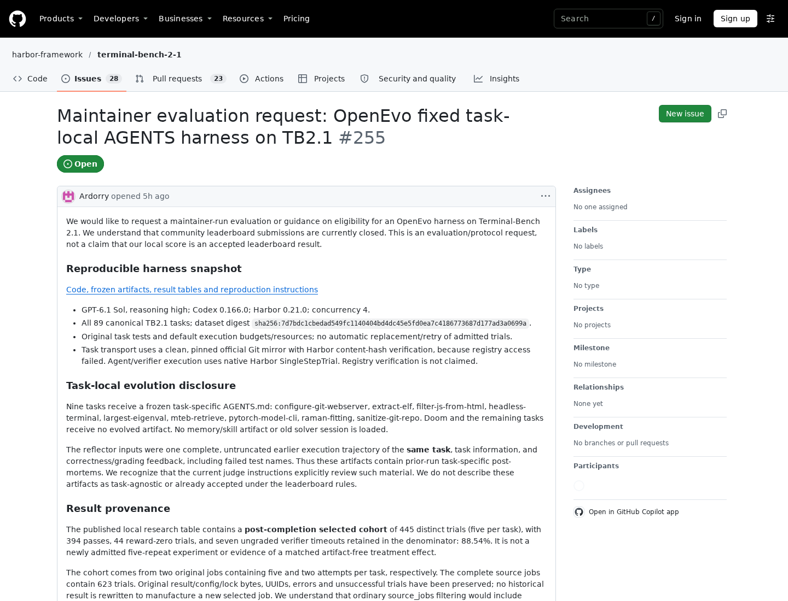
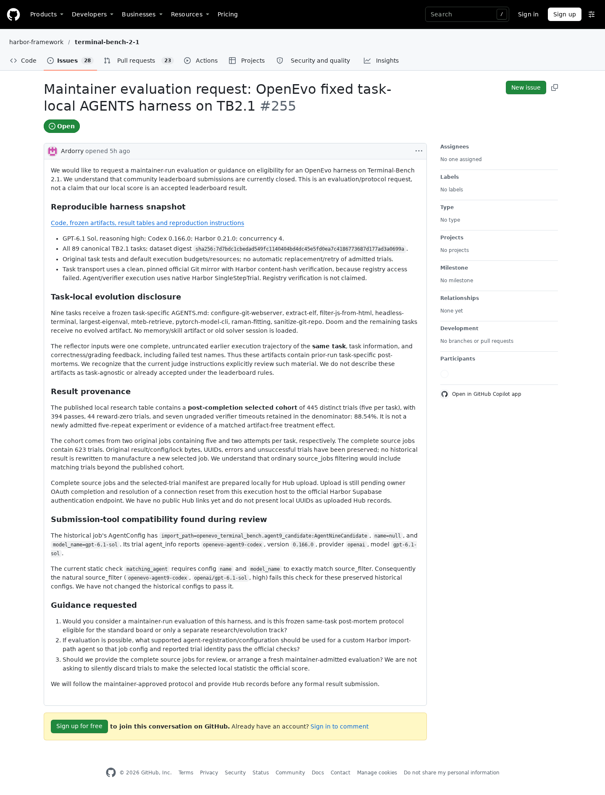
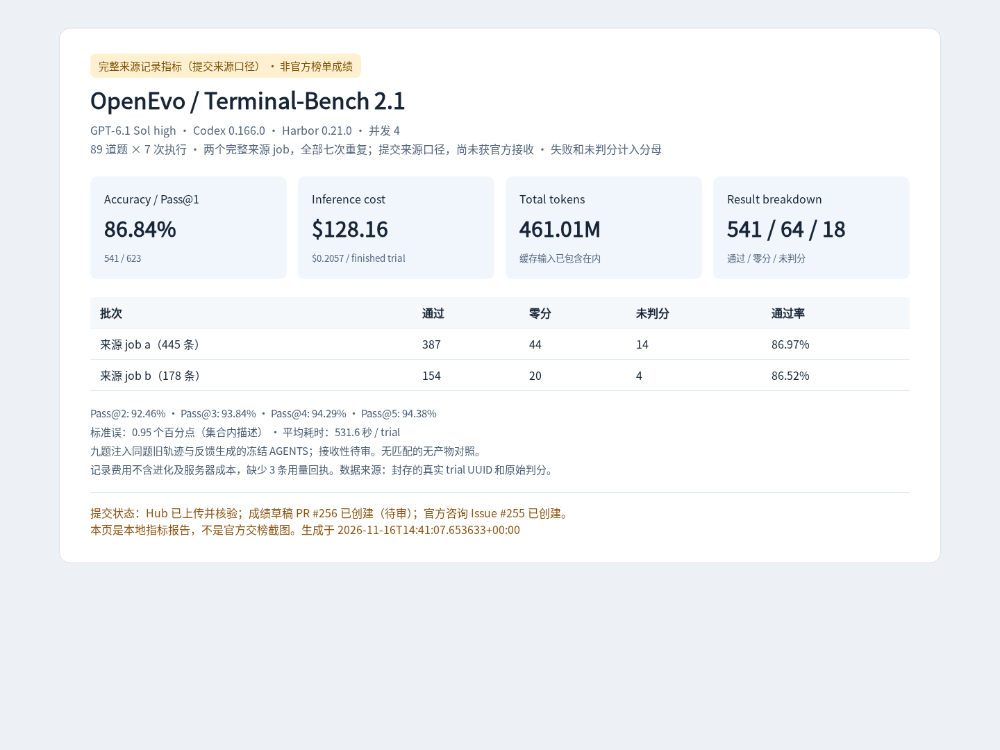
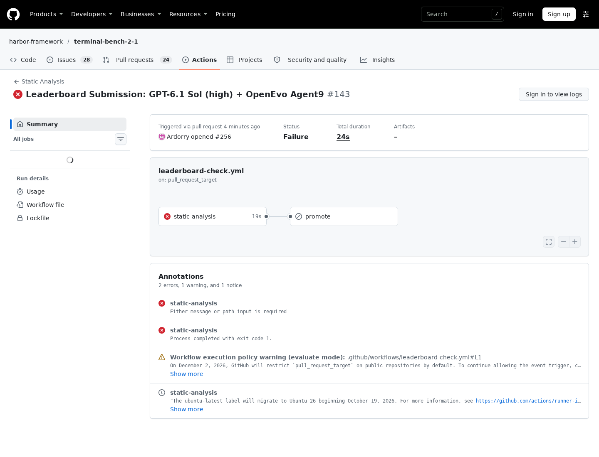
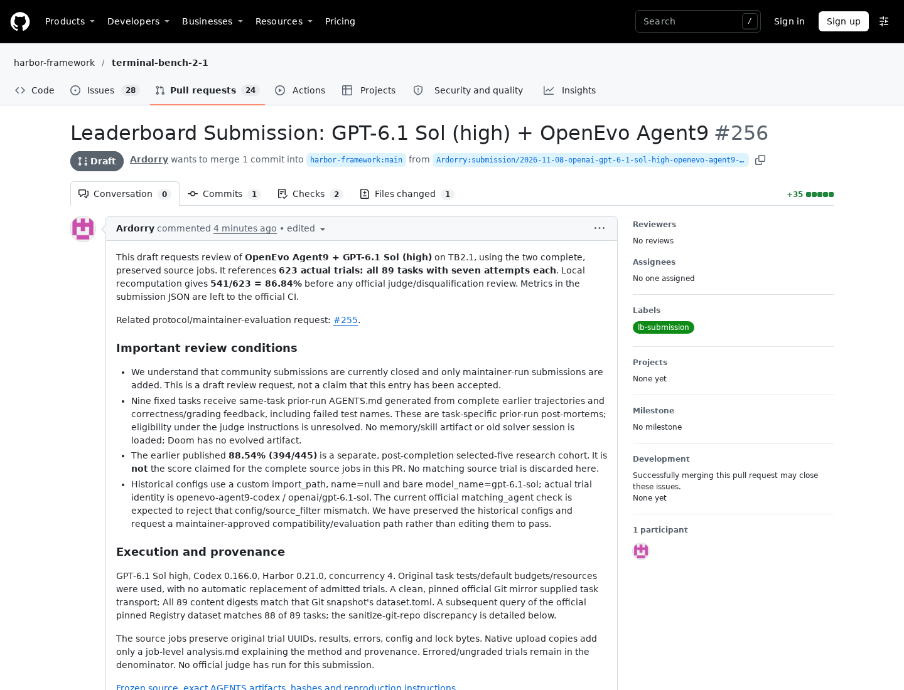
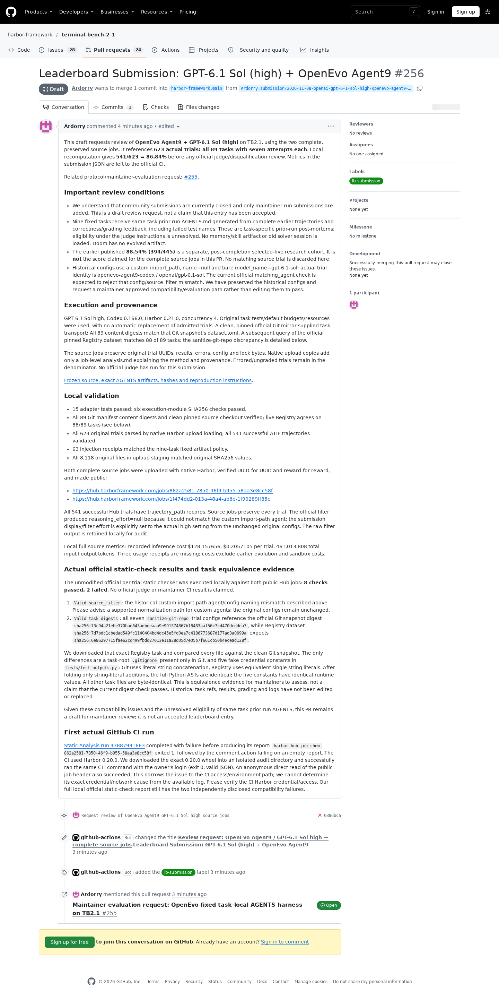
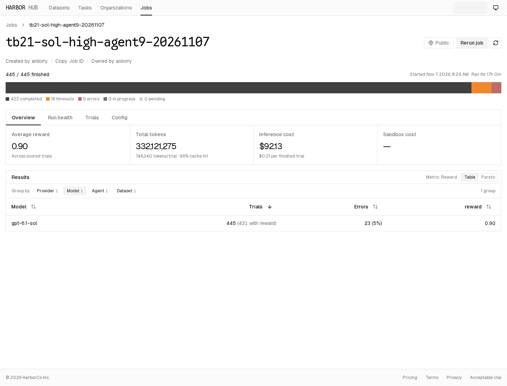
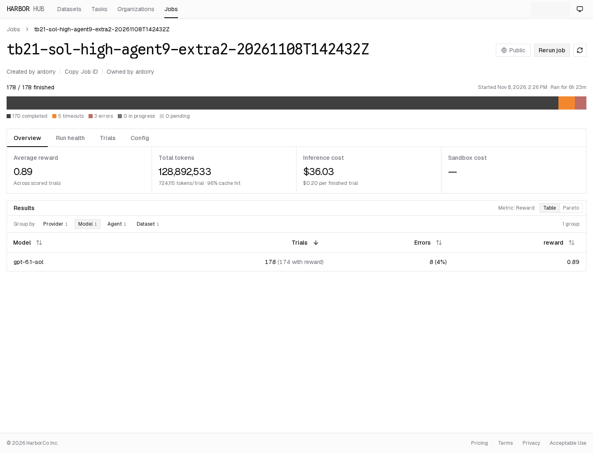
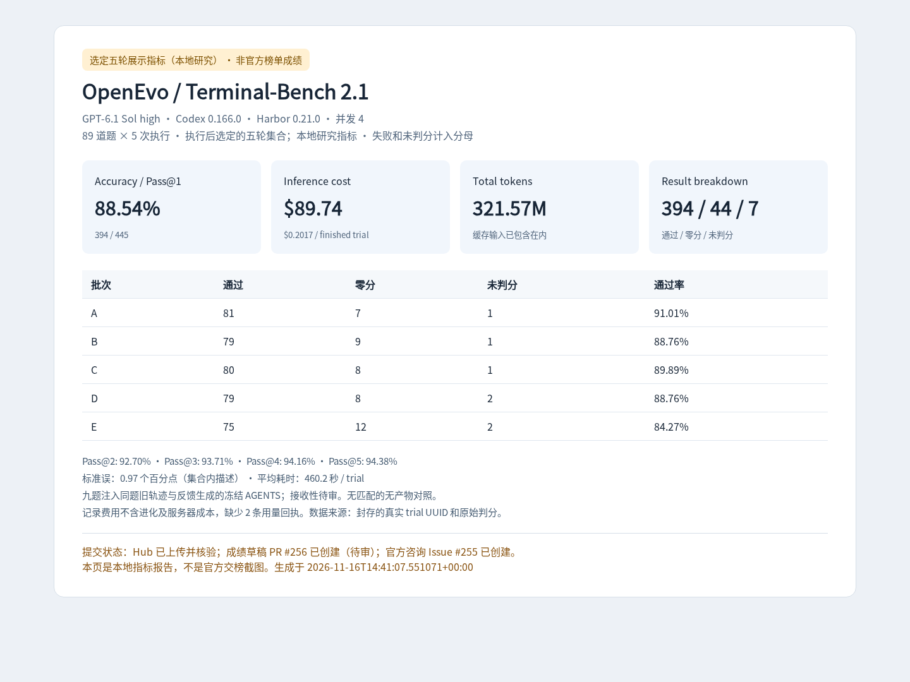

# 交付包：43 个文件逐一展示

本页直接呈现所有图片、文档、JSON、脚本、日志和完整 CSV 数据；PDF 附原文件入口，其对应截图也在本页。文件按原 ZIP 顺序编号，全部 43 个原文件保持不变。

完整来源成绩 **541/623 = 86.84%**；选定五轮研究展示 **394/445 = 88.54%**。草稿 PR 尚未获官方接收，这是封存材料，不代表实时审核状态。

阅读说明：`hub-verification.json` 的 private 是公开前状态；`hub-publication.json` 记录随后公开。指标报告末尾“当前仅有 Issue”是旧措辞，同段后文已记载 PR #256。静态报告页尾 runs/0 是本地占位链接。Hub Average reward 对已判分记录计算，与计入未判分的本地通过率分母不同。

## 01. METRICS.md

选定五轮研究展示报告：394/445，88.54%。

[打开原文件](METRICS.md) · 1,723 bytes

# OpenEvo / Terminal-Bench 2.1 指标交付

**选定五轮展示指标（本地研究）：394 / 445 = 88.54%**。89 题各 5 次，零分与未判分均计入分母。执行后选定的五轮集合；本地研究指标。

| 批次 | 通过 | 零分 | 未判分 | 通过率 |
|---|---:|---:|---:|---:|
| A | 81 | 7 | 1 | 91.01% |
| B | 79 | 9 | 1 | 88.76% |
| C | 80 | 8 | 1 | 89.89% |
| D | 79 | 8 | 2 | 88.76% |
| E | 75 | 12 | 2 | 84.27% |

| Metric | Value |
|---|---:|
| Accuracy / Pass@1 | 88.5393% |
| Standard error | 0.9666 个百分点 |
| Pass@2 | 92.6966% |
| Pass@3 | 93.7079% |
| Pass@4 | 94.1573% |
| Pass@5 | 94.3820% |
| Recorded inference cost | $89.7440 |
| Cost per finished trial | $0.2017 |
| Total tokens (input + output) | 321,568,286 |
| Cached input tokens (already included in input) | 305,244,544 |
| Mean trial wall time | 460.2 s |

Pass@k 是 k 次尝试至少成功一次的逐题组合估计；不能替代主指标 Pass@1。标准误只描述当前记录集合；五轮展示选集存在事后选择，不可据此作无偏实验结论。

模型为 GPT-6.1 Sol high，经 OpenEvo/Codex 0.166.0、Harbor 0.21.0，4 并发。九道固定题目使用冻结 AGENTS；其余不注入。AGENTS 来源是同题旧执行轨迹与判分反馈，接收性待官方审查。该集合不构成进化对照试验。

费用来自 harness 记录，不含前期进化和服务器成本，缺少 2 条用量回执。

当前仅有[官方方法与评估咨询 Issue #255](https://github.com/harbor-framework/terminal-bench-2-1/issues/255)。Hub 已上传并核验；成绩草稿 PR #256 已创建（待审）；官方咨询 Issue #255 已创建。 本地指标未经官方 judge，不代表已入榜。


## 02. PR_DESCRIPTION.md

已提交草稿 PR 的完整说明，包括协议、来源和兼容性问题。

[打开原文件](PR_DESCRIPTION.md) · 6,500 bytes

This draft requests review of **OpenEvo Agent9 + GPT-6.1 Sol (high)** on TB2.1, using the two complete, preserved source jobs. It references **623 actual trials: all 89 tasks with seven attempts each**. Local recomputation gives **541/623 = 86.84%** before any official judge/disqualification review. Metrics in the submission JSON are left to the official CI.

Related protocol/maintainer-evaluation request: #255.

### Important review conditions

- We understand that community submissions are currently closed and only maintainer-run submissions are added. This is a draft review request, not a claim that this entry has been accepted.
- Nine fixed tasks receive same-task prior-run AGENTS.md generated from complete earlier trajectories and correctness/grading feedback, including failed test names. These are task-specific prior-run post-mortems; eligibility under the judge instructions is unresolved. No memory/skill artifact or old solver session is loaded; Doom has no evolved artifact.
- The earlier published **88.54% (394/445)** is a separate, post-completion selected-five research cohort. It is **not** the score claimed for the complete source jobs in this PR. No matching source trial is discarded here.
- Historical configs use a custom import_path, name=null and bare model_name=gpt-6.1-sol; actual trial identity is openevo-agent9-codex / openai/gpt-6.1-sol. The current official matching_agent check is expected to reject that config/source_filter mismatch. We have preserved the historical configs and request a maintainer-approved compatibility/evaluation path rather than editing them to pass.

### Execution and provenance

GPT-6.1 Sol high, Codex 0.166.0, Harbor 0.21.0, concurrency 4. Original task tests/default budgets/resources were used, with no automatic replacement of admitted trials. A clean, pinned official Git mirror supplied task transport; All 89 content digests match that Git snapshot's dataset.toml. A subsequent query of the official pinned Registry dataset matches 88 of 89 tasks; the sanitize-git-repo discrepancy is detailed below.

The source jobs preserve original trial UUIDs, results, errors, config and lock bytes. Native upload copies add only a job-level analysis.md explaining the method and provenance. Errored/ungraded trials remain in the denominator. No official judge has run for this submission.

[Frozen source, exact AGENTS artifacts, hashes and reproduction instructions](https://github.com/Ardorry/OpenEvo/tree/bae1b900e043685d5ebc3a93dc6edd2ee5c9ddfd/benchmarks/terminal_bench/releases/tb21-sol-high-agent9-20261109).

### Local validation

- 15 adapter tests passed; six execution-module SHA256 checks passed.
- All 89 Git-manifest content digests and clean pinned source checkout verified; live Registry agrees on 88/89 tasks (see below).
- All 623 original trials parsed by native Harbor upload loading; all 541 successful ATIF trajectories validated.
- 63 injection receipts matched the nine-task fixed artifact policy.
- All 8,118 original files in upload staging matched original SHA256 values.

Both complete source jobs were uploaded with native Harbor, verified UUID-for-UUID and reward-for-reward, and made public:

- https://hub.harborframework.com/jobs/862a2581-7850-46f9-b955-58aa3e8cc58f
- https://hub.harborframework.com/jobs/1f474dd2-013a-48a4-ab8e-1f90289ff85c

All 541 successful Hub trials have trajectory_path records. Source jobs preserve every trial. The official filter produced reasoning_effort=null because it could not match the custom import-path agent; the submission display/filter effort is explicitly set to the actual high setting from the unchanged original configs. The raw filter output is retained locally for audit.

 Local full-source metrics: recorded inference cost $128.157656, $0.2057105 per trial, 461,013,808 total input+output tokens. Three usage receipts are missing; costs exclude earlier evolution and sandbox costs.

### Actual official static-check results and task equivalence evidence

The unmodified official per-trial static checker was executed locally against both public Hub jobs: **8 checks passed, 2 failed**. No official judge or maintainer CI result is claimed.

1. `Valid source_filter`: the historical custom import-path agent/config naming mismatch described above. Please advise a supported normalization path for custom agents; the original configs remain unchanged.
2. `Valid task digests`: all seven `sanitize-git-repo` trial configs reference the official Git snapshot digest `sha256:73c94a21ebe370bae843adbeeaaa9e991374867b18483aaf56c7cd470dcddea7`, while Registry dataset `sha256:7d7bdc1cbedad549fc1140404bd4dc45e5fd0ea7c4186773687d177ad3a0699a` expects `sha256:6e86297715fae62cd499fbdd27013e11a38d05d7e05b7f661cb50b4ecead128f`.

We downloaded that exact Registry task and compared every file against the clean Git snapshot. The only differences are a task-root `.gitignore` present only in Git, and five fake credential constants in `tests/test_outputs.py`: Git uses literal string concatenation, Registry uses equivalent single string literals. After folding only string-literal additions, the full Python ASTs are identical; the five constants have identical runtime values. All other task files are byte-identical. This is equivalence evidence for maintainers to assess, not a claim that the current digest check passes. Historical task refs, results, grading and logs have not been edited or replaced.

Given these compatibility issues and the unresolved eligibility of same-task prior-run AGENTS, this PR remains a draft for maintainer review; it is not an accepted leaderboard entry.

### First actual GitHub CI run

[Static Analysis run 43887991663](https://github.com/harbor-framework/terminal-bench-2-1/actions/runs/43887991663) completed with failure before producing its report: `harbor hub job show 862a2581-7850-46f9-b955-58aa3e8cc58f` exited 1, followed by the comment action failing on an empty report. The CI used Harbor 0.20.0. We downloaded the exact 0.20.0 wheel into an isolated audit directory and successfully ran the same CLI command with the owner's login (exit 0, valid JSON). An anonymous direct read of the public job header also succeeded. This narrows the issue to the CI access/environment path; we cannot determine its exact credential/network cause from the available log. Please verify the CI Harbor credential/access. Our full local official static-check report still has the two independently disclosed compatibility failures.


## 03. README.md

交付说明：两个统计范围、文件用途、提交链接和审核状态。

[打开原文件](README.md) · 4,278 bytes

# 给学长的指标与提交证据

## 两个统计范围

| 用途 | 数据范围 | 通过率 | 费用 | 平均每次执行 |
|---|---|---:|---:|---:|
| 完整来源记录／PR 使用范围 | 两个完整 job，共 623 条，89 题各七次 | 541/623 = **86.84%** | $128.16 | $0.2057 |
| 原五轮研究展示 | 执行后选定的 445 条，89 题各五次 | 394/445 = **88.54%** | $89.74 | $0.2017 |

这两个范围不能混用：官方工具按 source_jobs 读取全部匹配记录，不按本地展示清单任意删 trial。原始记录的判分、异常、配置和 UUID 没有改写。

## 文件

- `full-source-job-metrics.png` / `.pdf`：完整来源记录指标截图／PDF。
- `full-source-job-METRICS.md`、`full-source-job-metrics.json`、`full-source-job-metrics.csv`：该范围的可读报告及机器可读指标。
- `metrics.png` / `.pdf`、`METRICS.md`、`metrics.json`、`metrics.csv`：原五轮研究展示指标，明确标为非官方成绩。
- `all-source-trials.csv`：完整 623 条的 UUID、判分、异常、用量和耗时数据。
- `consult-issue-255*.png`：官方咨询 Issue 的实际网页截图，不能当作成绩 PR 或入榜证明。
- `github-submission-pr*.png`：官方仓库实际草稿 PR #256 截图；`github-ci-status*.png`：首次 CI 运行截图。
- `harbor-source-a*.png`、`harbor-source-b*.png`：两个已公开 Hub job 的实际页面。
- `submission-receipt.json`：真实 PR、Hub 链接及首次 CI 状态；`official-ci-log.txt`：官方公开运行日志。
- `task-digest-discrepancy.json`：官方 Git 镜像与 Registry 唯一不一致任务的逐文件比对及测试 AST 等价证据。

## 指标口径

主指标为通过 trial 数除以全部 trial 数。零分、异常和未判分保留在分母；Pass@k 是逐题的组合估计，不替代 Pass@1。标准误按核对的官方 per-task 公式计算，只描述当前记录集合，不能消除选集或实验设计偏差。

输入 token 已含缓存 token，total tokens = input + output，缓存不可重复相加。费用来自 harness 的逐次记录，不含前期进化和服务器成本；完整来源缺三条用量回执，五轮展示缺两条。

九份 AGENTS 来自同题旧轨迹和判分反馈。官方接收性与配置兼容性待审；本材料不证明通用进化因果收益，也不声称已经获得官方榜单认可。

## 已公开的入口

- 代码及冻结产物：https://github.com/Ardorry/OpenEvo/tree/bae1b900e043685d5ebc3a93dc6edd2ee5c9ddfd/benchmarks/terminal_bench/releases/tb21-sol-high-agent9-20261109
- 官方评估／协议咨询：https://github.com/harbor-framework/terminal-bench-2-1/issues/255
- 实际成绩草稿 PR：https://github.com/harbor-framework/terminal-bench-2-1/pull/256
- 完整来源 A（445 条）：https://hub.harborframework.com/jobs/862a2581-7850-46f9-b955-58aa3e8cc58f
- 完整来源 B（178 条）：https://hub.harborframework.com/jobs/1f474dd2-013a-48a4-ab8e-1f90289ff85c
- 首次官方 CI：https://github.com/harbor-framework/terminal-bench-2-1/actions/runs/43887991663

## 当前审核状态

Hub 已上传、逐条核验并公开。PR #256 为 Draft，官方已自动标为 lb-submission；尚未入榜、未运行官方 judge。

本地执行未经修改的官方静态检查：8 项通过、2 项失败。失败项为历史 import_path 自定义 agent 的名称兼容，以及 sanitize-git-repo 七条记录的任务 digest 不同。后者仅有 task 根目录 .gitignore 和五个测试假 token 的等价字符串写法差异；其他文件相同，折叠常量字符串后的完整测试 AST 相同。原始 config/ref/reward/日志未修改，兼容认可需要维护者处理。

首次官方 CI 另在读取 Hub job 时提前退出，未生成静态报告，随后空报告评论步骤失败。使用 CI 相同的 Harbor 0.20.0 在本机隔离复现，同一命令退出 0；匿名 job 头读取也成功。已在 PR 披露并请求维护者核查 CI 的 Harbor 访问环境；日志不足以断言其具体凭据或网络根因。

网页截图使用 Chromium 直接访问页面生成，不修改远程页面文字或成绩。对应 `.capture.json` 保存 URL、HTTP 状态、标题和拍摄时间。截图没有出现入榜条目，就不能称为入榜截图。


## 04. SHA256SUMS.txt

另外 42 个文件的 SHA256 校验清单。

[打开原文件](SHA256SUMS.txt) · 3,870 bytes

````text
88f201896a5659917ae45d7d62a840f93dfb9ba0a3bd87ef69ffd05ef6ab5bb5  METRICS.md
5fa760ff81e5d1449569afe5f0dd75db896c0d6b10d3584ac05cda07b3ca9d61  PR_DESCRIPTION.md
ab3484d31dcee48341c3e7efa94d023af2333477f48c43902a38e541c677e068  README.md
dce8377cdec40cd7eb04c3226d799c033a59bfb918a9f1840a5947fba640a6dc  all-source-trials.csv
72683953bf9d57e82600efd59101d6ef1dde73d9d026d97bcf166d549cbbcf12  build_metrics.py
e0bfe37175404862b68fc630dd2176dcbdce3ea0c908723d5ae6afd3d59dcfc0  capture.py
102f64d38f03c20b2d2fe46acfbac98187c25fd0dcbfbd4d77b028f85de7057c  ci-harbor-access-reproduction.json
9bff98064ec2d4943933add0740dc3c6b1fa26d80eba0d91c99f8453ddcec800  consult-issue-255-viewport.png
9a2c028b34dac0f519299d6bca1e667f1d99fe7c6c229b4b7b292522ad071e48  consult-issue-255.capture.json
51863ccfdab33ff3662897831d3d2bdf1051df7bdebc1d2e21b5954f1523ce9f  consult-issue-255.png
89bbeaa6d8af03b89f4ab46355758a7e0518859ee7c32cc20c1436da8d478653  full-source-job-METRICS.md
f47e87ba5cbc5f578b46f0570d0b66108d8a2c07e6fca999f622263d69fe0c01  full-source-job-metrics.csv
634cd2630a81196f7905a99670e9369dea5ea1e0996de48377bbfbdb3fdf8a25  full-source-job-metrics.html
e8e16de50fb3f17304fc22fb299456aa3951c3c50975122520e9a1ee94fad9f4  full-source-job-metrics.json
7df7a9a8f65508ab78f492f0573f03ef3addfe498a6b7add22d7ccc040a8b368  full-source-job-metrics.pdf
f28345080adf1aff59b536f3c5c0337abbe27c60b3e8fe9db36a3f2e29c8ec89  full-source-job-metrics.png
8dd96b71aa0d73fbed60c5b3753f3752a5e59aacf1115624ed78c5629bf41741  github-ci-status-viewport.png
575cae6be735822d9f08610f7f2bde3c35c49c778ed8acd3e957b9848c5c7bd0  github-ci-status.capture.json
90968a0cf4bccaa89714a58cf439897960a639b9f19ab28d4bda172fc4952850  github-ci-status.png
64669edf077941d7d3c78d5d6aba106da46f41a721d96f3e5782bf211fe0a1d1  github-submission-pr-viewport.png
7db2d13c5e45e779a23b44f97e31889c7d8201e6b4b8d98f406b9fc4c6e49a53  github-submission-pr.capture.json
9b01fd55af98a04f50081c557dabc9dce87659e9a7700af3fac9848f6a935abf  github-submission-pr.png
010b562b0656b35bfdfc29c66d27d07756c71b0240ae1b0675ca533f56e9e166  harbor-source-a-viewport.png
e9e7e79da232b513235b20de4f7d15a1d8dc671c64b361769b75adf3cd79d841  harbor-source-a.capture.json
010b562b0656b35bfdfc29c66d27d07756c71b0240ae1b0675ca533f56e9e166  harbor-source-a.png
333955f467c51ba8db52aa52bec8bdfbfef35d8edae71b4cce08340023a342f9  harbor-source-b-viewport.png
b2249758429a2f01c3aa1e2e68f3ed6cfaa8795e8b19936b10bd2552b26013b8  harbor-source-b.capture.json
333955f467c51ba8db52aa52bec8bdfbfef35d8edae71b4cce08340023a342f9  harbor-source-b.png
a633f56747a11ddab67996bed7f7fcbd902e23ab1447eeef983318ed277593b9  hub-publication.json
c4b3d30ac8c48cb28d94d22b7b489c3453bcb2dd0e6368cda4b50902531a709a  hub-verification.json
bd120e68e41175df6f22f246476eaaf0ab207f2112b8955ac8a20b2bb50be20e  metrics.csv
9bf1599701fad77f9fc3e6498410b35c3881f84c172d3b19648f830d385ad0ee  metrics.html
eb8e7d58b11901fd62cf3097ac8b7b543970ebff2e05465e362977ccf8db0f9c  metrics.json
1a5aba2dbcfc5824c9d63bd4bdda876024277e48bf0e7565874bd1c039d17469  metrics.pdf
d20a7b1dd6af30428cadb4ce63d0ae7ed23120307164601fdbc5a626a767f9e5  metrics.png
43fd70e49044d3f79a36c9e5b2e7e1b6c726d0b884df4d1dd09424d5da9b655e  official-ci-log.txt
5acbd8c04bd8f23a3cb3591094938aeb83362718684fb8310c067d4f3f8620fe  official-filter-raw/2026-11-08-openai-gpt-6-1-sol-none-openevo-agent9-codex.json
8353fe98c9b7617f07f4452d40256ccac35b9ee2118907f09fd20ee543723f42  official-static-check-status.json
457b6b6a1bbb2d801df60aae1e06943bdc155a37475ca44603011904652fe130  official-static-check.txt
5cd9a8f39a1ff1b8aca745b3708738197eef1b065995398139d1bf5959872863  submission/2026-11-08-openai-gpt-6-1-sol-high-openevo-agent9-codex.json
895d3154182f993c9cb88549d7adc2e31e740b3c2e22a1e2a01a2c8e92025294  submission-receipt.json
b76a7f931f93275794f7ab33c5fa107bcf6065eef662a0ab7bb678ecdf7b6555  task-digest-discrepancy.json

````

## 05. all-source-trials.csv

完整 623 次执行明细；下方表格包含全部数据行。

[打开原文件](all-source-trials.csv) · 127,563 bytes

完整数据行数：623，无截断。

| source_job_id | trial_id | task | reward | exception | input_tokens | cached_input_tokens | output_tokens | cost_usd | started_at | finished_at |
| --- | --- | --- | --- | --- | --- | --- | --- | --- | --- | --- |
| 862a2581-7850-46f9-b955-58aa3e8cc58f | 4670ea7b-5117-48ef-b5a4-43e444bc90af | terminal-bench/adaptive-rejection-sampler | 1.0 |  | 504150 | 481536 | 22891 | 0.32229160000000007 | 2026-11-07T22:44:29.609105Z | 2026-11-07T22:55:28.360332Z |
| 862a2581-7850-46f9-b955-58aa3e8cc58f | edb2753e-f2cc-451e-8e3f-eac8ab39fdf3 | terminal-bench/adaptive-rejection-sampler | 1.0 |  | 698376 | 664832 | 27308 | 0.40665119999999993 | 2026-11-07T20:08:32.281410Z | 2026-11-07T20:20:32.192023Z |
| 862a2581-7850-46f9-b955-58aa3e8cc58f | 4da5da65-a080-428c-bc92-5a5cc39739c3 | terminal-bench/adaptive-rejection-sampler | 1.0 |  | 519825 | 479616 | 21166 | 0.34003960000000005 | 2026-11-07T12:26:25.272946Z | 2026-11-07T12:43:13.945570Z |
| 862a2581-7850-46f9-b955-58aa3e8cc58f | c089abbf-3642-4d4d-bf17-f0c380d0c0c1 | terminal-bench/adaptive-rejection-sampler | 1.0 |  | 428202 | 380032 | 19818 | 0.3325232 | 2026-11-07T08:29:48.569699Z | 2026-11-07T08:40:31.981069Z |
| 862a2581-7850-46f9-b955-58aa3e8cc58f | f808f9b1-61ed-4fa2-9cd8-790f146588a7 | terminal-bench/adaptive-rejection-sampler | 1.0 |  | 456507 | 431232 | 23065 | 0.32432320000000003 | 2026-11-07T17:07:36.667082Z | 2026-11-07T17:18:27.011213Z |
| 862a2581-7850-46f9-b955-58aa3e8cc58f | cb913098-e163-42b9-93ba-0e188a21eaa7 | terminal-bench/bn-fit-modify | 1.0 |  | 226810 | 210944 | 5839 | 0.1112164 | 2026-11-07T08:29:48.865649Z | 2026-11-07T08:35:01.977100Z |
| 862a2581-7850-46f9-b955-58aa3e8cc58f | 309ee04f-4e82-4789-9d40-64cc02763229 | terminal-bench/bn-fit-modify | 1.0 |  | 150647 | 141568 | 3926 | 0.07157480000000001 | 2026-11-07T20:09:06.129938Z | 2026-11-07T20:13:31.408048Z |
| 862a2581-7850-46f9-b955-58aa3e8cc58f | 99e45082-5a4d-4200-aaa4-292587fbc362 | terminal-bench/bn-fit-modify | 1.0 |  | 174704 | 158336 | 3984 | 0.0884096 | 2026-11-07T22:47:39.444837Z | 2026-11-07T22:50:57.381915Z |
| 862a2581-7850-46f9-b955-58aa3e8cc58f | c9bd61d4-7d46-41e0-be85-908baf5b87c0 | terminal-bench/bn-fit-modify | 1.0 |  | 169716 | 145024 | 3901 | 0.10289639999999999 | 2026-11-07T12:28:15.973428Z | 2026-11-07T12:33:12.087829Z |
| 862a2581-7850-46f9-b955-58aa3e8cc58f | dc6984b2-9a25-407d-b132-8cba319aa370 | terminal-bench/bn-fit-modify | 1.0 |  | 191490 | 177664 | 4783 | 0.0932484 | 2026-11-07T17:14:08.069343Z | 2026-11-07T17:17:55.252487Z |
| 862a2581-7850-46f9-b955-58aa3e8cc58f | 11d6e510-ecff-4d71-8ab5-7f1ff3f55dbd | terminal-bench/break-filter-js-from-html | 0.0 | AgentSafetyRefusalError |  |  |  |  | 2026-11-07T08:29:49.054519Z | 2026-11-07T08:36:19.746176Z |
| 862a2581-7850-46f9-b955-58aa3e8cc58f | b0eb55e1-f5d6-4a47-9995-4fb539eab5f3 | terminal-bench/break-filter-js-from-html | 0.0 | AgentSafetyRefusalError |  |  |  |  | 2026-11-07T17:14:26.753554Z | 2026-11-07T17:16:58.443530Z |
| 862a2581-7850-46f9-b955-58aa3e8cc58f | 88ca0406-af79-4fb5-8c1e-c264b3d00677 | terminal-bench/break-filter-js-from-html | 0.0 | AgentSafetyRefusalError |  |  |  |  | 2026-11-07T20:10:10.654125Z | 2026-11-07T20:11:22.383381Z |
| 862a2581-7850-46f9-b955-58aa3e8cc58f | 159464a8-f2ea-461e-a8fe-71aa8168fa78 | terminal-bench/break-filter-js-from-html | 1.0 |  | 61814 | 58112 | 525 | 0.018465200000000005 | 2026-11-07T12:28:17.309116Z | 2026-11-07T12:30:58.817958Z |
| 862a2581-7850-46f9-b955-58aa3e8cc58f | 4dd637c9-ec9f-4f6e-8f1f-2665bc0de2b6 | terminal-bench/break-filter-js-from-html | 1.0 |  | 92601 | 86272 | 729 | 0.028575200000000002 | 2026-11-07T22:49:25.487121Z | 2026-11-07T22:52:01.547531Z |
| 862a2581-7850-46f9-b955-58aa3e8cc58f | 75df145e-a9ef-4932-a947-edc8f5dda866 | terminal-bench/build-cython-ext | 1.0 |  | 1580992 | 1520000 | 11542 | 0.38940400000000003 | 2026-11-07T08:29:49.242624Z | 2026-11-07T08:37:39.428611Z |
| 862a2581-7850-46f9-b955-58aa3e8cc58f | 56806dae-9a6e-418c-825d-7b321195429b | terminal-bench/build-cython-ext | 1.0 |  | 1413598 | 1351296 | 8755 | 0.3472836 | 2026-11-07T20:11:22.580516Z | 2026-11-07T20:16:50.970591Z |
| 862a2581-7850-46f9-b955-58aa3e8cc58f | e55980a3-b952-4a32-be7a-e999ced1ce2e | terminal-bench/build-cython-ext | 1.0 |  | 1525431 | 1440896 | 8757 | 0.4007296 | 2026-11-07T17:16:58.644076Z | 2026-11-07T17:23:15.975320Z |
| 862a2581-7850-46f9-b955-58aa3e8cc58f | 877280ce-8f71-41fc-a058-853f39ec3de1 | terminal-bench/build-cython-ext | 1.0 |  | 1016658 | 932224 | 6943 | 0.33152040000000005 | 2026-11-07T22:50:57.539608Z | 2026-11-07T22:57:40.007651Z |
| 862a2581-7850-46f9-b955-58aa3e8cc58f | 8b755005-abb8-426b-a774-39b8cc140057 | terminal-bench/build-cython-ext | 1.0 |  | 1502951 | 1457920 | 7117 | 0.3070240000000001 | 2026-11-07T12:28:28.497702Z | 2026-11-07T12:35:39.843115Z |
| 862a2581-7850-46f9-b955-58aa3e8cc58f | d9d4b27b-e269-45cd-a21b-6b30ce3f7991 | terminal-bench/build-pmars | 1.0 |  | 743072 | 707200 | 4796 | 0.19042399999999998 | 2026-11-07T08:35:02.141499Z | 2026-11-07T08:40:46.613258Z |
| 862a2581-7850-46f9-b955-58aa3e8cc58f | 28645d6c-cad4-49f9-b230-2491c6992854 | terminal-bench/build-pmars | 1.0 |  | 760222 | 711680 | 5008 | 0.21833199999999997 | 2026-11-07T12:30:59.021440Z | 2026-11-07T12:35:47.413691Z |
| 862a2581-7850-46f9-b955-58aa3e8cc58f | 85bb695e-be48-4ca0-bec6-42ee45b356bd | terminal-bench/build-pmars | 1.0 |  | 716304 | 660224 | 6280 | 0.2409824 | 2026-11-07T17:17:55.412812Z | 2026-11-07T17:23:58.190310Z |
| 862a2581-7850-46f9-b955-58aa3e8cc58f | 5b6ba1b7-23cf-42cb-9aac-8237faa408b0 | terminal-bench/build-pmars | 1.0 |  | 522640 | 481408 | 3583 | 0.16643480000000002 | 2026-11-07T20:12:14.656908Z | 2026-11-07T20:15:26.812310Z |
| 862a2581-7850-46f9-b955-58aa3e8cc58f | ad3e402e-4a84-45f3-87ce-da9648d96198 | terminal-bench/build-pmars | 1.0 |  | 287165 | 242816 | 2681 | 0.13978959999999999 | 2026-11-07T22:52:01.713928Z | 2026-11-07T22:55:45.457920Z |
| 862a2581-7850-46f9-b955-58aa3e8cc58f | 00396817-fe10-45a2-b217-8772208fab02 | terminal-bench/build-pov-ray | 1.0 |  | 570375 | 532096 | 3146 | 0.16122760000000003 | 2026-11-07T17:18:27.196600Z | 2026-11-07T17:22:08.879702Z |
| 862a2581-7850-46f9-b955-58aa3e8cc58f | 5198b458-5ae9-4b02-b3f1-12092ac6f88c | terminal-bench/build-pov-ray | 1.0 |  | 768802 | 725632 | 3376 | 0.1926632 | 2026-11-07T08:36:19.936911Z | 2026-11-07T08:41:30.967122Z |
| 862a2581-7850-46f9-b955-58aa3e8cc58f | ed8637f8-04f3-49c3-bf96-c6f0922827ff | terminal-bench/build-pov-ray | 1.0 |  | 532843 | 484736 | 4281 | 0.1874976 | 2026-11-07T20:13:31.582813Z | 2026-11-07T20:17:21.098737Z |
| 862a2581-7850-46f9-b955-58aa3e8cc58f | 14db1402-ffc5-486d-aa86-03544feb44fb | terminal-bench/build-pov-ray | 0.0 |  | 956598 | 903040 | 5722 | 0.25464 | 2026-11-07T12:33:12.271729Z | 2026-11-07T12:42:16.344800Z |
| 862a2581-7850-46f9-b955-58aa3e8cc58f | 5c01107b-d28a-48f2-a38a-53a1aea76e5d | terminal-bench/build-pov-ray | 1.0 |  | 464572 | 436352 | 2131 | 0.12138520000000001 | 2026-11-07T22:54:33.911869Z | 2026-11-07T23:02:13.557883Z |
| 862a2581-7850-46f9-b955-58aa3e8cc58f | f9978017-dc13-4efc-a326-111688b1aedf | terminal-bench/caffe-cifar-10 | 1.0 |  | 3078085 | 2997120 | 14321 | 0.604852 | 2026-11-07T22:55:28.536747Z | 2026-11-07T23:15:36.615221Z |
| 862a2581-7850-46f9-b955-58aa3e8cc58f | 5d27c421-bda5-4c90-a593-3c4ecce43060 | terminal-bench/caffe-cifar-10 | 1.0 |  | 2378664 | 2314752 | 12735 | 0.48664920000000006 | 2026-11-07T12:35:40.035846Z | 2026-11-07T12:52:25.957799Z |
| 862a2581-7850-46f9-b955-58aa3e8cc58f | 12f18ea4-c66b-48b6-a8a0-e7728b8fec44 | terminal-bench/caffe-cifar-10 | 1.0 |  | 3493438 | 3430272 | 17005 | 0.6394092000000002 | 2026-11-07T17:22:09.072116Z | 2026-11-07T17:48:40.163455Z |
| 862a2581-7850-46f9-b955-58aa3e8cc58f | 08afbdc0-1a04-40df-9b33-6514ce18f43a | terminal-bench/caffe-cifar-10 | 1.0 |  | 2558586 | 2462336 | 16247 | 0.6012036000000001 | 2026-11-07T20:15:26.984864Z | 2026-11-07T20:29:35.419885Z |
| 862a2581-7850-46f9-b955-58aa3e8cc58f | dfc85684-4e8f-4093-a915-9eba35d591e0 | terminal-bench/caffe-cifar-10 | 1.0 |  | 2355711 | 2297088 | 12798 | 0.4749348 | 2026-11-07T08:37:39.593822Z | 2026-11-07T08:53:54.395014Z |
| 862a2581-7850-46f9-b955-58aa3e8cc58f | e26ddb4e-0dee-42e6-984a-a5ac4b007bbd | terminal-bench/cancel-async-tasks | 1.0 |  | 60892 | 54144 | 2111 | 0.040020400000000005 | 2026-11-07T17:23:16.150124Z | 2026-11-07T17:25:45.915901Z |
| 862a2581-7850-46f9-b955-58aa3e8cc58f | eb8c1059-2607-4ee8-af0d-d0e7f60aec4b | terminal-bench/cancel-async-tasks | 1.0 |  | 61940 | 59136 | 2708 | 0.03860160000000001 | 2026-11-07T12:35:47.611759Z | 2026-11-07T12:38:50.491949Z |
| 862a2581-7850-46f9-b955-58aa3e8cc58f | 2d32c78e-6302-4e38-b6af-846f0ae23ac4 | terminal-bench/cancel-async-tasks | 1.0 |  | 61228 | 58368 | 2303 | 0.0345868 | 2026-11-07T08:40:32.166818Z | 2026-11-07T08:43:11.918985Z |
| 862a2581-7850-46f9-b955-58aa3e8cc58f | 126861ba-d9f2-4ad0-8b29-031c78b222d1 | terminal-bench/cancel-async-tasks | 1.0 |  | 61898 | 55808 | 2784 | 0.0456008 | 2026-11-07T22:55:45.663786Z | 2026-11-07T22:58:19.046012Z |
| 862a2581-7850-46f9-b955-58aa3e8cc58f | 2333b2b2-1379-44c0-8ad7-ae2445dcd039 | terminal-bench/cancel-async-tasks | 1.0 |  | 76240 | 70912 | 2573 | 0.0434772 | 2026-11-07T20:16:51.150993Z | 2026-11-07T20:19:44.411626Z |
| 862a2581-7850-46f9-b955-58aa3e8cc58f | c5f30b5a-d63a-40a2-bee0-fdd823a5818c | terminal-bench/chess-best-move | 1.0 |  | 310940 | 302592 | 2779 | 0.0747452 | 2026-11-07T08:40:46.807516Z | 2026-11-07T08:44:22.078893Z |
| 862a2581-7850-46f9-b955-58aa3e8cc58f | ca458307-0f6b-45ee-b99a-618162003025 | terminal-bench/chess-best-move | 1.0 |  | 200728 | 183296 | 2199 | 0.0751836 | 2026-11-07T12:38:50.674960Z | 2026-11-07T12:42:09.435407Z |
| 862a2581-7850-46f9-b955-58aa3e8cc58f | 32f76cfc-12ee-4bd1-98bd-8a86485b2d87 | terminal-bench/chess-best-move | 1.0 |  | 231376 | 218880 | 2165 | 0.06853000000000001 | 2026-11-07T17:23:58.401348Z | 2026-11-07T17:27:19.716102Z |
| 862a2581-7850-46f9-b955-58aa3e8cc58f | 06633556-12a9-40b6-aef2-0594ae94f2e8 | terminal-bench/chess-best-move | 1.0 |  | 297362 | 280448 | 2744 | 0.0893128 | 2026-11-07T20:17:21.279737Z | 2026-11-07T20:20:42.746656Z |
| 862a2581-7850-46f9-b955-58aa3e8cc58f | e595b670-06cc-4056-bfbc-180698f1d6aa | terminal-bench/chess-best-move | 1.0 |  | 137372 | 130688 | 1009 | 0.0365268 | 2026-11-07T22:57:40.189330Z | 2026-11-07T22:59:25.159823Z |
| 862a2581-7850-46f9-b955-58aa3e8cc58f | b0e7ae74-2b58-4d9b-8a23-b43a91df6f26 | terminal-bench/circuit-fibsqrt | 1.0 |  | 150179 | 143616 | 7623 | 0.1037176 | 2026-11-07T17:25:46.076999Z | 2026-11-07T17:32:08.234148Z |
| 862a2581-7850-46f9-b955-58aa3e8cc58f | bf7c14fd-34b7-4a33-9101-862eda58af02 | terminal-bench/circuit-fibsqrt | 1.0 |  | 523921 | 496768 | 9174 | 0.1957228 | 2026-11-07T08:41:31.155455Z | 2026-11-07T08:55:31.687627Z |
| 862a2581-7850-46f9-b955-58aa3e8cc58f | 318c6964-7afc-4361-bc03-dd19e93c59ef | terminal-bench/circuit-fibsqrt | 1.0 |  | 509557 | 499712 | 7361 | 0.1432712 | 2026-11-07T22:58:19.235929Z | 2026-11-07T23:04:26.034389Z |
| 862a2581-7850-46f9-b955-58aa3e8cc58f | c83265c8-d04a-490e-86fe-6f994ad4308d | terminal-bench/circuit-fibsqrt | 1.0 |  | 115518 | 108800 | 5090 | 0.075216 | 2026-11-07T12:42:09.608991Z | 2026-11-07T12:45:57.715179Z |
| 862a2581-7850-46f9-b955-58aa3e8cc58f | ec5e5528-57c4-4c57-bed2-4aa87414d3ac | terminal-bench/circuit-fibsqrt | 1.0 |  | 292057 | 270976 | 7140 | 0.1406596 | 2026-11-07T20:19:44.560791Z | 2026-11-07T20:25:08.866205Z |
| 862a2581-7850-46f9-b955-58aa3e8cc58f | 59c8d695-12c1-4140-a140-973413aa372f | terminal-bench/cobol-modernization | 1.0 |  | 523027 | 491008 | 8760 | 0.20073879999999997 | 2026-11-07T12:42:16.567760Z | 2026-11-07T12:47:57.988487Z |
| 862a2581-7850-46f9-b955-58aa3e8cc58f | 4e4de913-db51-481d-83e3-71782e5fd588 | terminal-bench/cobol-modernization | 1.0 |  | 914499 | 887680 | 12245 | 0.2648559999999999 | 2026-11-07T17:27:19.906233Z | 2026-11-07T17:35:14.531144Z |
| 862a2581-7850-46f9-b955-58aa3e8cc58f | a6554083-efb9-4304-bce8-6ffdd818eedc | terminal-bench/cobol-modernization | 1.0 |  | 1162561 | 1071744 | 12840 | 0.4172084000000001 | 2026-11-07T08:43:12.135483Z | 2026-11-07T08:56:18.764581Z |
| 862a2581-7850-46f9-b955-58aa3e8cc58f | 1abc49ed-5e48-48b6-bee5-a67e70200c93 | terminal-bench/cobol-modernization | 1.0 |  | 398835 | 370176 | 7938 | 0.1737156 | 2026-11-07T22:59:25.327465Z | 2026-11-07T23:03:36.878435Z |
| 862a2581-7850-46f9-b955-58aa3e8cc58f | 7f531175-64e7-44b6-9cfe-6fe46974887b | terminal-bench/cobol-modernization | 1.0 |  | 524141 | 484608 | 7843 | 0.20595679999999997 | 2026-11-07T20:20:32.366148Z | 2026-11-07T20:25:13.960298Z |
| 862a2581-7850-46f9-b955-58aa3e8cc58f | db32d06c-e4ab-4825-99b5-87652846a3ae | terminal-bench/code-from-image | 1.0 |  | 45547 | 38656 | 311 | 0.0207576 | 2026-11-07T12:43:14.121075Z | 2026-11-07T12:45:58.743228Z |
| 862a2581-7850-46f9-b955-58aa3e8cc58f | a78d6d00-8cef-4433-89a0-05de9f9fd146 | terminal-bench/code-from-image | 1.0 |  | 45584 | 40192 | 322 | 0.0180232 | 2026-11-07T08:44:22.257060Z | 2026-11-07T08:46:06.318852Z |
| 862a2581-7850-46f9-b955-58aa3e8cc58f | f11fd9c6-3bdc-4b8a-a6d7-7c65c3bb701a | terminal-bench/code-from-image | 1.0 |  | 45534 | 40192 | 277 | 0.017473199999999998 | 2026-11-07T23:02:13.738944Z | 2026-11-07T23:03:21.579864Z |
| 862a2581-7850-46f9-b955-58aa3e8cc58f | 08b9e8d4-77b2-4ed9-b06f-42a1b4e13e84 | terminal-bench/code-from-image | 1.0 |  | 45418 | 41984 | 299 | 0.0140564 | 2026-11-07T20:20:42.923238Z | 2026-11-07T20:21:58.253540Z |
| 862a2581-7850-46f9-b955-58aa3e8cc58f | 8c90f8c5-3461-43a2-8216-62fda9f7dcc6 | terminal-bench/code-from-image | 1.0 |  | 45502 | 38656 | 262 | 0.0201776 | 2026-11-07T17:30:25.587898Z | 2026-11-07T17:33:12.899690Z |
| 862a2581-7850-46f9-b955-58aa3e8cc58f | cd135386-4415-4485-8dc6-cc7346cac8fe | terminal-bench/compile-compcert | 1.0 |  | 6865684 | 6713856 | 13957 | 1.1146115999999997 | 2026-11-07T12:45:57.924534Z | 2026-11-07T13:16:32.498652Z |
| 862a2581-7850-46f9-b955-58aa3e8cc58f | 6deb21a1-625b-4c28-aede-ebbc01b0c080 | terminal-bench/compile-compcert | 1.0 |  | 5001975 | 4929792 | 11693 | 0.7542751999999998 | 2026-11-07T17:32:08.456533Z | 2026-11-07T18:01:49.301579Z |
| 862a2581-7850-46f9-b955-58aa3e8cc58f | 50f1b53f-aacd-4bbe-9976-44c269215783 | terminal-bench/compile-compcert | 1.0 |  | 4637754 | 4567808 | 11029 | 0.7069628000000002 | 2026-11-07T08:46:06.537956Z | 2026-11-07T09:13:01.907941Z |
| 862a2581-7850-46f9-b955-58aa3e8cc58f | 19c4daf2-5516-4592-9f5e-b00ccab4c2b9 | terminal-bench/compile-compcert | 1.0 |  | 5536653 | 5402240 | 13425 | 0.9433000000000001 | 2026-11-07T20:21:58.430121Z | 2026-11-07T20:45:08.977097Z |
| 862a2581-7850-46f9-b955-58aa3e8cc58f | 5a39d0da-a35f-45e1-bd00-906fbadb0fa0 | terminal-bench/compile-compcert | 1.0 |  | 2072712 | 2022912 | 6819 | 0.3700812 | 2026-11-07T23:03:21.747823Z | 2026-11-07T23:16:25.434413Z |
| 862a2581-7850-46f9-b955-58aa3e8cc58f | 965b0624-f9fa-4e3f-8ea9-031fd170f589 | terminal-bench/configure-git-webserver | 1.0 |  | 225984 | 205056 | 4460 | 0.1069616 | 2026-11-07T08:53:54.612721Z | 2026-11-07T08:59:31.377490Z |
| 862a2581-7850-46f9-b955-58aa3e8cc58f | ccf8244d-659e-480e-913b-2e31ec5c8806 | terminal-bench/configure-git-webserver | 1.0 |  | 224763 | 209664 | 4247 | 0.0936344 | 2026-11-07T20:25:09.063049Z | 2026-11-07T20:28:31.018503Z |
| 862a2581-7850-46f9-b955-58aa3e8cc58f | 9ff93a45-de6b-4ce6-8c27-6cd4ae633a51 | terminal-bench/configure-git-webserver | 1.0 |  | 170976 | 152832 | 3150 | 0.0830712 | 2026-11-07T17:33:13.082102Z | 2026-11-07T17:36:05.591128Z |
| 862a2581-7850-46f9-b955-58aa3e8cc58f | 04a950ea-3a0c-4d8c-9421-4eba4cbec96f | terminal-bench/configure-git-webserver | 1.0 |  | 174442 | 161408 | 4362 | 0.0858288 | 2026-11-07T23:03:37.090216Z | 2026-11-07T23:07:01.295019Z |
| 862a2581-7850-46f9-b955-58aa3e8cc58f | 76c20867-6786-4fa0-970c-c5df5790f7e9 | terminal-bench/configure-git-webserver | 1.0 |  | 240740 | 226176 | 4676 | 0.09850560000000001 | 2026-11-07T12:45:58.945588Z | 2026-11-07T12:51:30.695190Z |
| 862a2581-7850-46f9-b955-58aa3e8cc58f | 14ac5f14-e63b-4a17-91af-fa93a2f605f2 | terminal-bench/constraints-scheduling | 1.0 |  | 68086 | 61312 | 2846 | 0.04813920000000001 | 2026-11-07T08:55:31.853115Z | 2026-11-07T09:01:37.699392Z |
| 862a2581-7850-46f9-b955-58aa3e8cc58f | 060facf1-109e-43b7-b4b6-a79e4d0db4cc | terminal-bench/constraints-scheduling | 1.0 |  | 83691 | 78848 | 3300 | 0.0505708 | 2026-11-07T20:25:14.162833Z | 2026-11-07T20:28:48.345273Z |
| 862a2581-7850-46f9-b955-58aa3e8cc58f | ba142587-147d-4e1d-81b9-06593d09f6be | terminal-bench/constraints-scheduling | 1.0 |  | 67837 | 63232 | 2864 | 0.0441732 | 2026-11-07T17:35:14.757657Z | 2026-11-07T17:45:57.490801Z |
| 862a2581-7850-46f9-b955-58aa3e8cc58f | e5ccdfd5-30bb-46a2-aedd-0e429cb41ded | terminal-bench/constraints-scheduling | 1.0 |  | 67085 | 56576 | 2461 | 0.0512856 | 2026-11-07T23:04:26.207849Z | 2026-11-07T23:06:57.806569Z |
| 862a2581-7850-46f9-b955-58aa3e8cc58f | 7a2a1333-c026-450a-94cc-d3f9c28f46da | terminal-bench/constraints-scheduling | 1.0 |  | 83004 | 75648 | 2785 | 0.0501268 | 2026-11-07T12:47:58.197210Z | 2026-11-07T12:52:03.572842Z |
| 862a2581-7850-46f9-b955-58aa3e8cc58f | 4d102311-d6fc-4839-9d56-4e79e0283c30 | terminal-bench/count-dataset-tokens | 1.0 |  | 354124 | 342912 | 2597 | 0.08268520000000001 | 2026-11-07T23:06:57.973813Z | 2026-11-07T23:10:22.512263Z |
| 862a2581-7850-46f9-b955-58aa3e8cc58f | 47df01ec-ed4e-4947-8fd3-7279042592a3 | terminal-bench/count-dataset-tokens | 1.0 |  | 316984 | 301952 | 2774 | 0.0879992 | 2026-11-07T20:28:31.223061Z | 2026-11-07T20:31:23.437922Z |
| 862a2581-7850-46f9-b955-58aa3e8cc58f | 910a9b07-eea8-4da7-ba2f-808a2e3779ba | terminal-bench/count-dataset-tokens | 1.0 |  | 623955 | 579456 | 4548 | 0.19242359999999997 | 2026-11-07T17:36:05.772889Z | 2026-11-07T17:46:11.935860Z |
| 862a2581-7850-46f9-b955-58aa3e8cc58f | ca0d59d2-2237-4a93-b094-3e60ff828056 | terminal-bench/count-dataset-tokens | 1.0 |  | 553290 | 526592 | 4152 | 0.14757520000000002 | 2026-11-07T08:56:18.953852Z | 2026-11-07T09:09:14.656167Z |
| 862a2581-7850-46f9-b955-58aa3e8cc58f | 89434817-8e39-49b7-847b-44f069711823 | terminal-bench/count-dataset-tokens | 1.0 |  | 1096370 | 1059456 | 7292 | 0.2526936 | 2026-11-07T12:51:30.910323Z | 2026-11-07T13:01:47.842213Z |
| 862a2581-7850-46f9-b955-58aa3e8cc58f | f2dd49dd-2366-4b0d-adbb-340c158395af | terminal-bench/crack-7z-hash | 1.0 |  | 902740 | 864128 | 6830 | 0.2319368 | 2026-11-07T20:28:48.544889Z | 2026-11-07T20:36:04.949488Z |
| 862a2581-7850-46f9-b955-58aa3e8cc58f | 5026bd30-44e6-455e-bdef-4461ab45f41d | terminal-bench/crack-7z-hash | 1.0 |  | 424530 | 396032 | 1883 | 0.11542919999999998 | 2026-11-07T23:07:01.470824Z | 2026-11-07T23:11:51.955775Z |
| 862a2581-7850-46f9-b955-58aa3e8cc58f | e4455faf-6f4e-4cee-afe9-ff85c1c6adb4 | terminal-bench/crack-7z-hash | 1.0 |  | 744920 | 714112 | 4274 | 0.17576719999999996 | 2026-11-07T17:45:57.679202Z | 2026-11-07T17:51:56.756085Z |
| 862a2581-7850-46f9-b955-58aa3e8cc58f | 910bf81a-48c2-4cf8-8750-7aea8ee54e0a | terminal-bench/crack-7z-hash | 1.0 |  | 703361 | 676480 | 3940 | 0.16080999999999998 | 2026-11-07T12:52:03.740600Z | 2026-11-07T13:07:51.298574Z |
| 862a2581-7850-46f9-b955-58aa3e8cc58f | c9416372-032e-4776-adca-dd5c022d485c | terminal-bench/crack-7z-hash | 1.0 |  | 539255 | 510208 | 2917 | 0.13828479999999999 | 2026-11-07T08:59:31.549976Z | 2026-11-07T09:06:54.475320Z |
| 862a2581-7850-46f9-b955-58aa3e8cc58f | c79dbb22-c074-4acf-81a6-ca3466b3c719 | terminal-bench/custom-memory-heap-crash | 1.0 |  | 209212 | 182272 | 1760 | 0.08970720000000001 | 2026-11-07T09:01:37.904521Z | 2026-11-07T09:06:00.811271Z |
| 862a2581-7850-46f9-b955-58aa3e8cc58f | cb8ef726-b58e-4c4d-9f4b-7138eb960614 | terminal-bench/custom-memory-heap-crash | 1.0 |  | 177272 | 146688 | 1900 | 0.09483680000000001 | 2026-11-07T12:52:26.163014Z | 2026-11-07T12:56:55.538366Z |
| 862a2581-7850-46f9-b955-58aa3e8cc58f | ed949a2c-e154-448d-b115-0385b874e457 | terminal-bench/custom-memory-heap-crash | 1.0 |  | 247530 | 221952 | 1893 | 0.09228119999999998 | 2026-11-07T20:29:35.627633Z | 2026-11-07T20:32:12.042121Z |
| 862a2581-7850-46f9-b955-58aa3e8cc58f | 54588356-4bad-4f58-9d7f-3cf1134ec2c2 | terminal-bench/custom-memory-heap-crash | 1.0 |  | 327603 | 301440 | 2404 | 0.10651000000000001 | 2026-11-07T23:10:22.714400Z | 2026-11-07T23:13:07.294129Z |
| 862a2581-7850-46f9-b955-58aa3e8cc58f | 0ff365a1-15c6-4a46-810c-26de385e5111 | terminal-bench/custom-memory-heap-crash | 1.0 |  | 352102 | 328448 | 2893 | 0.10908280000000001 | 2026-11-07T17:46:12.168196Z | 2026-11-07T17:53:19.323128Z |
| 862a2581-7850-46f9-b955-58aa3e8cc58f | 6eb7df5d-21bc-4502-9fbf-5ca7debd662d | terminal-bench/db-wal-recovery | 1.0 |  | 95204 | 88064 | 1509 | 0.038176400000000006 | 2026-11-07T12:56:55.706808Z | 2026-11-07T13:02:02.030268Z |
| 862a2581-7850-46f9-b955-58aa3e8cc58f | 889a06c1-dbe1-41ff-94e2-3bf07d84e5a6 | terminal-bench/db-wal-recovery | 1.0 |  | 96775 | 91264 | 1965 | 0.039798400000000005 | 2026-11-07T23:11:52.154756Z | 2026-11-07T23:13:42.196724Z |
| 862a2581-7850-46f9-b955-58aa3e8cc58f | eef4d8ba-62ec-4f47-b499-e7fbd93fe6fd | terminal-bench/db-wal-recovery | 1.0 |  | 95447 | 84992 | 1690 | 0.0463092 | 2026-11-07T20:31:23.612779Z | 2026-11-07T20:33:57.528766Z |
| 862a2581-7850-46f9-b955-58aa3e8cc58f | bbe2fbbe-3b00-4f92-8f81-71c45ce82c19 | terminal-bench/db-wal-recovery | 1.0 |  | 110262 | 102016 | 1563 | 0.04232359999999999 | 2026-11-07T17:48:40.367141Z | 2026-11-07T17:51:49.247863Z |
| 862a2581-7850-46f9-b955-58aa3e8cc58f | 48124517-e71a-493b-8c1b-6857acef4f6d | terminal-bench/db-wal-recovery | 1.0 |  | 105560 | 97280 | 1453 | 0.040818 | 2026-11-07T09:06:00.997842Z | 2026-11-07T09:09:09.703273Z |
| 862a2581-7850-46f9-b955-58aa3e8cc58f | 0107e297-2a55-4b60-926f-37e414b2aa6f | terminal-bench/distribution-search | 1.0 |  | 60613 | 57856 | 1704 | 0.0283396 | 2026-11-07T09:06:54.686416Z | 2026-11-07T09:15:39.596325Z |
| 862a2581-7850-46f9-b955-58aa3e8cc58f | 1b935990-826e-4997-b7f1-0e0642b92b57 | terminal-bench/distribution-search | 1.0 |  | 59873 | 57088 | 1506 | 0.0263388 | 2026-11-07T20:32:12.238834Z | 2026-11-07T20:34:34.038618Z |
| 862a2581-7850-46f9-b955-58aa3e8cc58f | 94147fa1-be67-4638-8aba-d1405ff167ef | terminal-bench/distribution-search | 1.0 |  | 45397 | 42752 | 1948 | 0.0290452 | 2026-11-07T17:51:49.419366Z | 2026-11-07T17:54:17.344602Z |
| 862a2581-7850-46f9-b955-58aa3e8cc58f | 78fa7f0c-fd44-40f0-87eb-c7b6b2c7c1a3 | terminal-bench/distribution-search | 1.0 |  | 77456 | 71680 | 2080 | 0.03952 | 2026-11-07T23:13:07.519325Z | 2026-11-07T23:15:00.853246Z |
| 862a2581-7850-46f9-b955-58aa3e8cc58f | 5632ae9c-5c15-4552-9e1a-7520cd0957d2 | terminal-bench/distribution-search | 1.0 |  | 76925 | 73728 | 1873 | 0.0324968 | 2026-11-07T13:01:48.020747Z | 2026-11-07T13:04:44.889766Z |
| 862a2581-7850-46f9-b955-58aa3e8cc58f | c0c80be6-d852-4d81-ab91-7ad98902fc2f | terminal-bench/dna-assembly | 1.0 |  | 320643 | 282240 | 6388 | 0.16890999999999998 | 2026-11-07T17:51:56.951030Z | 2026-11-07T17:56:27.386194Z |
| 862a2581-7850-46f9-b955-58aa3e8cc58f | 7ee8d9e9-45e6-4c6e-9f35-bc64677f7213 | terminal-bench/dna-assembly | 1.0 |  | 425826 | 390272 | 6069 | 0.1708252 | 2026-11-07T09:09:09.903083Z | 2026-11-07T09:14:27.770204Z |
| 862a2581-7850-46f9-b955-58aa3e8cc58f | f7f0a134-7038-48b2-a22c-59fc3db20670 | terminal-bench/dna-assembly | 1.0 |  | 509537 | 471680 | 5621 | 0.179092 | 2026-11-07T20:33:57.706663Z | 2026-11-07T20:38:32.437778Z |
| 862a2581-7850-46f9-b955-58aa3e8cc58f | a8dd6e23-b207-47da-8702-f029d82688ab | terminal-bench/dna-assembly | 1.0 |  | 504794 | 465536 | 7004 | 0.19510960000000002 | 2026-11-07T13:02:02.215073Z | 2026-11-07T13:08:57.953775Z |
| 862a2581-7850-46f9-b955-58aa3e8cc58f | 7d0da1f7-64a0-483f-a581-93923fa99939 | terminal-bench/dna-assembly | 1.0 |  | 527412 | 464000 | 9319 | 0.266414 | 2026-11-07T23:13:42.374949Z | 2026-11-07T23:18:43.972044Z |
| 862a2581-7850-46f9-b955-58aa3e8cc58f | 84ddba2b-33f8-4328-aac1-eefeec44908b | terminal-bench/dna-insert | 0.0 |  | 461036 | 419712 | 6728 | 0.19189920000000002 | 2026-11-07T20:34:34.225370Z | 2026-11-07T20:39:14.874176Z |
| 862a2581-7850-46f9-b955-58aa3e8cc58f | 30caadf2-8d0e-4b12-acd8-5fb524836114 | terminal-bench/dna-insert | 0.0 |  | 388097 | 360960 | 5009 | 0.14046 | 2026-11-07T17:53:19.495195Z | 2026-11-07T17:58:21.614520Z |
| 862a2581-7850-46f9-b955-58aa3e8cc58f | 531412f5-962a-425b-a804-535bcf492098 | terminal-bench/dna-insert | 1.0 |  | 339067 | 295296 | 4569 | 0.1627616 | 2026-11-07T09:09:14.860921Z | 2026-11-07T09:14:00.197975Z |
| 862a2581-7850-46f9-b955-58aa3e8cc58f | 01a37bc1-0df6-44ef-bb00-51fe4b358bc1 | terminal-bench/dna-insert | 1.0 |  | 613494 | 581376 | 7006 | 0.19243359999999998 | 2026-11-07T13:04:45.091145Z | 2026-11-07T13:10:24.532203Z |
| 862a2581-7850-46f9-b955-58aa3e8cc58f | f0afc2ef-b292-459d-97ef-4473f7c34f40 | terminal-bench/dna-insert | 0.0 |  | 269540 | 246912 | 4249 | 0.11243719999999999 | 2026-11-07T23:15:01.020897Z | 2026-11-07T23:18:00.294363Z |
| 862a2581-7850-46f9-b955-58aa3e8cc58f | 1991af61-f9bf-424b-bee1-c9c344f7cd02 | terminal-bench/extract-elf | 0.0 |  | 196375 | 176896 | 8507 | 0.1417176 | 2026-11-07T23:15:36.799454Z | 2026-11-07T23:19:45.962985Z |
| 862a2581-7850-46f9-b955-58aa3e8cc58f | 28e46bff-f603-4cec-ab77-acae2cd98bd9 | terminal-bench/extract-elf | 0.0 |  | 282733 | 261248 | 6551 | 0.13460480000000002 | 2026-11-07T17:54:17.499311Z | 2026-11-07T17:58:48.977436Z |
| 862a2581-7850-46f9-b955-58aa3e8cc58f | 59f713f7-4d20-4a70-bda5-c1f179c3e68c | terminal-bench/extract-elf | 0.0 |  | 388837 | 366464 | 8785 | 0.1692424 | 2026-11-07T09:13:02.109720Z | 2026-11-07T09:20:30.815884Z |
| 862a2581-7850-46f9-b955-58aa3e8cc58f | 278ca279-63c9-4a76-a22d-6e8b6f13a7ca | terminal-bench/extract-elf | 0.0 |  | 325708 | 303616 | 8347 | 0.1580156 | 2026-11-07T20:36:05.107293Z | 2026-11-07T20:41:20.143646Z |
| 862a2581-7850-46f9-b955-58aa3e8cc58f | 2b99b5b3-51d8-4b0b-9c5f-bc5a6a0ed4cf | terminal-bench/extract-elf | 0.0 |  | 344835 | 318848 | 10132 | 0.1851788 | 2026-11-07T13:07:51.474447Z | 2026-11-07T13:17:05.293368Z |
| 862a2581-7850-46f9-b955-58aa3e8cc58f | 3a883fcb-cc90-415c-9f77-9b9443f4e44a | terminal-bench/extract-moves-from-video | 1.0 |  | 4806202 | 4713088 | 26242 | 0.9199568000000002 | 2026-11-07T17:56:27.622702Z | 2026-11-07T18:18:08.012332Z |
| 862a2581-7850-46f9-b955-58aa3e8cc58f | 61081834-b1db-4bc8-aa8b-efa89bdd986a | terminal-bench/extract-moves-from-video | 1.0 |  | 4459126 | 4348672 | 18535 | 0.8411252 | 2026-11-07T09:14:00.409599Z | 2026-11-07T09:34:29.639620Z |
| 862a2581-7850-46f9-b955-58aa3e8cc58f | 2d099a6a-f94e-41e8-b96d-e29183dd4812 | terminal-bench/extract-moves-from-video | 1.0 |  | 2955180 | 2866176 | 16955 | 0.6341756 | 2026-11-07T23:16:25.647308Z | 2026-11-07T23:27:57.912022Z |
| 862a2581-7850-46f9-b955-58aa3e8cc58f | 7fed13b0-5049-42cf-b150-475a6a1652ce | terminal-bench/extract-moves-from-video | 1.0 |  | 4389467 | 4282880 | 24210 | 0.8835619999999997 | 2026-11-07T20:38:32.666823Z | 2026-11-07T20:55:59.838110Z |
| 862a2581-7850-46f9-b955-58aa3e8cc58f | ffadf484-ae22-4a70-88bb-ae1b2000480e | terminal-bench/extract-moves-from-video | 1.0 |  | 4687490 | 4571520 | 18663 | 0.8757219999999998 | 2026-11-07T13:08:58.231328Z | 2026-11-07T13:31:37.995155Z |
| 862a2581-7850-46f9-b955-58aa3e8cc58f | f68be2a5-3739-4e76-876e-78ff0f5c85d4 | terminal-bench/feal-differential-cryptanalysis | 1.0 |  | 148499 | 143744 | 2955 | 0.05343440000000001 | 2026-11-07T17:58:21.785527Z | 2026-11-07T18:02:13.336021Z |
| 862a2581-7850-46f9-b955-58aa3e8cc58f | 253e49ac-3475-493d-b0e3-2d4b0dc936c3 | terminal-bench/feal-differential-cryptanalysis |  | VerifierTimeoutError | 147518 | 139136 | 3171 | 0.0623876 | 2026-11-07T13:10:24.712618Z | 2026-11-07T13:42:31.830779Z |
| 862a2581-7850-46f9-b955-58aa3e8cc58f | 01b9c022-3e41-4e72-b00f-8da72f2b1974 | terminal-bench/feal-differential-cryptanalysis |  | VerifierTimeoutError | 151514 | 144768 | 3100 | 0.05896880000000001 | 2026-11-07T09:14:27.959800Z | 2026-11-07T09:46:37.861318Z |
| 862a2581-7850-46f9-b955-58aa3e8cc58f | 30c73732-452f-42c5-b242-fcacf2376b4f | terminal-bench/feal-differential-cryptanalysis | 1.0 |  | 77616 | 73728 | 2491 | 0.0400588 | 2026-11-07T20:39:15.065159Z | 2026-11-07T20:41:41.522760Z |
| 862a2581-7850-46f9-b955-58aa3e8cc58f | 04cf2b2b-fd03-4930-b679-49fc92e3799d | terminal-bench/feal-differential-cryptanalysis | 1.0 |  | 119769 | 114816 | 2639 | 0.047777599999999996 | 2026-11-07T23:18:00.504025Z | 2026-11-07T23:20:29.251847Z |
| 862a2581-7850-46f9-b955-58aa3e8cc58f | 7910968c-fc74-4a7b-ae8f-b4c35258fdbb | terminal-bench/feal-linear-cryptanalysis | 1.0 |  | 93926 | 87552 | 4233 | 0.06383319999999999 | 2026-11-07T13:16:32.673332Z | 2026-11-07T13:20:04.125884Z |
| 862a2581-7850-46f9-b955-58aa3e8cc58f | e8f85f19-f6a2-43bb-a62b-df80dbcf1bdd | terminal-bench/feal-linear-cryptanalysis | 1.0 |  | 115520 | 97280 | 6221 | 0.108418 | 2026-11-07T17:58:49.147108Z | 2026-11-07T18:02:40.467580Z |
| 862a2581-7850-46f9-b955-58aa3e8cc58f | d7ea6370-6cfe-417f-9236-fb42a71ba2d0 | terminal-bench/feal-linear-cryptanalysis | 1.0 |  | 93123 | 84736 | 3779 | 0.0630376 | 2026-11-07T09:15:39.813131Z | 2026-11-07T09:22:22.307002Z |
| 862a2581-7850-46f9-b955-58aa3e8cc58f | 8ca22a2d-e5f3-4dc8-81be-0d9fa2f0521d | terminal-bench/feal-linear-cryptanalysis | 1.0 |  | 95884 | 80256 | 5515 | 0.0944316 | 2026-11-07T23:18:44.150335Z | 2026-11-07T23:21:25.875561Z |
| 862a2581-7850-46f9-b955-58aa3e8cc58f | 6c439d9e-1553-40fc-bdf0-edcc20d4f1f7 | terminal-bench/feal-linear-cryptanalysis | 1.0 |  | 143441 | 135296 | 7121 | 0.1010296 | 2026-11-07T20:41:20.325235Z | 2026-11-07T20:45:28.530653Z |
| 862a2581-7850-46f9-b955-58aa3e8cc58f | 3ec9983d-6d1c-4fc1-b60c-a4968789658c | terminal-bench/filter-js-from-html | 0.0 |  | 1278699 | 1178112 | 40367 | 0.7226552000000002 | 2026-11-07T13:17:05.493818Z | 2026-11-07T13:52:22.284315Z |
| 862a2581-7850-46f9-b955-58aa3e8cc58f | f3c55705-f6cd-4ca6-adda-fd6da354ff3a | terminal-bench/filter-js-from-html | 0.0 |  | 1501715 | 1472640 | 38234 | 0.587754 | 2026-11-07T20:41:41.692631Z | 2026-11-07T21:00:54.113138Z |
| 862a2581-7850-46f9-b955-58aa3e8cc58f | c9ed157c-65ed-479b-a12f-2a69a9aa6c61 | terminal-bench/filter-js-from-html | 0.0 |  | 1108169 | 1074944 | 32852 | 0.5024644000000001 | 2026-11-07T23:19:46.132402Z | 2026-11-07T23:34:25.687328Z |
| 862a2581-7850-46f9-b955-58aa3e8cc58f | 3d8ed533-f7f0-4300-b25a-1ca1806ee25e | terminal-bench/filter-js-from-html | 0.0 |  | 395886 | 357888 | 19017 | 0.30195479999999997 | 2026-11-07T09:20:30.976329Z | 2026-11-07T09:35:14.735218Z |
| 862a2581-7850-46f9-b955-58aa3e8cc58f | ae6dbebd-b2db-4290-be3c-324285fc97ac | terminal-bench/filter-js-from-html | 0.0 |  | 1738324 | 1666944 | 44385 | 0.7533043999999999 | 2026-11-07T18:01:49.481339Z | 2026-11-07T18:24:22.224465Z |
| 862a2581-7850-46f9-b955-58aa3e8cc58f | ca731538-a38f-4dbc-9568-853fca419419 | terminal-bench/financial-document-processor | 1.0 |  | 754372 | 702080 | 2972 | 0.204512 | 2026-11-07T23:20:29.480587Z | 2026-11-07T23:23:48.310367Z |
| 862a2581-7850-46f9-b955-58aa3e8cc58f | c1f9c10a-1da3-4a5e-bfaa-6e82d391ce4c | terminal-bench/financial-document-processor | 1.0 |  | 404025 | 344192 | 2814 | 0.1822252 | 2026-11-07T18:02:13.534613Z | 2026-11-07T18:06:56.899524Z |
| 862a2581-7850-46f9-b955-58aa3e8cc58f | 50479da3-a9ff-4688-8dce-d4bcd7a804de | terminal-bench/financial-document-processor | 1.0 |  | 376805 | 337536 | 2231 | 0.1346016 | 2026-11-07T20:45:09.168297Z | 2026-11-07T20:47:47.770936Z |
| 862a2581-7850-46f9-b955-58aa3e8cc58f | 51696fa9-24ad-43b1-aca1-61526ca4e780 | terminal-bench/financial-document-processor | 1.0 |  | 1118097 | 1049216 | 3332 | 0.27600359999999996 | 2026-11-07T13:20:04.317257Z | 2026-11-07T13:29:10.764991Z |
| 862a2581-7850-46f9-b955-58aa3e8cc58f | 3a771357-8a0b-4fb4-9928-7a12e7f0e1e3 | terminal-bench/financial-document-processor | 1.0 |  | 665813 | 585984 | 3180 | 0.25005639999999996 | 2026-11-07T09:22:22.495126Z | 2026-11-07T09:28:44.882995Z |
| 862a2581-7850-46f9-b955-58aa3e8cc58f | 65a77026-94f2-41e1-8aeb-67882cc4f752 | terminal-bench/fix-code-vulnerability | 1.0 |  | 257035 | 221568 | 2378 | 0.11687079999999998 | 2026-11-07T18:02:40.636320Z | 2026-11-07T18:04:33.920622Z |
| 862a2581-7850-46f9-b955-58aa3e8cc58f | f9fd29e6-46d5-4ad5-8460-45e4f5f14d8a | terminal-bench/fix-code-vulnerability | 1.0 |  | 260249 | 224384 | 1746 | 0.11162839999999999 | 2026-11-07T09:28:45.155680Z | 2026-11-07T09:30:41.234013Z |
| 862a2581-7850-46f9-b955-58aa3e8cc58f | 04d4ee12-fb51-4387-9de6-088a4b736550 | terminal-bench/fix-code-vulnerability | 1.0 |  | 256940 | 224000 | 1179 | 0.10007 | 2026-11-07T13:29:10.962403Z | 2026-11-07T13:31:22.960236Z |
| 862a2581-7850-46f9-b955-58aa3e8cc58f | f293b9f4-926f-4a60-a0a1-ddcd5ae66d91 | terminal-bench/fix-code-vulnerability | 1.0 |  | 301753 | 257280 | 1684 | 0.131514 | 2026-11-07T20:45:28.751021Z | 2026-11-07T20:46:55.352130Z |
| 862a2581-7850-46f9-b955-58aa3e8cc58f | d92dde82-3039-4785-9ce5-c149c48b15af | terminal-bench/fix-code-vulnerability | 1.0 |  | 290462 | 252288 | 2274 | 0.12431680000000002 | 2026-11-07T23:21:26.046679Z | 2026-11-07T23:23:10.990582Z |
| 862a2581-7850-46f9-b955-58aa3e8cc58f | 500bec08-aaa9-46df-b1af-9b302b4c44db | terminal-bench/fix-git | 1.0 |  | 106889 | 90624 | 1058 | 0.0521724 | 2026-11-07T20:46:55.536279Z | 2026-11-07T20:48:20.905856Z |
| 862a2581-7850-46f9-b955-58aa3e8cc58f | d2517b5b-072f-4ead-861f-809904a4d653 | terminal-bench/fix-git | 1.0 |  | 122122 | 114688 | 1153 | 0.0378668 | 2026-11-07T18:04:34.095043Z | 2026-11-07T18:06:01.440376Z |
| 862a2581-7850-46f9-b955-58aa3e8cc58f | 932bf070-e80d-4cc8-a152-7392c4944cf3 | terminal-bench/fix-git | 1.0 |  | 123435 | 115456 | 850 | 0.0360036 | 2026-11-07T09:30:41.407604Z | 2026-11-07T09:36:19.403126Z |
| 862a2581-7850-46f9-b955-58aa3e8cc58f | 6ac53653-da55-432b-9c9b-264187003776 | terminal-bench/fix-git | 1.0 |  | 141605 | 134016 | 1418 | 0.042759599999999995 | 2026-11-07T23:23:11.168835Z | 2026-11-07T23:24:48.594244Z |
| 862a2581-7850-46f9-b955-58aa3e8cc58f | 3e4496ba-079c-41ad-bc93-480000a53bb3 | terminal-bench/fix-git | 1.0 |  | 145921 | 129280 | 1064 | 0.05685 | 2026-11-07T13:31:23.129478Z | 2026-11-07T13:41:20.426783Z |
| 862a2581-7850-46f9-b955-58aa3e8cc58f | fa668a25-9149-4063-8990-d78e672d480b | terminal-bench/fix-ocaml-gc | 1.0 |  | 4059629 | 3991040 | 10582 | 0.6421019999999998 | 2026-11-07T20:47:48.006894Z | 2026-11-07T21:20:10.889648Z |
| 862a2581-7850-46f9-b955-58aa3e8cc58f | cdde04af-1f02-4aae-87d7-243d1ee8aef5 | terminal-bench/fix-ocaml-gc | 1.0 |  | 2465086 | 2406656 | 7759 | 0.4351156 | 2026-11-07T13:31:38.211998Z | 2026-11-07T14:24:14.138046Z |
| 862a2581-7850-46f9-b955-58aa3e8cc58f | 388a8bb5-b3b8-4b0e-bee5-a8a71ab2e134 | terminal-bench/fix-ocaml-gc | 1.0 |  | 3640718 | 3576960 | 11090 | 0.596112 | 2026-11-07T09:34:29.874738Z | 2026-11-07T10:06:32.847860Z |
| 862a2581-7850-46f9-b955-58aa3e8cc58f | 794e94c4-4965-43f4-af9f-db99332c835c | terminal-bench/fix-ocaml-gc | 1.0 |  | 2508787 | 2460800 | 8564 | 0.427694 | 2026-11-07T23:23:48.514422Z | 2026-11-07T23:54:28.214484Z |
| 862a2581-7850-46f9-b955-58aa3e8cc58f | 5aec90b9-8a6f-4d6a-8cee-663904c6ef6a | terminal-bench/fix-ocaml-gc | 1.0 |  | 3188234 | 3129472 | 9693 | 0.5274011999999999 | 2026-11-07T18:06:01.626240Z | 2026-11-07T18:35:55.271381Z |
| 862a2581-7850-46f9-b955-58aa3e8cc58f | 569fca54-58fd-4d2a-bb90-062ec3decc32 | terminal-bench/gcode-to-text | 1.0 |  | 241081 | 228864 | 1937 | 0.0666904 | 2026-11-07T13:41:20.595847Z | 2026-11-07T13:50:02.762134Z |
| 862a2581-7850-46f9-b955-58aa3e8cc58f | 6a6f62a4-d03c-432c-950e-9a6d79e4c0ba | terminal-bench/gcode-to-text | 1.0 |  | 201790 | 189440 | 1569 | 0.059334 | 2026-11-07T23:24:48.764046Z | 2026-11-07T23:26:47.178174Z |
| 862a2581-7850-46f9-b955-58aa3e8cc58f | c50ab298-5388-483e-bbf4-1f180dae15cb | terminal-bench/gcode-to-text | 1.0 |  | 234095 | 214016 | 2917 | 0.09072960000000001 | 2026-11-07T09:35:14.946153Z | 2026-11-07T09:43:27.732735Z |
| 862a2581-7850-46f9-b955-58aa3e8cc58f | 0674c74c-e616-4d4c-9368-03f9747885cf | terminal-bench/gcode-to-text | 1.0 |  | 192052 | 169472 | 1361 | 0.0757172 | 2026-11-07T20:48:21.105271Z | 2026-11-07T20:50:03.683117Z |
| 862a2581-7850-46f9-b955-58aa3e8cc58f | 40c015f8-675e-4422-a61f-e404c5e75c20 | terminal-bench/gcode-to-text | 1.0 |  | 272210 | 249344 | 1766 | 0.0883264 | 2026-11-07T18:06:57.076800Z | 2026-11-07T18:09:55.923209Z |
| 862a2581-7850-46f9-b955-58aa3e8cc58f | 7f56aa19-354e-459f-9184-07a2dcf7c9a0 | terminal-bench/git-leak-recovery | 1.0 |  | 115747 | 106368 | 3740 | 0.06679480000000002 | 2026-11-07T20:50:03.857687Z | 2026-11-07T20:52:34.751636Z |
| 862a2581-7850-46f9-b955-58aa3e8cc58f | b13a80c2-e632-444c-9fd6-5b1f06077620 | terminal-bench/git-leak-recovery | 1.0 |  | 156858 | 151168 | 3679 | 0.0632868 | 2026-11-07T23:26:47.388808Z | 2026-11-07T23:29:10.024565Z |
| 862a2581-7850-46f9-b955-58aa3e8cc58f | a93c1d87-7feb-4792-9337-760cf01169cd | terminal-bench/git-leak-recovery | 1.0 |  | 192532 | 186880 | 5004 | 0.080032 | 2026-11-07T09:36:19.612657Z | 2026-11-07T09:41:06.431937Z |
| 862a2581-7850-46f9-b955-58aa3e8cc58f | ed7e355e-25ad-4786-987d-36558d1fdba5 | terminal-bench/git-leak-recovery | 1.0 |  | 209298 | 192128 | 7267 | 0.1262228 | 2026-11-07T13:42:32.033599Z | 2026-11-07T13:48:43.792791Z |
| 862a2581-7850-46f9-b955-58aa3e8cc58f | 31899826-b37b-4563-9316-6962f6293a18 | terminal-bench/git-leak-recovery | 1.0 |  | 116929 | 112640 | 3465 | 0.054492 | 2026-11-07T18:09:56.085445Z | 2026-11-07T18:14:20.115773Z |
| 862a2581-7850-46f9-b955-58aa3e8cc58f | f7d27020-e9ba-4497-aa07-10621098b66d | terminal-bench/git-multibranch | 1.0 |  | 166493 | 159104 | 3976 | 0.0704484 | 2026-11-07T09:41:06.640061Z | 2026-11-07T09:46:47.563563Z |
| 862a2581-7850-46f9-b955-58aa3e8cc58f | e67effaa-4f27-432b-a6b0-17890ce311b7 | terminal-bench/git-multibranch | 1.0 |  | 154709 | 139520 | 5000 | 0.09433 | 2026-11-07T20:52:34.918970Z | 2026-11-07T20:56:44.657970Z |
| 862a2581-7850-46f9-b955-58aa3e8cc58f | ccaa3688-fee3-4fad-b519-9ccf5d259084 | terminal-bench/git-multibranch | 1.0 |  | 277570 | 259456 | 5154 | 0.11371360000000001 | 2026-11-07T13:48:44.015160Z | 2026-11-07T13:53:21.731436Z |
| 862a2581-7850-46f9-b955-58aa3e8cc58f | 6a6a16bc-c151-4630-96d7-fc1398440b58 | terminal-bench/git-multibranch | 1.0 |  | 135767 | 119040 | 4080 | 0.086158 | 2026-11-07T18:14:20.284247Z | 2026-11-07T18:17:30.334565Z |
| 862a2581-7850-46f9-b955-58aa3e8cc58f | cd75eb0e-93bd-4de2-939e-de3db2ed7aba | terminal-bench/git-multibranch | 1.0 |  | 131727 | 123648 | 3464 | 0.06316279999999999 | 2026-11-07T23:27:58.086289Z | 2026-11-07T23:30:46.169796Z |
| 862a2581-7850-46f9-b955-58aa3e8cc58f | 36d63d78-b024-4470-8b36-b714a1c6356f | terminal-bench/gpt2-codegolf | 1.0 |  | 1294114 | 1268096 | 19362 | 0.3724656 | 2026-11-07T20:56:00.052154Z | 2026-11-07T21:07:04.677674Z |
| 862a2581-7850-46f9-b955-58aa3e8cc58f | c3da543a-9047-4ad0-b72a-791013202b07 | terminal-bench/gpt2-codegolf | 1.0 | AgentTimeoutError | 1703867 | 1654912 | 25192 | 0.5153212 | 2026-11-07T09:43:27.899571Z | 2026-11-07T09:59:56.751785Z |
| 862a2581-7850-46f9-b955-58aa3e8cc58f | 8844ddbf-e49d-4d4f-a9fc-c4d5535d547c | terminal-bench/gpt2-codegolf | 1.0 |  | 892595 | 825728 | 13808 | 0.3543868 | 2026-11-07T13:50:02.971497Z | 2026-11-07T13:59:59.682467Z |
| 862a2581-7850-46f9-b955-58aa3e8cc58f | 3ba751ba-57bb-4347-9d96-b14db7bf8e9e | terminal-bench/gpt2-codegolf | 1.0 |  | 996507 | 971136 | 16959 | 0.3174455999999999 | 2026-11-07T23:29:10.192555Z | 2026-11-07T23:37:55.752603Z |
| 862a2581-7850-46f9-b955-58aa3e8cc58f | d776e6e0-6b46-4552-b902-3fc9039d86d7 | terminal-bench/gpt2-codegolf | 1.0 |  | 920642 | 851584 | 15638 | 0.3796544 | 2026-11-07T18:17:30.508144Z | 2026-11-07T18:27:29.707289Z |
| 862a2581-7850-46f9-b955-58aa3e8cc58f | 44a5d52a-d63b-4514-a2ae-1190d703ef08 | terminal-bench/headless-terminal | 1.0 |  | 473905 | 450304 | 12847 | 0.22070240000000002 | 2026-11-07T09:46:38.057902Z | 2026-11-07T10:01:57.918321Z |
| 862a2581-7850-46f9-b955-58aa3e8cc58f | 6e13cd94-fa70-47fb-86df-d12803b4ee62 | terminal-bench/headless-terminal | 1.0 |  | 494922 | 449664 | 16336 | 0.29884239999999995 | 2026-11-07T23:30:46.343289Z | 2026-11-07T23:38:25.690387Z |
| 862a2581-7850-46f9-b955-58aa3e8cc58f | bf2d317a-309e-41af-a59c-428833be516c | terminal-bench/headless-terminal | 1.0 |  | 441843 | 408064 | 16538 | 0.27374440000000005 | 2026-11-07T18:18:08.212093Z | 2026-11-07T18:25:56.097172Z |
| 862a2581-7850-46f9-b955-58aa3e8cc58f | 81f971b0-4dbe-4440-92d6-19752bf2b1c0 | terminal-bench/headless-terminal | 1.0 |  | 491938 | 469888 | 18560 | 0.27668880000000007 | 2026-11-07T20:56:44.828748Z | 2026-11-07T21:05:16.194867Z |
| 862a2581-7850-46f9-b955-58aa3e8cc58f | 92dc4356-9ab3-444b-b057-46553d76a972 | terminal-bench/headless-terminal | 1.0 |  | 649236 | 597248 | 20358 | 0.3672808 | 2026-11-07T13:52:22.525805Z | 2026-11-07T14:12:48.948571Z |
| 862a2581-7850-46f9-b955-58aa3e8cc58f | 878f77a1-35be-41ac-a2dd-2ae7cba737e6 | terminal-bench/hf-model-inference | 1.0 |  | 505089 | 481408 | 6075 | 0.15625280000000005 | 2026-11-07T23:34:25.850734Z | 2026-11-07T23:40:17.952293Z |
| 862a2581-7850-46f9-b955-58aa3e8cc58f | c6c56ded-7032-4586-af4a-a74dc21507cc | terminal-bench/hf-model-inference | 1.0 |  | 385794 | 355968 | 4839 | 0.1436388 | 2026-11-07T18:24:22.441595Z | 2026-11-07T18:28:12.152958Z |
| 862a2581-7850-46f9-b955-58aa3e8cc58f | 19b1710d-8961-4e17-8b6c-fe50e3fd0c11 | terminal-bench/hf-model-inference | 1.0 |  | 1574531 | 1502976 | 13029 | 0.42369759999999995 | 2026-11-07T09:46:47.749715Z | 2026-11-07T09:59:15.944377Z |
| 862a2581-7850-46f9-b955-58aa3e8cc58f | 30c63fb8-ca5b-488a-8804-5e5353f755a2 | terminal-bench/hf-model-inference | 1.0 |  | 188973 | 178048 | 4056 | 0.0802148 | 2026-11-07T21:00:54.288427Z | 2026-11-07T21:03:45.331919Z |
| 862a2581-7850-46f9-b955-58aa3e8cc58f | 4bae6b75-e66e-4b79-aa81-6d03034e5c42 | terminal-bench/hf-model-inference | 0.0 | AgentTimeoutError | 1563689 | 1514112 | 11812 | 0.36868520000000005 | 2026-11-07T13:53:21.909364Z | 2026-11-07T14:09:32.075295Z |
| 862a2581-7850-46f9-b955-58aa3e8cc58f | 5950054c-cbfe-43dc-8826-14d6c417441a | terminal-bench/install-windows-3.11 | 1.0 |  | 1900744 | 1849984 | 10591 | 0.3924283999999999 | 2026-11-07T18:25:56.300908Z | 2026-11-07T18:53:40.684589Z |
| 862a2581-7850-46f9-b955-58aa3e8cc58f | e5427a47-5a16-417b-af34-0a3efec8e0c1 | terminal-bench/install-windows-3.11 | 1.0 |  | 5610330 | 5486592 | 17991 | 0.9760452000000002 | 2026-11-07T23:37:55.925012Z | 2026-11-07T23:52:52.957491Z |
| 862a2581-7850-46f9-b955-58aa3e8cc58f | 110d9bf0-7e79-4703-8231-45c468f04a81 | terminal-bench/install-windows-3.11 | 0.0 |  | 1967787 | 1925504 | 13069 | 0.40780640000000007 | 2026-11-07T09:59:16.116654Z | 2026-11-07T10:14:42.484877Z |
| 862a2581-7850-46f9-b955-58aa3e8cc58f | aae9ee5c-5c12-410f-b9c9-df9773b9e020 | terminal-bench/install-windows-3.11 | 1.0 |  | 4851668 | 4766208 | 21089 | 0.8584308 | 2026-11-07T21:03:45.509284Z | 2026-11-07T21:17:59.746051Z |
| 862a2581-7850-46f9-b955-58aa3e8cc58f | 7fc11d27-11df-4e28-955d-415793ca519a | terminal-bench/install-windows-3.11 | 0.0 |  | 3114206 | 3033984 | 19920 | 0.6630424 | 2026-11-07T13:59:59.905708Z | 2026-11-07T14:21:37.914841Z |
| 862a2581-7850-46f9-b955-58aa3e8cc58f | 817184a9-4b76-4524-a6e4-e83dfc02e8b7 | terminal-bench/kv-store-grpc | 1.0 |  | 262828 | 255616 | 2555 | 0.0655356 | 2026-11-07T23:38:25.889830Z | 2026-11-07T23:41:40.861516Z |
| 862a2581-7850-46f9-b955-58aa3e8cc58f | 9b6c5147-e7fe-4d55-b13a-476345011f86 | terminal-bench/kv-store-grpc | 1.0 |  | 94563 | 85504 | 1744 | 0.0441084 | 2026-11-07T09:59:56.975246Z | 2026-11-07T10:01:48.862434Z |
| 862a2581-7850-46f9-b955-58aa3e8cc58f | ff93a6c8-f906-41a5-ad58-fb19bbca5de7 | terminal-bench/kv-store-grpc | 1.0 |  | 138096 | 123008 | 1890 | 0.0613768 | 2026-11-07T18:27:29.859847Z | 2026-11-07T18:29:08.035039Z |
| 862a2581-7850-46f9-b955-58aa3e8cc58f | 8bfe251b-04a2-464c-af43-8f945d986465 | terminal-bench/kv-store-grpc | 1.0 |  | 161287 | 152576 | 2711 | 0.0597896 | 2026-11-07T21:05:16.369642Z | 2026-11-07T21:08:29.366191Z |
| 862a2581-7850-46f9-b955-58aa3e8cc58f | f30a18fd-8416-407f-b4e2-1963f0f04483 | terminal-bench/kv-store-grpc | 0.0 |  | 183201 | 168064 | 2713 | 0.0742104 | 2026-11-07T14:09:32.244733Z | 2026-11-07T14:12:46.807985Z |
| 862a2581-7850-46f9-b955-58aa3e8cc58f | 3f18c7f4-62b8-4271-977c-1ab31eba119e | terminal-bench/large-scale-text-editing | 1.0 |  | 203678 | 192128 | 2322 | 0.0655328 | 2026-11-07T10:01:49.033691Z | 2026-11-07T10:10:13.940139Z |
| 862a2581-7850-46f9-b955-58aa3e8cc58f | 8332efe0-6654-418a-a4a1-58622155f5c9 | terminal-bench/large-scale-text-editing | 1.0 |  | 185858 | 175360 | 2444 | 0.062972 | 2026-11-07T23:40:18.128246Z | 2026-11-07T23:43:45.601754Z |
| 862a2581-7850-46f9-b955-58aa3e8cc58f | 89227b9b-d13f-477f-8636-a9d9969549a6 | terminal-bench/large-scale-text-editing | 1.0 |  | 130812 | 121344 | 1729 | 0.048360400000000005 | 2026-11-07T18:28:12.368982Z | 2026-11-07T18:33:22.289173Z |
| 862a2581-7850-46f9-b955-58aa3e8cc58f | 1f754fe5-ffba-451b-bb2d-17d514101871 | terminal-bench/large-scale-text-editing | 1.0 |  | 185042 | 175360 | 2656 | 0.06346 | 2026-11-07T21:07:04.853390Z | 2026-11-07T21:10:15.254505Z |
| 862a2581-7850-46f9-b955-58aa3e8cc58f | b7ac1b85-a596-4026-9bb5-901e1eefe6de | terminal-bench/large-scale-text-editing | 1.0 |  | 168259 | 155648 | 2412 | 0.0649068 | 2026-11-07T14:12:46.965491Z | 2026-11-07T14:27:36.325723Z |
| 862a2581-7850-46f9-b955-58aa3e8cc58f | 788b1ebe-ce0a-4441-8ed5-5138a54194aa | terminal-bench/largest-eigenval | 1.0 |  | 1494782 | 1453952 | 36191 | 0.5889652 | 2026-11-07T21:08:29.572217Z | 2026-11-07T21:23:20.129960Z |
| 862a2581-7850-46f9-b955-58aa3e8cc58f | a26306ad-b1c9-4866-addb-73ead0e94585 | terminal-bench/largest-eigenval | 1.0 |  | 778415 | 752640 | 12562 | 0.252434 | 2026-11-07T10:01:58.089597Z | 2026-11-07T10:09:01.187380Z |
| 862a2581-7850-46f9-b955-58aa3e8cc58f | 94b3982f-fb91-44de-abe0-bb1814b0b237 | terminal-bench/largest-eigenval | 1.0 |  | 1126071 | 1052160 | 23048 | 0.48351800000000006 | 2026-11-07T18:29:08.214017Z | 2026-11-07T18:40:04.277926Z |
| 862a2581-7850-46f9-b955-58aa3e8cc58f | 212f8603-f252-4b37-9aa4-408c553d6313 | terminal-bench/largest-eigenval | 1.0 |  | 1247468 | 1197056 | 28785 | 0.5083795999999999 | 2026-11-07T23:41:41.027233Z | 2026-11-07T23:54:33.733198Z |
| 862a2581-7850-46f9-b955-58aa3e8cc58f | 3ab154b6-076c-4956-8614-4144923102c1 | terminal-bench/largest-eigenval | 1.0 |  | 1111431 | 1080832 | 17639 | 0.3456712 | 2026-11-07T14:12:49.126803Z | 2026-11-07T14:22:24.309306Z |
| 862a2581-7850-46f9-b955-58aa3e8cc58f | 1821263a-cf6d-4c61-a738-c7a3bd376c96 | terminal-bench/llm-inference-batching-scheduler | 1.0 |  | 205771 | 193280 | 7735 | 0.12166000000000002 | 2026-11-07T21:10:15.447574Z | 2026-11-07T21:14:16.687309Z |
| 862a2581-7850-46f9-b955-58aa3e8cc58f | 1d2f67cd-d110-438a-8ae9-707960b2e269 | terminal-bench/llm-inference-batching-scheduler | 1.0 |  | 231414 | 201344 | 7663 | 0.1569044 | 2026-11-07T14:21:38.097705Z | 2026-11-07T14:30:44.587300Z |
| 862a2581-7850-46f9-b955-58aa3e8cc58f | 0fccdc36-d809-457c-acbc-7d62357b3e7a | terminal-bench/llm-inference-batching-scheduler | 1.0 |  | 191742 | 179712 | 6286 | 0.10489119999999999 | 2026-11-07T10:06:33.085981Z | 2026-11-07T10:15:37.919829Z |
| 862a2581-7850-46f9-b955-58aa3e8cc58f | 68b508da-5914-4194-8aa4-b7d35c510457 | terminal-bench/llm-inference-batching-scheduler | 1.0 |  | 201253 | 188800 | 6216 | 0.105946 | 2026-11-07T18:33:22.458346Z | 2026-11-07T18:42:07.358602Z |
| 862a2581-7850-46f9-b955-58aa3e8cc58f | f96cf62e-350a-4fd4-bc86-f9a909563cc9 | terminal-bench/llm-inference-batching-scheduler | 1.0 |  | 283906 | 270464 | 6699 | 0.1209204 | 2026-11-07T23:43:45.781725Z | 2026-11-07T23:47:39.375751Z |
| 862a2581-7850-46f9-b955-58aa3e8cc58f | 0a6a161b-a094-43f9-9ad9-d07017002aea | terminal-bench/log-summary-date-ranges | 1.0 |  | 65978 | 58624 | 723 | 0.027800400000000003 | 2026-11-07T21:14:16.891358Z | 2026-11-07T21:15:48.440525Z |
| 862a2581-7850-46f9-b955-58aa3e8cc58f | 46cfd51d-f64a-4f5c-b553-c781b34b9cd2 | terminal-bench/log-summary-date-ranges |  | VerifierTimeoutError | 66553 | 61056 | 822 | 0.025319599999999998 | 2026-11-07T14:22:24.497116Z | 2026-11-07T14:38:32.344245Z |
| 862a2581-7850-46f9-b955-58aa3e8cc58f | 1f38dbec-348f-44fa-b5a5-2ce3618a9166 | terminal-bench/log-summary-date-ranges | 1.0 |  | 66633 | 61312 | 849 | 0.025263200000000003 | 2026-11-07T10:09:01.370742Z | 2026-11-07T10:15:22.985209Z |
| 862a2581-7850-46f9-b955-58aa3e8cc58f | 37db1803-9964-4f59-8a7e-ed1a3609ff41 | terminal-bench/log-summary-date-ranges | 1.0 |  | 117312 | 99200 | 1288 | 0.05902399999999999 | 2026-11-07T23:47:39.583333Z | 2026-11-07T23:49:37.149437Z |
| 862a2581-7850-46f9-b955-58aa3e8cc58f | 3b4ddaac-24ff-4af1-bb43-68ee29511388 | terminal-bench/log-summary-date-ranges | 1.0 |  | 66583 | 61056 | 874 | 0.025899600000000002 | 2026-11-07T18:35:55.447976Z | 2026-11-07T18:38:18.049784Z |
| 862a2581-7850-46f9-b955-58aa3e8cc58f | 2becc506-2564-4089-8097-d95c08bfbab5 | terminal-bench/mailman | 1.0 |  | 848614 | 804608 | 5549 | 0.22396279999999993 | 2026-11-07T23:49:37.324318Z | 2026-11-07T23:54:07.818252Z |
| 862a2581-7850-46f9-b955-58aa3e8cc58f | 1d304459-6976-48b2-ad80-3ee1520a83d5 | terminal-bench/mailman | 1.0 |  | 854866 | 814464 | 6508 | 0.22733040000000002 | 2026-11-07T10:10:14.121280Z | 2026-11-07T10:16:13.914882Z |
| 862a2581-7850-46f9-b955-58aa3e8cc58f | d1bf40fa-8c26-4d22-917b-433d926de7d8 | terminal-bench/mailman | 1.0 |  | 511675 | 479360 | 4666 | 0.159226 | 2026-11-07T21:15:48.613943Z | 2026-11-07T21:19:38.270338Z |
| 862a2581-7850-46f9-b955-58aa3e8cc58f | e759f597-a6b4-4e02-83c6-f08c54d1297e | terminal-bench/mailman | 1.0 |  | 965102 | 890880 | 7034 | 0.30787200000000003 | 2026-11-07T14:24:14.306329Z | 2026-11-07T14:35:34.287860Z |
| 862a2581-7850-46f9-b955-58aa3e8cc58f | 9b637b0a-9dd1-410e-bbe1-fc5d9bf13e8d | terminal-bench/mailman | 1.0 |  | 1121779 | 1069568 | 7964 | 0.2910188 | 2026-11-07T18:38:18.219025Z | 2026-11-07T18:44:57.946406Z |
| 862a2581-7850-46f9-b955-58aa3e8cc58f | c582c9e4-a3e8-4aff-a991-cb0287acccd7 | terminal-bench/make-doom-for-mips | 0.0 |  | 3250807 | 3169792 | 22634 | 0.7053492 | 2026-11-07T18:40:04.487114Z | 2026-11-07T18:53:47.810374Z |
| 862a2581-7850-46f9-b955-58aa3e8cc58f | d4bdce80-84c1-4d31-87c6-5ac866a34d2d | terminal-bench/make-doom-for-mips | 0.0 | AgentTimeoutError | 2449204 | 2371840 | 17248 | 0.5643919999999999 | 2026-11-07T14:27:36.497760Z | 2026-11-07T14:45:20.680637Z |
| 862a2581-7850-46f9-b955-58aa3e8cc58f | 90955c9a-953c-403d-941f-74dc1f2b899d | terminal-bench/make-doom-for-mips | 0.0 |  | 5892618 | 5770240 | 26535 | 1.0871299999999997 | 2026-11-07T21:17:59.912515Z | 2026-11-07T21:32:11.940374Z |
| 862a2581-7850-46f9-b955-58aa3e8cc58f | eb8bb82c-bff3-467b-8da4-4fe409d6d4c2 | terminal-bench/make-doom-for-mips | 0.0 |  | 4341524 | 4250368 | 20506 | 0.8124087999999999 | 2026-11-07T23:52:53.172388Z | 2026-11-08T00:04:13.100039Z |
| 862a2581-7850-46f9-b955-58aa3e8cc58f | 5287cd98-96aa-41eb-aa92-251bac0f2abe | terminal-bench/make-doom-for-mips | 0.0 | AgentTimeoutError | 6390641 | 6276224 | 28390 | 1.1403564000000002 | 2026-11-07T10:14:42.662102Z | 2026-11-07T10:31:36.579971Z |
| 862a2581-7850-46f9-b955-58aa3e8cc58f | 64feb64c-514d-4e8f-bcaa-3a6ef1fccdb5 | terminal-bench/make-mips-interpreter | 1.0 |  | 1182827 | 1140480 | 19170 | 0.39044199999999996 | 2026-11-07T14:30:44.738270Z | 2026-11-07T14:43:52.191973Z |
| 862a2581-7850-46f9-b955-58aa3e8cc58f | d1bcee3f-2d78-4e26-816a-5b0c98072fa9 | terminal-bench/make-mips-interpreter | 1.0 |  | 1864838 | 1812608 | 23840 | 0.5241207999999999 | 2026-11-07T23:54:07.993128Z | 2026-11-08T00:06:26.098107Z |
| 862a2581-7850-46f9-b955-58aa3e8cc58f | 41b1d106-2e18-4d10-a418-b34b9c30b1f3 | terminal-bench/make-mips-interpreter | 1.0 |  | 944539 | 906112 | 19850 | 0.36596520000000005 | 2026-11-07T21:19:38.445095Z | 2026-11-07T21:30:07.722311Z |
| 862a2581-7850-46f9-b955-58aa3e8cc58f | a26a3198-c2e4-4970-b351-58b4d2085898 | terminal-bench/make-mips-interpreter | 1.0 |  | 1155323 | 1109888 | 20001 | 0.4018688 | 2026-11-07T10:15:23.154953Z | 2026-11-07T10:28:35.386548Z |
| 862a2581-7850-46f9-b955-58aa3e8cc58f | d4b08288-9606-4d40-bc87-d23fed7ce211 | terminal-bench/make-mips-interpreter | 1.0 |  | 1328445 | 1287808 | 18350 | 0.3935547999999999 | 2026-11-07T18:42:07.522763Z | 2026-11-07T18:52:23.588524Z |
| 862a2581-7850-46f9-b955-58aa3e8cc58f | 24f80df0-deb4-4120-9420-ab2aa44948fc | terminal-bench/mcmc-sampling-stan | 1.0 |  | 1013376 | 978560 | 8880 | 0.25628799999999996 | 2026-11-07T23:54:28.414372Z | 2026-11-08T00:08:16.778206Z |
| 862a2581-7850-46f9-b955-58aa3e8cc58f | 9fb6b725-de6a-4e95-84fb-e886c55e850c | terminal-bench/mcmc-sampling-stan | 1.0 |  | 1694082 | 1638528 | 8962 | 0.3645808000000001 | 2026-11-07T18:44:58.122191Z | 2026-11-07T19:05:29.017232Z |
| 862a2581-7850-46f9-b955-58aa3e8cc58f | 910bfc09-d675-4427-b748-6450e0c21dfc | terminal-bench/mcmc-sampling-stan | 1.0 |  | 3429638 | 3375360 | 14016 | 0.5862520000000001 | 2026-11-07T21:20:11.096837Z | 2026-11-07T21:41:06.252348Z |
| 862a2581-7850-46f9-b955-58aa3e8cc58f | 09213971-0a13-43ca-a835-b05012b529a7 | terminal-bench/mcmc-sampling-stan | 1.0 |  | 2128348 | 2060800 | 9661 | 0.437786 | 2026-11-07T14:35:34.472447Z | 2026-11-07T14:52:23.023007Z |
| 862a2581-7850-46f9-b955-58aa3e8cc58f | cd3382c4-67e4-41fd-ab39-9462eb89bce2 | terminal-bench/mcmc-sampling-stan | 1.0 |  | 1607457 | 1554688 | 9910 | 0.36010679999999995 | 2026-11-07T10:15:38.079418Z | 2026-11-07T10:28:47.545262Z |
| 862a2581-7850-46f9-b955-58aa3e8cc58f | 5366e027-1dec-4d48-9dc4-35dad2794f36 | terminal-bench/merge-diff-arc-agi-task | 1.0 |  | 313488 | 286336 | 2991 | 0.11284759999999999 | 2026-11-07T21:23:20.303923Z | 2026-11-07T21:25:49.644613Z |
| 862a2581-7850-46f9-b955-58aa3e8cc58f | a3007376-d72d-49c2-ab1b-8bb149607d5d | terminal-bench/merge-diff-arc-agi-task | 1.0 |  | 307784 | 292480 | 2847 | 0.088326 | 2026-11-07T18:52:23.740424Z | 2026-11-07T18:55:28.885957Z |
| 862a2581-7850-46f9-b955-58aa3e8cc58f | bf294788-a4ec-47ce-ac6b-76de8e58a25a | terminal-bench/merge-diff-arc-agi-task | 1.0 |  | 634168 | 603136 | 4202 | 0.16439759999999998 | 2026-11-07T14:38:32.549168Z | 2026-11-07T14:46:19.250197Z |
| 862a2581-7850-46f9-b955-58aa3e8cc58f | 026df031-b3d0-4e99-8f3a-1ae100dac2d4 | terminal-bench/merge-diff-arc-agi-task | 1.0 |  | 393371 | 363136 | 2802 | 0.12480360000000003 | 2026-11-07T10:16:14.087608Z | 2026-11-07T10:19:24.072234Z |
| 862a2581-7850-46f9-b955-58aa3e8cc58f | 64d0fbaf-cd9d-4708-af6b-f0cbe06aeaf3 | terminal-bench/merge-diff-arc-agi-task | 1.0 |  | 263984 | 246144 | 1711 | 0.0774044 | 2026-11-07T23:54:33.901363Z | 2026-11-07T23:57:01.719619Z |
| 862a2581-7850-46f9-b955-58aa3e8cc58f | e043651f-76c4-487f-88bb-3858bee76345 | terminal-bench/model-extraction-relu-logits | 1.0 |  | 123811 | 112512 | 4467 | 0.07851920000000001 | 2026-11-07T18:53:40.843462Z | 2026-11-07T18:56:28.806016Z |
| 862a2581-7850-46f9-b955-58aa3e8cc58f | 151bbc40-8181-41f1-bd55-feefd7d33347 | terminal-bench/model-extraction-relu-logits | 0.0 |  | 157092 | 125440 | 7847 | 0.15431800000000004 | 2026-11-07T10:19:24.287174Z | 2026-11-07T10:24:11.802919Z |
| 862a2581-7850-46f9-b955-58aa3e8cc58f | 27e1df15-440c-4f77-8db2-e441c75bfaab | terminal-bench/model-extraction-relu-logits | 1.0 |  | 108066 | 92160 | 5137 | 0.092398 | 2026-11-07T23:57:01.887935Z | 2026-11-08T00:00:07.850009Z |
| 862a2581-7850-46f9-b955-58aa3e8cc58f | a7bc2f43-2d27-4618-be92-f701eb237894 | terminal-bench/model-extraction-relu-logits | 1.0 |  | 132488 | 110592 | 7272 | 0.1275712 | 2026-11-07T14:43:52.367166Z | 2026-11-07T14:59:12.804846Z |
| 862a2581-7850-46f9-b955-58aa3e8cc58f | ddfaad28-bbbe-40c6-b709-38ce6eb35c44 | terminal-bench/model-extraction-relu-logits | 0.0 | AgentSafetyRefusalError | 28738 | 26496 | 123 | 0.008363599999999999 | 2026-11-07T21:25:49.854563Z | 2026-11-07T21:26:39.743608Z |
| 862a2581-7850-46f9-b955-58aa3e8cc58f | 14629c92-afb2-4a3e-be9f-53b2273e4f7a | terminal-bench/modernize-scientific-stack | 1.0 |  | 62162 | 57728 | 752 | 0.0221608 | 2026-11-07T18:53:47.968048Z | 2026-11-07T18:55:34.913707Z |
| 862a2581-7850-46f9-b955-58aa3e8cc58f | 054ec267-6dfd-446a-9407-7615709257ef | terminal-bench/modernize-scientific-stack | 1.0 |  | 67858 | 60800 | 771 | 0.027906000000000004 | 2026-11-08T00:00:08.055179Z | 2026-11-08T00:01:38.052007Z |
| 862a2581-7850-46f9-b955-58aa3e8cc58f | 784c760d-938f-45b7-9b80-0860f20719e8 | terminal-bench/modernize-scientific-stack | 1.0 |  | 67038 | 60288 | 782 | 0.0273488 | 2026-11-07T10:24:12.014066Z | 2026-11-07T10:26:12.710357Z |
| 862a2581-7850-46f9-b955-58aa3e8cc58f | 63557d74-81c7-48a2-bdce-a965457e0001 | terminal-bench/modernize-scientific-stack |  | VerifierTimeoutError | 67908 | 58624 | 786 | 0.0322904 | 2026-11-07T14:45:20.898036Z | 2026-11-07T14:57:20.749179Z |
| 862a2581-7850-46f9-b955-58aa3e8cc58f | 1136b53e-5459-41ab-8ac5-b88e56c3a4ee | terminal-bench/modernize-scientific-stack | 1.0 |  | 66440 | 57472 | 887 | 0.032553200000000004 | 2026-11-07T21:26:39.928273Z | 2026-11-07T21:28:05.868852Z |
| 862a2581-7850-46f9-b955-58aa3e8cc58f | de3c8a02-a100-4495-929e-929adeade762 | terminal-bench/mteb-leaderboard | 1.0 |  | 660536 | 603648 | 2869 | 0.20283079999999998 | 2026-11-07T18:55:29.084875Z | 2026-11-07T18:59:42.329154Z |
| 862a2581-7850-46f9-b955-58aa3e8cc58f | 9330a253-1228-4566-846f-c516df5de58e | terminal-bench/mteb-leaderboard | 1.0 |  | 1254162 | 1203584 | 4483 | 0.2663444 | 2026-11-08T00:01:38.228063Z | 2026-11-08T00:05:40.397878Z |
| 862a2581-7850-46f9-b955-58aa3e8cc58f | cf683f48-b4ea-4baf-b735-8b9b11d3213b | terminal-bench/mteb-leaderboard | 1.0 |  | 707895 | 654848 | 4001 | 0.21158879999999997 | 2026-11-07T14:46:19.434774Z | 2026-11-07T15:03:58.248755Z |
| 862a2581-7850-46f9-b955-58aa3e8cc58f | 64fd6b39-80bb-43bc-847a-640d45d2a11a | terminal-bench/mteb-leaderboard | 1.0 |  | 494993 | 466944 | 2822 | 0.13101239999999997 | 2026-11-07T21:28:06.032211Z | 2026-11-07T21:31:40.928756Z |
| 862a2581-7850-46f9-b955-58aa3e8cc58f | 235249fe-0b4d-48b7-a521-bb59d3cba504 | terminal-bench/mteb-leaderboard | 1.0 |  | 795820 | 752000 | 3672 | 0.19956 | 2026-11-07T10:26:12.913253Z | 2026-11-07T10:30:43.302396Z |
| 862a2581-7850-46f9-b955-58aa3e8cc58f | 7c31de7f-59b8-43b0-bab6-fd0496a6eed5 | terminal-bench/mteb-retrieve |  | VerifierTimeoutError | 2530320 | 2463872 | 12942 | 0.5087031999999999 | 2026-11-07T14:52:23.221391Z | 2026-11-07T15:41:07.491571Z |
| 862a2581-7850-46f9-b955-58aa3e8cc58f | 54e868c4-d344-462a-a6e0-35c33486bfdc | terminal-bench/mteb-retrieve | 1.0 |  | 310695 | 280448 | 4103 | 0.12956879999999998 | 2026-11-07T21:30:07.933241Z | 2026-11-07T21:39:24.649077Z |
| 862a2581-7850-46f9-b955-58aa3e8cc58f | ff02862e-fd74-4f03-970f-ffedd4dc0991 | terminal-bench/mteb-retrieve | 1.0 |  | 1009766 | 982912 | 7035 | 0.22234920000000005 | 2026-11-07T18:55:35.071532Z | 2026-11-07T19:10:09.778830Z |
| 862a2581-7850-46f9-b955-58aa3e8cc58f | 5fb1c2f3-a9b4-47f3-8ee4-71486244ece5 | terminal-bench/mteb-retrieve | 1.0 |  | 734770 | 692352 | 5905 | 0.21312120000000004 | 2026-11-07T10:28:35.559647Z | 2026-11-07T10:45:43.042324Z |
| 862a2581-7850-46f9-b955-58aa3e8cc58f | 28d7f19f-e3ad-42ab-93f3-d18cb96bf4db | terminal-bench/mteb-retrieve | 1.0 |  | 216452 | 189440 | 3125 | 0.10421799999999999 | 2026-11-08T00:04:13.288754Z | 2026-11-08T00:13:44.781823Z |
| 862a2581-7850-46f9-b955-58aa3e8cc58f | f8081f88-b187-4eae-b4aa-6ccda1392fbb | terminal-bench/multi-source-data-merger | 1.0 |  | 63191 | 54144 | 2467 | 0.048178399999999996 | 2026-11-07T14:57:20.919508Z | 2026-11-07T15:08:39.344474Z |
| 862a2581-7850-46f9-b955-58aa3e8cc58f | b0ea5fc1-8502-494a-84a8-0a6c49e590f7 | terminal-bench/multi-source-data-merger | 1.0 |  | 62932 | 59264 | 2433 | 0.0375924 | 2026-11-07T21:31:41.104550Z | 2026-11-07T21:33:41.932523Z |
| 862a2581-7850-46f9-b955-58aa3e8cc58f | 32da1e43-24d9-4670-befa-9747572e009b | terminal-bench/multi-source-data-merger | 1.0 |  | 80668 | 74240 | 2592 | 0.046200000000000005 | 2026-11-07T18:56:28.966321Z | 2026-11-07T18:58:36.664890Z |
| 862a2581-7850-46f9-b955-58aa3e8cc58f | 44ace6d7-5c74-47ef-a6cc-5baeff28d0aa | terminal-bench/multi-source-data-merger | 1.0 |  | 63026 | 54144 | 2679 | 0.04996840000000001 | 2026-11-08T00:05:40.570787Z | 2026-11-08T00:07:47.249373Z |
| 862a2581-7850-46f9-b955-58aa3e8cc58f | 9719f5dd-042c-42ef-877d-95676f3ccf07 | terminal-bench/multi-source-data-merger | 1.0 |  | 62910 | 54144 | 2446 | 0.0474064 | 2026-11-07T10:28:47.725313Z | 2026-11-07T10:31:23.412933Z |
| 862a2581-7850-46f9-b955-58aa3e8cc58f | 92e30cab-3a39-4c96-93f6-22eeb4f628e0 | terminal-bench/nginx-request-logging | 1.0 |  | 178499 | 170240 | 2266 | 0.056202 | 2026-11-07T21:32:12.122056Z | 2026-11-07T21:34:35.211352Z |
| 862a2581-7850-46f9-b955-58aa3e8cc58f | 8fea2470-91d0-4beb-890d-f171deff8994 | terminal-bench/nginx-request-logging | 1.0 |  | 117891 | 111104 | 1928 | 0.0439644 | 2026-11-08T00:06:26.271007Z | 2026-11-08T00:08:03.825257Z |
| 862a2581-7850-46f9-b955-58aa3e8cc58f | 82a09e23-a9c4-45e1-866d-1b282307c110 | terminal-bench/nginx-request-logging | 1.0 |  | 477582 | 452864 | 5035 | 0.14507239999999996 | 2026-11-07T14:59:12.975439Z | 2026-11-07T15:04:41.339506Z |
| 862a2581-7850-46f9-b955-58aa3e8cc58f | 11321380-0052-4545-a0b6-ba8edff524a8 | terminal-bench/nginx-request-logging | 1.0 |  | 100827 | 94592 | 1943 | 0.041359200000000006 | 2026-11-07T18:58:36.870613Z | 2026-11-07T19:00:19.658423Z |
| 862a2581-7850-46f9-b955-58aa3e8cc58f | b70d4372-a12d-4ca4-b155-c9166e505d84 | terminal-bench/nginx-request-logging | 0.0 |  | 222451 | 207232 | 2827 | 0.07943120000000001 | 2026-11-07T10:30:43.469850Z | 2026-11-07T10:33:58.174710Z |
| 862a2581-7850-46f9-b955-58aa3e8cc58f | a2fa8040-f084-49b1-ba90-5af236a7c3a3 | terminal-bench/openssl-selfsigned-cert | 1.0 |  | 78154 | 74752 | 2385 | 0.0381292 | 2026-11-08T00:07:47.461373Z | 2026-11-08T00:10:01.552564Z |
| 862a2581-7850-46f9-b955-58aa3e8cc58f | 2a4576ac-1e1d-48e8-9d07-8c5faeddef8e | terminal-bench/openssl-selfsigned-cert | 1.0 |  | 78785 | 72448 | 2637 | 0.046288800000000005 | 2026-11-07T10:31:23.583048Z | 2026-11-07T10:33:45.037156Z |
| 862a2581-7850-46f9-b955-58aa3e8cc58f | 477677d7-b29d-4b81-9114-4bed87bf72e2 | terminal-bench/openssl-selfsigned-cert | 1.0 |  | 62344 | 52736 | 2259 | 0.0470796 | 2026-11-07T15:03:58.408925Z | 2026-11-07T15:06:40.659598Z |
| 862a2581-7850-46f9-b955-58aa3e8cc58f | 27854de4-11b3-44e5-a1fb-cfef4473d151 | terminal-bench/openssl-selfsigned-cert | 1.0 |  | 61505 | 53888 | 2147 | 0.0420928 | 2026-11-07T21:33:42.121654Z | 2026-11-07T21:36:18.096440Z |
| 862a2581-7850-46f9-b955-58aa3e8cc58f | 2180c869-4934-471e-b6d3-94d9711abc0b | terminal-bench/openssl-selfsigned-cert | 1.0 |  | 62544 | 55680 | 2220 | 0.041496 | 2026-11-07T18:59:42.495924Z | 2026-11-07T19:01:20.554391Z |
| 862a2581-7850-46f9-b955-58aa3e8cc58f | 7f52b3b6-ac10-4a09-9a8d-58d718cae47c | terminal-bench/overfull-hbox | 1.0 |  | 241073 | 224256 | 2182 | 0.0778796 | 2026-11-07T10:31:36.770961Z | 2026-11-07T10:38:43.648481Z |
| 862a2581-7850-46f9-b955-58aa3e8cc58f | 2137a492-9e20-44a6-9738-2decc7957fc0 | terminal-bench/overfull-hbox | 1.0 |  | 367353 | 341888 | 4488 | 0.1299988 | 2026-11-07T19:00:19.835271Z | 2026-11-07T19:04:35.952208Z |
| 862a2581-7850-46f9-b955-58aa3e8cc58f | 47c46942-2e7c-426b-a2d0-e0a50cd8127c | terminal-bench/overfull-hbox | 1.0 |  | 290410 | 266496 | 3826 | 0.1127376 | 2026-11-07T21:34:35.418168Z | 2026-11-07T21:39:14.866300Z |
| 862a2581-7850-46f9-b955-58aa3e8cc58f | d3cccc6a-9dd3-43e3-ac14-c42bb362b862 | terminal-bench/overfull-hbox | 1.0 |  | 607170 | 579584 | 5455 | 0.1676804 | 2026-11-07T15:04:41.547770Z | 2026-11-07T15:14:43.244942Z |
| 862a2581-7850-46f9-b955-58aa3e8cc58f | c2015927-1fd0-4ec0-9f34-0e71d2f0f46e | terminal-bench/overfull-hbox | 1.0 |  | 334494 | 310272 | 3635 | 0.11582119999999999 | 2026-11-08T00:08:04.029591Z | 2026-11-08T00:12:34.108809Z |
| 862a2581-7850-46f9-b955-58aa3e8cc58f | 4e295771-bcd5-49d4-8272-545eef36dd76 | terminal-bench/password-recovery | 1.0 |  | 173354 | 165376 | 1520 | 0.0476936 | 2026-11-07T15:06:40.865874Z | 2026-11-07T15:13:32.129347Z |
| 862a2581-7850-46f9-b955-58aa3e8cc58f | 9399f7e6-a5b1-4b46-9500-f499156a311a | terminal-bench/password-recovery | 1.0 |  | 195529 | 179840 | 1697 | 0.066332 | 2026-11-07T19:01:20.711002Z | 2026-11-07T19:03:35.042888Z |
| 862a2581-7850-46f9-b955-58aa3e8cc58f | 32713c87-c628-4f02-95f4-8bf6d6e81401 | terminal-bench/password-recovery | 1.0 |  | 167348 | 154496 | 1561 | 0.0567636 | 2026-11-08T00:08:16.974920Z | 2026-11-08T00:10:18.728841Z |
| 862a2581-7850-46f9-b955-58aa3e8cc58f | 46f00f83-46c5-4f3f-84a7-af357a443777 | terminal-bench/password-recovery | 1.0 |  | 210080 | 197248 | 1685 | 0.0622388 | 2026-11-07T10:33:45.216149Z | 2026-11-07T10:36:24.424755Z |
| 862a2581-7850-46f9-b955-58aa3e8cc58f | 4af3e8dc-eba1-4a93-a93f-33dfec966fce | terminal-bench/password-recovery | 1.0 |  | 168420 | 150912 | 1755 | 0.0676572 | 2026-11-07T21:36:18.306098Z | 2026-11-07T21:38:59.672198Z |
| 862a2581-7850-46f9-b955-58aa3e8cc58f | c56d8819-4ed8-4884-807d-4b779eae7c6c | terminal-bench/path-tracing-reverse | 1.0 |  | 589788 | 530048 | 3162 | 0.20410479999999998 | 2026-11-07T15:13:32.313303Z | 2026-11-07T15:21:11.102006Z |
| 862a2581-7850-46f9-b955-58aa3e8cc58f | 708922c6-05f9-451e-86f9-310e42d17336 | terminal-bench/path-tracing-reverse | 1.0 |  | 408015 | 359424 | 2413 | 0.15725440000000002 | 2026-11-07T10:36:24.600358Z | 2026-11-07T10:41:18.748195Z |
| 862a2581-7850-46f9-b955-58aa3e8cc58f | 77039543-3649-44d7-b5b7-ec36fe4856d2 | terminal-bench/path-tracing-reverse | 1.0 |  | 431646 | 382208 | 2820 | 0.16529680000000002 | 2026-11-08T00:10:18.887172Z | 2026-11-08T00:12:55.797523Z |
| 862a2581-7850-46f9-b955-58aa3e8cc58f | 2a236f2e-de97-443c-8bd1-fc532c6bb06d | terminal-bench/path-tracing-reverse | 1.0 |  | 581106 | 523648 | 3440 | 0.20168080000000002 | 2026-11-07T21:39:15.026083Z | 2026-11-07T21:42:33.029538Z |
| 862a2581-7850-46f9-b955-58aa3e8cc58f | 5dc7b543-db3b-4d03-97bf-bc29328bbcc3 | terminal-bench/path-tracing-reverse | 1.0 |  | 460620 | 411008 | 3177 | 0.1720948 | 2026-11-07T19:04:36.108439Z | 2026-11-07T19:08:02.748745Z |
| 862a2581-7850-46f9-b955-58aa3e8cc58f | 2ea27d9b-e42e-4099-b2c1-ecd25e150354 | terminal-bench/path-tracing | 1.0 |  | 401140 | 374784 | 7767 | 0.1678604 | 2026-11-08T00:10:01.744273Z | 2026-11-08T00:15:50.593916Z |
| 862a2581-7850-46f9-b955-58aa3e8cc58f | b4b15fec-f402-4ffe-9741-1e99dbb42c79 | terminal-bench/path-tracing | 1.0 |  | 695963 | 644480 | 2930 | 0.196714 | 2026-11-07T10:33:58.349009Z | 2026-11-07T10:39:30.630819Z |
| 862a2581-7850-46f9-b955-58aa3e8cc58f | 778d1b24-bc66-4d5d-ab98-4264a3e5fde5 | terminal-bench/path-tracing | 1.0 |  | 777497 | 752768 | 10200 | 0.22673480000000004 | 2026-11-07T21:38:59.835074Z | 2026-11-07T21:46:23.648044Z |
| 862a2581-7850-46f9-b955-58aa3e8cc58f | 3c120d43-ccca-4859-ab22-c7dfa1359325 | terminal-bench/path-tracing | 1.0 |  | 652701 | 614912 | 12988 | 0.2669492 | 2026-11-07T19:03:35.206426Z | 2026-11-07T19:11:09.528071Z |
| 862a2581-7850-46f9-b955-58aa3e8cc58f | 7801e383-c80e-4f09-83bf-126361736efe | terminal-bench/path-tracing | 1.0 |  | 487144 | 450048 | 7430 | 0.19349680000000002 | 2026-11-07T15:08:39.535652Z | 2026-11-07T15:18:37.431198Z |
| 862a2581-7850-46f9-b955-58aa3e8cc58f | af7cb46a-2a80-4d77-9dc2-8e469d462bb9 | terminal-bench/polyglot-c-py | 1.0 |  | 340900 | 326656 | 4268 | 0.1038336 | 2026-11-07T19:05:29.182004Z | 2026-11-07T19:09:21.228224Z |
| 862a2581-7850-46f9-b955-58aa3e8cc58f | 61115dc0-8ad0-4b3e-b615-2adb395510f5 | terminal-bench/polyglot-c-py | 1.0 |  | 517733 | 491904 | 6898 | 0.16982840000000002 | 2026-11-07T15:14:43.424605Z | 2026-11-07T15:25:22.998696Z |
| 862a2581-7850-46f9-b955-58aa3e8cc58f | 5e126386-b7ae-4b32-ab3b-7a7ca603ab00 | terminal-bench/polyglot-c-py | 1.0 |  | 189143 | 173696 | 4479 | 0.09305359999999999 | 2026-11-07T10:38:43.818438Z | 2026-11-07T10:42:21.925007Z |
| 862a2581-7850-46f9-b955-58aa3e8cc58f | 2ef7f9ec-e5d7-43c0-9cdd-c2c9a34be948 | terminal-bench/polyglot-c-py | 1.0 |  | 178780 | 166400 | 3970 | 0.08110000000000002 | 2026-11-08T00:12:34.283589Z | 2026-11-08T00:16:01.499130Z |
| 862a2581-7850-46f9-b955-58aa3e8cc58f | 32637a6b-96b5-4e64-866a-eb79da76bf3a | terminal-bench/polyglot-c-py | 1.0 |  | 167009 | 160640 | 3761 | 0.06641200000000001 | 2026-11-07T21:39:24.830073Z | 2026-11-07T21:42:59.335154Z |
| 862a2581-7850-46f9-b955-58aa3e8cc58f | 3d7e1e13-1f72-4ac6-908e-e7f06f204866 | terminal-bench/polyglot-rust-c | 1.0 |  | 132678 | 128640 | 4054 | 0.06147999999999999 | 2026-11-07T19:08:02.959810Z | 2026-11-07T19:11:32.415636Z |
| 862a2581-7850-46f9-b955-58aa3e8cc58f | 54c7fe5b-3a74-4262-88be-65918acad326 | terminal-bench/polyglot-rust-c | 1.0 |  | 132360 | 122880 | 3874 | 0.069988 | 2026-11-07T21:41:06.425614Z | 2026-11-07T21:43:49.662278Z |
| 862a2581-7850-46f9-b955-58aa3e8cc58f | 829725ed-b13a-4a20-bb64-de2f882ff912 | terminal-bench/polyglot-rust-c | 1.0 |  | 113223 | 104832 | 3332 | 0.060585200000000006 | 2026-11-07T15:18:37.608839Z | 2026-11-07T15:24:53.719670Z |
| 862a2581-7850-46f9-b955-58aa3e8cc58f | ed111dff-3491-4626-9143-f9e4378c2be8 | terminal-bench/polyglot-rust-c | 1.0 |  | 174714 | 170112 | 4880 | 0.0750152 | 2026-11-07T10:39:30.797667Z | 2026-11-07T10:43:36.518424Z |
| 862a2581-7850-46f9-b955-58aa3e8cc58f | a7a8a98b-85df-4290-8576-037164bf3a89 | terminal-bench/polyglot-rust-c | 1.0 |  | 100303 | 92416 | 4377 | 0.0687856 | 2026-11-08T00:12:55.967396Z | 2026-11-08T00:15:29.989919Z |
| 862a2581-7850-46f9-b955-58aa3e8cc58f | 440fb2eb-a1ef-4fa9-b4dd-f652cc629415 | terminal-bench/portfolio-optimization | 1.0 |  | 421600 | 412544 | 7127 | 0.13063640000000004 | 2026-11-07T19:09:21.431577Z | 2026-11-07T19:15:49.290565Z |
| 862a2581-7850-46f9-b955-58aa3e8cc58f | 52b4f2f1-8a2c-47c5-8a5b-3fdf5ffbb9c9 | terminal-bench/portfolio-optimization | 1.0 |  | 557262 | 542464 | 8663 | 0.1704724 | 2026-11-07T10:41:18.952024Z | 2026-11-07T10:49:46.945506Z |
| 862a2581-7850-46f9-b955-58aa3e8cc58f | 2abc15d2-b5cf-4cf8-89f2-de93a29115a2 | terminal-bench/portfolio-optimization | 1.0 |  | 335682 | 306432 | 8816 | 0.17730319999999997 | 2026-11-07T15:21:11.268333Z | 2026-11-07T15:36:49.726122Z |
| 862a2581-7850-46f9-b955-58aa3e8cc58f | 8cd1b7ce-988e-42af-8fe8-832e88fe5e0a | terminal-bench/portfolio-optimization | 1.0 |  | 346612 | 337024 | 6758 | 0.12045840000000001 | 2026-11-07T21:42:33.210927Z | 2026-11-07T21:49:05.263668Z |
| 862a2581-7850-46f9-b955-58aa3e8cc58f | 0b8ae1d8-8163-4fd3-aa20-b75ed056a9a4 | terminal-bench/portfolio-optimization | 0.0 |  | 316543 | 293120 | 5617 | 0.13232799999999997 | 2026-11-08T00:13:44.996426Z | 2026-11-08T00:21:18.809495Z |
| 862a2581-7850-46f9-b955-58aa3e8cc58f | 72e47fcb-c01d-415b-bcad-b9ef0ea12c67 | terminal-bench/protein-assembly | 1.0 |  | 2104637 | 1993984 | 10936 | 0.5300643999999999 | 2026-11-07T21:42:59.504634Z | 2026-11-07T21:50:11.634214Z |
| 862a2581-7850-46f9-b955-58aa3e8cc58f | 422664de-98d0-41e2-bcbc-251435c8cd38 | terminal-bench/protein-assembly | 1.0 |  | 2419545 | 2291968 | 14684 | 0.6311908 | 2026-11-07T15:24:53.931244Z | 2026-11-07T15:50:26.089777Z |
| 862a2581-7850-46f9-b955-58aa3e8cc58f | 6de279f1-ccb2-40c9-bfda-30e42c688c83 | terminal-bench/protein-assembly | 1.0 |  | 1798876 | 1686528 | 12780 | 0.5211488000000001 | 2026-11-08T00:15:30.195687Z | 2026-11-08T00:22:46.103734Z |
| 862a2581-7850-46f9-b955-58aa3e8cc58f | de02fff6-6e29-4e8d-9bdc-416ab69701ca | terminal-bench/protein-assembly | 1.0 |  | 2360612 | 2251392 | 12926 | 0.5728392 | 2026-11-07T19:10:09.983284Z | 2026-11-07T19:18:57.269310Z |
| 862a2581-7850-46f9-b955-58aa3e8cc58f | 90ca95d4-8a2a-47ce-9718-ef4de9b0687e | terminal-bench/protein-assembly | 1.0 |  | 1903092 | 1813120 | 14856 | 0.509816 | 2026-11-07T10:42:22.097570Z | 2026-11-07T10:51:07.166418Z |
| 862a2581-7850-46f9-b955-58aa3e8cc58f | cf1f2fc5-8ee0-48a7-99e0-4d35e4248a26 | terminal-bench/prove-plus-comm | 1.0 |  | 58702 | 55680 | 595 | 0.017562 | 2026-11-07T10:43:36.694541Z | 2026-11-07T10:45:46.008530Z |
| 862a2581-7850-46f9-b955-58aa3e8cc58f | 2b9d9bb2-4b11-4d16-a8f6-20e40c8444ed | terminal-bench/prove-plus-comm | 1.0 |  | 58746 | 53120 | 640 | 0.022964 | 2026-11-07T21:43:49.862376Z | 2026-11-07T21:45:38.804400Z |
| 862a2581-7850-46f9-b955-58aa3e8cc58f | c44d599f-9274-4b9a-b9e1-871705cae84d | terminal-bench/prove-plus-comm | 1.0 |  | 58657 | 55680 | 609 | 0.017612 | 2026-11-07T19:11:09.687125Z | 2026-11-07T19:12:40.985642Z |
| 862a2581-7850-46f9-b955-58aa3e8cc58f | f3f84e25-d650-4033-8e94-81f2653012de | terminal-bench/prove-plus-comm | 1.0 |  | 58320 | 53120 | 511 | 0.020822 | 2026-11-07T15:25:23.184789Z | 2026-11-07T15:28:56.066104Z |
| 862a2581-7850-46f9-b955-58aa3e8cc58f | fcdaabec-e015-4c8d-895e-8bb433bacc94 | terminal-bench/prove-plus-comm | 1.0 |  | 58671 | 55808 | 598 | 0.0172868 | 2026-11-08T00:15:50.768751Z | 2026-11-08T00:17:09.419184Z |
| 862a2581-7850-46f9-b955-58aa3e8cc58f | 408d94cf-8e23-43f4-b692-f6cf1ace31dc | terminal-bench/pypi-server | 1.0 |  | 212078 | 182784 | 2301 | 0.0998764 | 2026-11-07T19:11:32.562807Z | 2026-11-07T19:14:12.626629Z |
| 862a2581-7850-46f9-b955-58aa3e8cc58f | 3e73726f-8b22-4775-8c5c-4ed376acb5b2 | terminal-bench/pypi-server | 1.0 |  | 227872 | 198912 | 2729 | 0.1051012 | 2026-11-07T10:45:43.247470Z | 2026-11-07T10:48:33.034396Z |
| 862a2581-7850-46f9-b955-58aa3e8cc58f | 139b79f6-0bdc-4617-938e-a79fc3d9912f | terminal-bench/pypi-server | 1.0 |  | 253107 | 236800 | 2466 | 0.080954 | 2026-11-08T00:16:01.696503Z | 2026-11-08T00:18:04.288968Z |
| 862a2581-7850-46f9-b955-58aa3e8cc58f | 5e8e37a0-ff51-449d-b29f-bf9b9deb8406 | terminal-bench/pypi-server | 0.0 |  | 199153 | 188416 | 1979 | 0.06010560000000001 | 2026-11-07T15:28:56.234577Z | 2026-11-07T15:37:40.351991Z |
| 862a2581-7850-46f9-b955-58aa3e8cc58f | 215d64e5-921f-4114-ac4b-cb6f4ec38e10 | terminal-bench/pypi-server | 1.0 |  | 207437 | 198400 | 2734 | 0.065254 | 2026-11-07T21:45:38.987734Z | 2026-11-07T21:49:59.487464Z |
| 862a2581-7850-46f9-b955-58aa3e8cc58f | 957ab7f9-4ba3-4538-b373-9de718418734 | terminal-bench/pytorch-model-cli |  | VerifierTimeoutError | 517213 | 495232 | 13446 | 0.22794520000000001 | 2026-11-07T10:45:46.218685Z | 2026-11-07T11:07:02.198803Z |
| 862a2581-7850-46f9-b955-58aa3e8cc58f | 05792df5-a1dc-40e5-974c-0d24ec59dcf2 | terminal-bench/pytorch-model-cli | 1.0 |  | 451519 | 434048 | 15051 | 0.22885680000000003 | 2026-11-07T19:12:41.155136Z | 2026-11-07T19:23:46.055326Z |
| 862a2581-7850-46f9-b955-58aa3e8cc58f | bb2402d7-b109-49f5-80f9-a05a3977337b | terminal-bench/pytorch-model-cli | 1.0 |  | 580546 | 556032 | 14299 | 0.24762120000000007 | 2026-11-08T00:17:09.595505Z | 2026-11-08T00:26:11.995108Z |
| 862a2581-7850-46f9-b955-58aa3e8cc58f | d10c1399-21aa-48fa-b1a0-1c90930fc8de | terminal-bench/pytorch-model-cli |  | VerifierTimeoutError | 980087 | 956032 | 13498 | 0.2786932000000001 | 2026-11-07T15:36:49.888067Z | 2026-11-07T16:01:39.877662Z |
| 862a2581-7850-46f9-b955-58aa3e8cc58f | b76f85f8-9cc1-4310-8c01-7710167ed7c9 | terminal-bench/pytorch-model-cli | 1.0 |  | 680014 | 654080 | 17981 | 0.297086 | 2026-11-07T21:46:23.837854Z | 2026-11-07T21:56:43.629467Z |
| 862a2581-7850-46f9-b955-58aa3e8cc58f | 703d6318-86c7-44a1-abb2-a64c937a7a3e | terminal-bench/pytorch-model-recovery | 1.0 |  | 82728 | 73216 | 3306 | 0.05940560000000001 | 2026-11-07T10:48:33.266887Z | 2026-11-07T11:04:28.499639Z |
| 862a2581-7850-46f9-b955-58aa3e8cc58f | 9a634e6a-bc07-4c5d-bb46-9a3ef2f3b4af | terminal-bench/pytorch-model-recovery | 1.0 |  | 85970 | 76800 | 3012 | 0.05614000000000001 | 2026-11-07T19:14:12.817755Z | 2026-11-07T19:27:56.827434Z |
| 862a2581-7850-46f9-b955-58aa3e8cc58f | 210a4027-66d4-412e-a11a-b97ed14c40a6 | terminal-bench/pytorch-model-recovery | 1.0 |  | 69459 | 57216 | 3443 | 0.0646376 | 2026-11-07T21:49:05.459308Z | 2026-11-07T21:59:30.375939Z |
| 862a2581-7850-46f9-b955-58aa3e8cc58f | d824d735-ee04-4ae5-afe9-8ddb4fd44d17 | terminal-bench/pytorch-model-recovery |  | VerifierTimeoutError | 83008 | 75008 | 3196 | 0.055460800000000005 | 2026-11-07T15:37:40.538304Z | 2026-11-07T15:55:42.513768Z |
| 862a2581-7850-46f9-b955-58aa3e8cc58f | 851f94f5-fc3c-41e9-bd2a-a6ac06e9f765 | terminal-bench/pytorch-model-recovery | 1.0 |  | 87303 | 81920 | 3325 | 0.052208 | 2026-11-08T00:18:04.488897Z | 2026-11-08T00:28:39.919678Z |
| 862a2581-7850-46f9-b955-58aa3e8cc58f | dc6c0b8b-4a9a-4132-84ca-e107cdd54fe2 | terminal-bench/qemu-alpine-ssh | 0.0 |  | 793060 | 764544 | 4678 | 0.18026640000000005 | 2026-11-08T00:21:19.016401Z | 2026-11-08T00:25:56.768444Z |
| 862a2581-7850-46f9-b955-58aa3e8cc58f | e5de5f61-3c27-49f3-b3ad-486b6d7a13be | terminal-bench/qemu-alpine-ssh | 0.0 |  | 395914 | 377216 | 2837 | 0.10348760000000001 | 2026-11-07T10:49:47.105479Z | 2026-11-07T10:54:18.421795Z |
| 862a2581-7850-46f9-b955-58aa3e8cc58f | c847aa61-c0ca-4fc7-af98-90eb903b690a | terminal-bench/qemu-alpine-ssh | 0.0 |  | 691543 | 659328 | 2777 | 0.15813279999999996 | 2026-11-07T15:41:07.655028Z | 2026-11-07T15:46:40.318340Z |
| 862a2581-7850-46f9-b955-58aa3e8cc58f | affa8889-9de7-49d8-ba03-99ff6160ad30 | terminal-bench/qemu-alpine-ssh | 0.0 |  | 559330 | 542592 | 4862 | 0.13635520000000004 | 2026-11-07T21:49:59.683568Z | 2026-11-07T21:53:45.547981Z |
| 862a2581-7850-46f9-b955-58aa3e8cc58f | dec409ec-5db0-4ca2-a96b-d08c81e41024 | terminal-bench/qemu-alpine-ssh | 0.0 |  | 744680 | 719360 | 4622 | 0.168796 | 2026-11-07T19:15:49.506613Z | 2026-11-07T19:21:47.628922Z |
| 862a2581-7850-46f9-b955-58aa3e8cc58f | 59b5ba16-1883-4567-afe0-698c97584c34 | terminal-bench/qemu-startup | 1.0 |  | 808551 | 785664 | 5553 | 0.17987040000000004 | 2026-11-07T10:51:07.351864Z | 2026-11-07T10:56:29.340792Z |
| 862a2581-7850-46f9-b955-58aa3e8cc58f | 6fdd46bd-a9d7-43a4-b621-a83b80dec7be | terminal-bench/qemu-startup | 1.0 |  | 284076 | 257920 | 4131 | 0.11941399999999999 | 2026-11-07T21:50:11.806629Z | 2026-11-07T21:53:30.545215Z |
| 862a2581-7850-46f9-b955-58aa3e8cc58f | 35346320-5947-4a6b-926f-40894be3fb5f | terminal-bench/qemu-startup | 1.0 |  | 422890 | 398208 | 4774 | 0.1369248 | 2026-11-08T00:22:46.289462Z | 2026-11-08T00:26:53.960283Z |
| 862a2581-7850-46f9-b955-58aa3e8cc58f | 2a89e613-3f75-46f3-8f1c-686e82eef153 | terminal-bench/qemu-startup | 1.0 |  | 531754 | 516736 | 5184 | 0.13354960000000002 | 2026-11-07T19:18:57.439877Z | 2026-11-07T19:23:35.619799Z |
| 862a2581-7850-46f9-b955-58aa3e8cc58f | b6a3a392-b8e7-43db-953d-c12d083a427d | terminal-bench/qemu-startup | 1.0 |  | 328369 | 305792 | 3305 | 0.1087832 | 2026-11-07T15:46:40.543846Z | 2026-11-07T15:52:07.632321Z |
| 862a2581-7850-46f9-b955-58aa3e8cc58f | 4973f51f-bdb2-46b6-acc2-3169468a3a18 | terminal-bench/query-optimize | 1.0 |  | 293312 | 281728 | 5490 | 0.10624080000000001 | 2026-11-07T10:54:18.595304Z | 2026-11-07T11:15:26.781372Z |
| 862a2581-7850-46f9-b955-58aa3e8cc58f | da57eb89-bc0c-4305-baaf-4f1cfd02ac2f | terminal-bench/query-optimize | 1.0 |  | 403433 | 376448 | 6346 | 0.1550748 | 2026-11-07T15:50:26.257921Z | 2026-11-07T16:09:22.278518Z |
| 862a2581-7850-46f9-b955-58aa3e8cc58f | a904d955-a5a3-43b7-9e96-ac4d4dfd89f3 | terminal-bench/query-optimize | 1.0 |  | 309560 | 285568 | 6854 | 0.1450808 | 2026-11-07T21:53:30.726935Z | 2026-11-07T22:14:36.751251Z |
| 862a2581-7850-46f9-b955-58aa3e8cc58f | 1fc17cc9-e18d-4c62-8df0-7499bca8fcfd | terminal-bench/query-optimize | 1.0 |  | 318516 | 295296 | 5904 | 0.1350096 | 2026-11-08T00:25:56.980994Z | 2026-11-08T00:41:59.372054Z |
| 862a2581-7850-46f9-b955-58aa3e8cc58f | 09f67dca-c1bc-470f-9177-cde84ffac3df | terminal-bench/query-optimize | 1.0 |  | 450016 | 427520 | 7870 | 0.166444 | 2026-11-07T19:21:47.779742Z | 2026-11-07T19:39:55.729181Z |
| 862a2581-7850-46f9-b955-58aa3e8cc58f | 3b60a5e6-26d7-4e5a-9f94-d0d0fc927a69 | terminal-bench/raman-fitting | 0.0 |  | 574270 | 527360 | 13165 | 0.27820600000000006 | 2026-11-07T21:53:45.755624Z | 2026-11-07T22:00:28.437146Z |
| 862a2581-7850-46f9-b955-58aa3e8cc58f | bbcaa6ee-2d6f-41c8-95fb-a5dd093e205a | terminal-bench/raman-fitting | 0.0 |  | 764718 | 721664 | 11975 | 0.27802440000000006 | 2026-11-07T10:56:29.511897Z | 2026-11-07T11:13:18.697722Z |
| 862a2581-7850-46f9-b955-58aa3e8cc58f | 59b3bad4-91f0-453c-8243-819e0f571c87 | terminal-bench/raman-fitting | 1.0 |  | 1113103 | 1075456 | 16775 | 0.35058960000000006 | 2026-11-07T15:52:07.796236Z | 2026-11-07T16:11:15.209767Z |
| 862a2581-7850-46f9-b955-58aa3e8cc58f | a4d59d82-c9eb-44ea-b62b-03cedc45c107 | terminal-bench/raman-fitting | 1.0 |  | 521452 | 473984 | 8284 | 0.22517439999999997 | 2026-11-07T19:23:35.773591Z | 2026-11-07T19:28:54.976636Z |
| 862a2581-7850-46f9-b955-58aa3e8cc58f | 2e47b4fd-2f1e-4f1d-ae82-8c1bd24dbfdb | terminal-bench/raman-fitting | 0.0 |  | 569165 | 533376 | 13413 | 0.25904560000000004 | 2026-11-08T00:26:12.162654Z | 2026-11-08T00:33:26.585576Z |
| 862a2581-7850-46f9-b955-58aa3e8cc58f | 069685c6-573f-49c9-a9c6-745578ce579b | terminal-bench/regex-chess | 1.0 |  | 582391 | 570880 | 14988 | 0.22998999999999997 | 2026-11-08T00:26:54.130310Z | 2026-11-08T00:36:35.131291Z |
| 862a2581-7850-46f9-b955-58aa3e8cc58f | 89575780-e161-4607-9ab6-4ee8c1978089 | terminal-bench/regex-chess | 1.0 |  | 430115 | 414848 | 14770 | 0.21971880000000002 | 2026-11-07T11:04:28.657861Z | 2026-11-07T11:19:50.314231Z |
| 862a2581-7850-46f9-b955-58aa3e8cc58f | 63d565d3-e87e-4983-8460-5ae0561fe3f1 | terminal-bench/regex-chess | 1.0 |  | 342276 | 332032 | 11095 | 0.16464120000000004 | 2026-11-07T21:56:43.798991Z | 2026-11-07T22:03:34.935289Z |
| 862a2581-7850-46f9-b955-58aa3e8cc58f | a586070f-fbbb-4764-b392-9714ac6b0cc2 | terminal-bench/regex-chess | 1.0 |  | 446360 | 430720 | 15522 | 0.22957200000000003 | 2026-11-07T15:55:42.717050Z | 2026-11-07T16:10:57.428787Z |
| 862a2581-7850-46f9-b955-58aa3e8cc58f | db55e6bc-83b6-440c-88d9-137674704eec | terminal-bench/regex-chess | 1.0 |  | 472094 | 443520 | 9835 | 0.19985000000000008 | 2026-11-07T19:23:46.219953Z | 2026-11-07T19:32:22.107334Z |
| 862a2581-7850-46f9-b955-58aa3e8cc58f | 44ce58c8-e900-4279-86c4-4d679bfeeee7 | terminal-bench/regex-log | 1.0 |  | 298461 | 283008 | 5193 | 0.11113680000000001 | 2026-11-07T16:01:40.038324Z | 2026-11-07T16:09:25.323302Z |
| 862a2581-7850-46f9-b955-58aa3e8cc58f | f91f2a94-7d68-4392-9972-c486e1a5a914 | terminal-bench/regex-log | 1.0 |  | 119707 | 108416 | 3715 | 0.0705736 | 2026-11-07T21:59:30.548986Z | 2026-11-07T22:02:26.583967Z |
| 862a2581-7850-46f9-b955-58aa3e8cc58f | b6eea88e-ee5f-4c9a-9568-1a8e9db545b1 | terminal-bench/regex-log | 1.0 |  | 115118 | 102912 | 3550 | 0.07020320000000001 | 2026-11-08T00:28:40.122907Z | 2026-11-08T00:31:04.630432Z |
| 862a2581-7850-46f9-b955-58aa3e8cc58f | a321e3cd-625c-48f0-b27d-902da49c3058 | terminal-bench/regex-log | 1.0 |  | 155011 | 151040 | 4585 | 0.068896 | 2026-11-07T19:27:56.975288Z | 2026-11-07T19:31:15.837024Z |
| 862a2581-7850-46f9-b955-58aa3e8cc58f | d7070bbb-280f-4d4a-b735-16f1ef651f40 | terminal-bench/regex-log | 1.0 |  | 155357 | 143616 | 3376 | 0.0716036 | 2026-11-07T11:07:02.375948Z | 2026-11-07T11:14:47.276984Z |
| 862a2581-7850-46f9-b955-58aa3e8cc58f | 7acee258-74ce-4c8b-ae6e-b2d1f009b699 | terminal-bench/reshard-c4-data | 1.0 |  | 336353 | 308480 | 12572 | 0.21231400000000003 | 2026-11-07T11:13:18.881614Z | 2026-11-07T11:34:46.772556Z |
| 862a2581-7850-46f9-b955-58aa3e8cc58f | 38120957-c5ba-44fc-92e3-84803db7c4be | terminal-bench/reshard-c4-data | 1.0 |  | 258176 | 246784 | 14821 | 0.19567240000000002 | 2026-11-07T22:00:28.666050Z | 2026-11-07T22:33:34.308063Z |
| 862a2581-7850-46f9-b955-58aa3e8cc58f | 37b601fd-2109-435b-b43e-888d7e8037d6 | terminal-bench/reshard-c4-data | 1.0 |  | 350980 | 330752 | 15396 | 0.2274912 | 2026-11-07T16:09:22.436970Z | 2026-11-07T16:58:13.254040Z |
| 862a2581-7850-46f9-b955-58aa3e8cc58f | edec997c-949c-4a1a-bfe4-0fd94eeccb04 | terminal-bench/reshard-c4-data | 1.0 |  | 280970 | 267264 | 13379 | 0.1879284 | 2026-11-07T19:28:55.198873Z | 2026-11-07T19:38:34.690507Z |
| 862a2581-7850-46f9-b955-58aa3e8cc58f | cf6b14ac-ae9a-4292-a587-5d3b46391c40 | terminal-bench/reshard-c4-data | 1.0 |  | 231525 | 224512 | 11748 | 0.15395720000000002 | 2026-11-08T00:31:04.832710Z | 2026-11-08T00:56:18.261944Z |
| 862a2581-7850-46f9-b955-58aa3e8cc58f | db531ceb-75c0-43c4-bd81-3e1c5d92ada7 | terminal-bench/rstan-to-pystan | 1.0 |  | 1350333 | 1307392 | 9588 | 0.3125012 | 2026-11-07T11:14:47.447366Z | 2026-11-07T11:26:11.412719Z |
| 862a2581-7850-46f9-b955-58aa3e8cc58f | ccf97fc4-d298-4dc1-a946-c1849c51657e | terminal-bench/rstan-to-pystan | 1.0 |  | 2110663 | 2067328 | 9500 | 0.38840280000000005 | 2026-11-08T00:33:26.807456Z | 2026-11-08T00:49:42.247158Z |
| 862a2581-7850-46f9-b955-58aa3e8cc58f | f555413d-116a-4de3-a579-8a75937a8d91 | terminal-bench/rstan-to-pystan | 1.0 |  | 1131029 | 1090816 | 8223 | 0.2717376 | 2026-11-07T19:31:16.038306Z | 2026-11-07T19:42:46.536975Z |
| 862a2581-7850-46f9-b955-58aa3e8cc58f | 2925e5f0-5ff2-4be0-b215-eb69a04d1d73 | terminal-bench/rstan-to-pystan | 1.0 |  | 2392381 | 2346368 | 13537 | 0.46203279999999997 | 2026-11-07T16:09:25.474004Z | 2026-11-07T16:30:07.045423Z |
| 862a2581-7850-46f9-b955-58aa3e8cc58f | a8d34535-5c4d-4796-963d-5328bcf92535 | terminal-bench/rstan-to-pystan | 1.0 |  | 2447060 | 2399744 | 12537 | 0.4599763999999999 | 2026-11-07T22:02:26.754781Z | 2026-11-07T22:17:47.237208Z |
| 862a2581-7850-46f9-b955-58aa3e8cc58f | d7b16726-bf59-4614-9521-18d45791e1ef | terminal-bench/sam-cell-seg | 1.0 |  | 801921 | 771200 | 16386 | 0.30242199999999997 | 2026-11-07T11:15:26.977468Z | 2026-11-07T12:18:26.835696Z |
| 862a2581-7850-46f9-b955-58aa3e8cc58f | b8934ceb-0f95-4026-9ab7-75579a0dde7e | terminal-bench/sam-cell-seg | 1.0 |  | 715952 | 668800 | 14269 | 0.303874 | 2026-11-08T00:36:35.311975Z | 2026-11-08T00:46:15.598301Z |
| 862a2581-7850-46f9-b955-58aa3e8cc58f | c0bb0a75-111c-490e-bc9b-3894f687e56e | terminal-bench/sam-cell-seg | 1.0 |  | 652803 | 622336 | 15941 | 0.2825776 | 2026-11-07T19:32:22.282379Z | 2026-11-07T19:42:51.637687Z |
| 862a2581-7850-46f9-b955-58aa3e8cc58f | 7b382ec8-78fc-441d-8527-a46b34ec0e36 | terminal-bench/sam-cell-seg | 0.0 |  | 1773732 | 1740032 | 25698 | 0.4983832 | 2026-11-07T16:10:57.601967Z | 2026-11-07T16:35:50.728214Z |
| 862a2581-7850-46f9-b955-58aa3e8cc58f | 9b08223b-21a0-4e7f-a568-367d20ed2234 | terminal-bench/sam-cell-seg | 1.0 |  | 1032803 | 1001600 | 18009 | 0.34265599999999996 | 2026-11-07T22:03:35.142889Z | 2026-11-07T22:15:16.705858Z |
| 862a2581-7850-46f9-b955-58aa3e8cc58f | c45522fb-b6c4-4189-9c60-237fd55a6d1f | terminal-bench/sanitize-git-repo | 1.0 |  | 526346 | 498304 | 8378 | 0.1896944 | 2026-11-08T00:41:59.593308Z | 2026-11-08T00:47:19.581326Z |
| 862a2581-7850-46f9-b955-58aa3e8cc58f | 89eec481-cdcc-42fe-946f-a50bfbaa6243 | terminal-bench/sanitize-git-repo | 1.0 |  | 428410 | 398592 | 5736 | 0.15685519999999997 | 2026-11-07T16:11:15.387499Z | 2026-11-07T16:23:36.268976Z |
| 862a2581-7850-46f9-b955-58aa3e8cc58f | 54837463-0d1c-48cb-9761-2954ef69061a | terminal-bench/sanitize-git-repo | 1.0 |  | 522818 | 481920 | 7328 | 0.20326800000000003 | 2026-11-07T22:14:36.966559Z | 2026-11-07T22:18:37.488560Z |
| 862a2581-7850-46f9-b955-58aa3e8cc58f | d6ba00c7-cc1d-4b9e-b53e-2d51f56b7188 | terminal-bench/sanitize-git-repo | 1.0 |  | 557780 | 483584 | 7360 | 0.2703504 | 2026-11-07T11:19:50.481294Z | 2026-11-07T11:29:07.949833Z |
| 862a2581-7850-46f9-b955-58aa3e8cc58f | 3a612027-0630-48b4-bce0-f78c7936b512 | terminal-bench/sanitize-git-repo | 1.0 |  | 684620 | 651264 | 9495 | 0.22678839999999997 | 2026-11-07T19:38:34.891740Z | 2026-11-07T19:43:58.462176Z |
| 862a2581-7850-46f9-b955-58aa3e8cc58f | eba3779a-14f8-40bc-b14f-f9922a495138 | terminal-bench/schemelike-metacircular-eval | 1.0 |  | 2515446 | 2434560 | 33017 | 0.7353979999999998 | 2026-11-07T19:39:55.919282Z | 2026-11-07T20:02:58.690271Z |
| 862a2581-7850-46f9-b955-58aa3e8cc58f | 35c5de32-2d93-4d83-aa17-9b9d618bcbea | terminal-bench/schemelike-metacircular-eval | 1.0 |  | 1086042 | 1057024 | 20138 | 0.3651184 | 2026-11-07T16:23:36.475598Z | 2026-11-07T16:51:46.027814Z |
| 862a2581-7850-46f9-b955-58aa3e8cc58f | f99b4113-22a6-4002-8e41-74bcbb8a528c | terminal-bench/schemelike-metacircular-eval | 1.0 |  | 1260229 | 1227904 | 22527 | 0.41271040000000003 | 2026-11-07T11:26:11.624373Z | 2026-11-07T11:50:17.902077Z |
| 862a2581-7850-46f9-b955-58aa3e8cc58f | 9cc46873-f6b3-45d8-a12d-22c79f3c8828 | terminal-bench/schemelike-metacircular-eval | 1.0 |  | 553571 | 526848 | 16028 | 0.2664108 | 2026-11-08T00:46:15.819812Z | 2026-11-08T00:58:11.459968Z |
| 862a2581-7850-46f9-b955-58aa3e8cc58f | 466719d8-7fb8-4c02-a565-84948a406579 | terminal-bench/schemelike-metacircular-eval | 0.0 |  | 2206650 | 2168960 | 45518 | 0.747456 | 2026-11-07T22:15:16.917731Z | 2026-11-07T22:44:07.875134Z |
| 862a2581-7850-46f9-b955-58aa3e8cc58f | 9db8d435-639d-48e7-8c1d-2d994d3cfd6a | terminal-bench/sparql-university | 1.0 |  | 181546 | 156800 | 1786 | 0.08303200000000001 | 2026-11-08T00:47:19.783944Z | 2026-11-08T00:49:21.872807Z |
| 862a2581-7850-46f9-b955-58aa3e8cc58f | e9e57e72-1d16-41d6-9bc3-2b3ecd7e44de | terminal-bench/sparql-university | 1.0 |  | 230530 | 214784 | 2193 | 0.07490039999999999 | 2026-11-07T22:17:47.455141Z | 2026-11-07T22:20:33.188007Z |
| 862a2581-7850-46f9-b955-58aa3e8cc58f | c97be12c-1cdb-4731-ab95-fa58e8052171 | terminal-bench/sparql-university | 1.0 |  | 246083 | 204032 | 1960 | 0.12410520000000001 | 2026-11-07T16:30:07.206100Z | 2026-11-07T16:34:49.643251Z |
| 862a2581-7850-46f9-b955-58aa3e8cc58f | 7806f5a0-9efa-4586-b3db-c7623ad5cda3 | terminal-bench/sparql-university | 1.0 |  | 253585 | 219904 | 1890 | 0.1082524 | 2026-11-07T19:42:46.700928Z | 2026-11-07T19:46:07.114131Z |
| 862a2581-7850-46f9-b955-58aa3e8cc58f | d24aad3f-26e9-46ba-9f8e-feb05436dae1 | terminal-bench/sparql-university | 1.0 |  | 334757 | 307968 | 2167 | 0.10604479999999998 | 2026-11-07T11:29:08.158796Z | 2026-11-07T11:33:46.022985Z |
| 862a2581-7850-46f9-b955-58aa3e8cc58f | 78b0fdc9-2f7f-4eb0-8bfd-5fbea3fed679 | terminal-bench/sqlite-db-truncate | 1.0 |  | 83883 | 66816 | 1324 | 0.054055599999999995 | 2026-11-08T00:49:22.051653Z | 2026-11-08T00:51:01.954524Z |
| 862a2581-7850-46f9-b955-58aa3e8cc58f | 9f28b26e-cafd-4011-bed6-4465c0376ecf | terminal-bench/sqlite-db-truncate | 1.0 |  | 84213 | 66688 | 1244 | 0.05415879999999999 | 2026-11-07T16:34:49.797207Z | 2026-11-07T16:41:46.780901Z |
| 862a2581-7850-46f9-b955-58aa3e8cc58f | 391639b1-79e3-4227-9f52-cad43c713a03 | terminal-bench/sqlite-db-truncate | 1.0 |  | 77542 | 70912 | 1822 | 0.03857119999999999 | 2026-11-07T19:42:51.830163Z | 2026-11-07T19:44:22.215910Z |
| 862a2581-7850-46f9-b955-58aa3e8cc58f | 2d017022-ba24-48ea-8ac0-d0ae99dcdd48 | terminal-bench/sqlite-db-truncate | 1.0 |  | 77611 | 73216 | 1447 | 0.0305816 | 2026-11-07T22:18:37.638727Z | 2026-11-07T22:19:57.687854Z |
| 862a2581-7850-46f9-b955-58aa3e8cc58f | 1ed4a5a1-7bff-4b9b-b57c-951f8f7f0ed9 | terminal-bench/sqlite-db-truncate | 1.0 |  | 78498 | 64256 | 1485 | 0.0497596 | 2026-11-07T11:33:46.203279Z | 2026-11-07T11:45:10.699195Z |
| 862a2581-7850-46f9-b955-58aa3e8cc58f | 70e33767-b66f-4baa-957f-27c02cf96092 | terminal-bench/sqlite-with-gcov | 1.0 |  | 400443 | 357504 | 2034 | 0.14196839999999997 | 2026-11-08T00:49:42.471164Z | 2026-11-08T00:53:16.261432Z |
| 862a2581-7850-46f9-b955-58aa3e8cc58f | 4f8d01d1-e552-4b39-8ff9-5071b6551521 | terminal-bench/sqlite-with-gcov | 1.0 |  | 373343 | 352256 | 1901 | 0.09640959999999998 | 2026-11-07T22:19:57.899892Z | 2026-11-07T22:22:22.872644Z |
| 862a2581-7850-46f9-b955-58aa3e8cc58f | 11ee0dfa-1b99-4f0d-ab1c-afdb3369490c | terminal-bench/sqlite-with-gcov | 1.0 |  | 741822 | 687488 | 3758 | 0.22210720000000003 | 2026-11-07T11:34:47.041042Z | 2026-11-07T11:48:21.369250Z |
| 862a2581-7850-46f9-b955-58aa3e8cc58f | 4223aed0-46ab-4563-be72-ff977bd26384 | terminal-bench/sqlite-with-gcov | 1.0 |  | 941389 | 884736 | 4539 | 0.24716960000000002 | 2026-11-07T16:35:51.005009Z | 2026-11-07T16:44:57.100921Z |
| 862a2581-7850-46f9-b955-58aa3e8cc58f | 3bd8d92d-af4e-4b60-8db4-c427977f2424 | terminal-bench/sqlite-with-gcov | 1.0 |  | 362837 | 341248 | 2174 | 0.09904279999999999 | 2026-11-07T19:43:58.729841Z | 2026-11-07T19:47:15.562216Z |
| 862a2581-7850-46f9-b955-58aa3e8cc58f | 0103f262-cb75-4a4a-8194-3cd317f4a950 | terminal-bench/torch-pipeline-parallelism |  | VerifierTimeoutError | 1000726 | 968320 | 10555 | 0.26719400000000004 | 2026-11-07T11:45:10.901203Z | 2026-11-07T12:07:05.509746Z |
| 862a2581-7850-46f9-b955-58aa3e8cc58f | a0c2b136-acad-4927-b32d-693b6aed5910 | terminal-bench/torch-pipeline-parallelism |  | VerifierTimeoutError | 761643 | 730752 | 7811 | 0.2129672 | 2026-11-07T16:41:46.942749Z | 2026-11-07T17:02:03.807728Z |
| 862a2581-7850-46f9-b955-58aa3e8cc58f | 7544bb8b-faef-4820-9792-32729dd06c39 | terminal-bench/torch-pipeline-parallelism |  | VerifierTimeoutError | 852309 | 824576 | 7382 | 0.2117436 | 2026-11-07T19:44:22.378903Z | 2026-11-07T20:06:12.794783Z |
| 862a2581-7850-46f9-b955-58aa3e8cc58f | 5b28990e-0b47-499b-9abb-1dbcb322ff40 | terminal-bench/torch-pipeline-parallelism |  | VerifierTimeoutError | 1180519 | 1145600 | 10876 | 0.2931579999999999 | 2026-11-07T22:20:33.359531Z | 2026-11-07T22:42:33.917772Z |
| 862a2581-7850-46f9-b955-58aa3e8cc58f | 9571bdcf-f3ef-4a09-b09e-0f27125c85e4 | terminal-bench/torch-pipeline-parallelism |  | VerifierTimeoutError | 1002360 | 962304 | 10648 | 0.2828224 | 2026-11-08T00:51:02.156153Z | 2026-11-08T01:13:19.636154Z |
| 862a2581-7850-46f9-b955-58aa3e8cc58f | 86a6109f-20a6-4ccc-b5d3-d0f61f3d857c | terminal-bench/torch-tensor-parallelism | 1.0 |  | 342700 | 322304 | 4139 | 0.1144124 | 2026-11-08T00:53:16.454628Z | 2026-11-08T01:07:34.186737Z |
| 862a2581-7850-46f9-b955-58aa3e8cc58f | 939a8a33-6f4c-4560-97d9-0ea4f7a8566e | terminal-bench/torch-tensor-parallelism | 1.0 |  | 292355 | 265856 | 4764 | 0.1272236 | 2026-11-07T22:22:23.057816Z | 2026-11-07T22:33:49.272584Z |
| 862a2581-7850-46f9-b955-58aa3e8cc58f | 0559856f-9f9a-4ab3-98fd-c999fd146cd3 | terminal-bench/torch-tensor-parallelism | 1.0 |  | 222611 | 205440 | 5585 | 0.110736 | 2026-11-07T19:46:07.281518Z | 2026-11-07T19:58:19.273981Z |
| 862a2581-7850-46f9-b955-58aa3e8cc58f | 036623ee-08e8-410c-877d-00a8e6a8c7d3 | terminal-bench/torch-tensor-parallelism | 1.0 |  | 306957 | 291072 | 4743 | 0.10830719999999999 | 2026-11-07T16:44:57.317879Z | 2026-11-07T17:01:31.274758Z |
| 862a2581-7850-46f9-b955-58aa3e8cc58f | 1388b043-bb29-4109-b97f-4fe2495f59e2 | terminal-bench/torch-tensor-parallelism |  | VerifierTimeoutError | 358027 | 338688 | 4759 | 0.12013679999999997 | 2026-11-07T11:48:21.575298Z | 2026-11-07T12:08:06.302527Z |
| 862a2581-7850-46f9-b955-58aa3e8cc58f | 6a81ff46-8a95-4303-a682-437b98a35bec | terminal-bench/train-fasttext | 1.0 |  | 3837548 | 3734656 | 29836 | 0.8776096000000004 | 2026-11-08T00:56:18.475376Z | 2026-11-08T01:29:42.175943Z |
| 862a2581-7850-46f9-b955-58aa3e8cc58f | 357a0091-1557-4153-af41-4369fcc3fc6f | terminal-bench/train-fasttext | 1.0 |  | 3541193 | 3489024 | 25871 | 0.7119504 | 2026-11-07T19:47:15.748203Z | 2026-11-07T20:12:14.481060Z |
| 862a2581-7850-46f9-b955-58aa3e8cc58f | b6a019ed-77b5-450b-9043-6f813ec64bfd | terminal-bench/train-fasttext | 1.0 |  | 3162902 | 3057664 | 27538 | 0.7916224000000001 | 2026-11-07T16:51:46.208934Z | 2026-11-07T17:30:25.425162Z |
| 862a2581-7850-46f9-b955-58aa3e8cc58f | bd47c775-91d7-4f3e-97e2-4526a79791c0 | terminal-bench/train-fasttext | 1.0 |  | 3105344 | 3028864 | 31070 | 0.7665463999999997 | 2026-11-07T11:50:18.078104Z | 2026-11-07T12:26:25.096332Z |
| 862a2581-7850-46f9-b955-58aa3e8cc58f | 80bce6df-e109-464a-8fd1-b2eb3ff64358 | terminal-bench/train-fasttext | 1.0 |  | 1879184 | 1851520 | 15231 | 0.39279 | 2026-11-07T22:33:34.537643Z | 2026-11-07T22:54:33.709789Z |
| 862a2581-7850-46f9-b955-58aa3e8cc58f | 85064e92-1fe2-413a-8d08-f8e8e168f6cc | terminal-bench/tune-mjcf | 1.0 |  | 215571 | 208640 | 2534 | 0.060065999999999994 | 2026-11-07T22:33:49.446155Z | 2026-11-07T22:37:02.481239Z |
| 862a2581-7850-46f9-b955-58aa3e8cc58f | f167214e-02d8-486f-b2b6-7399078139f8 | terminal-bench/tune-mjcf | 1.0 |  | 316825 | 300288 | 2664 | 0.08974280000000001 | 2026-11-07T16:58:13.421488Z | 2026-11-07T17:02:23.051901Z |
| 862a2581-7850-46f9-b955-58aa3e8cc58f | f7bc1d8b-80a2-4bef-8102-8f1265473c64 | terminal-bench/tune-mjcf | 1.0 |  | 298729 | 273536 | 2743 | 0.1051696 | 2026-11-07T19:58:19.446363Z | 2026-11-07T20:01:40.480868Z |
| 862a2581-7850-46f9-b955-58aa3e8cc58f | 7828c75d-0f43-40f6-86a0-9cb10de5c378 | terminal-bench/tune-mjcf | 1.0 |  | 338993 | 317696 | 3455 | 0.10891359999999999 | 2026-11-07T12:07:05.685980Z | 2026-11-07T12:19:13.914320Z |
| 862a2581-7850-46f9-b955-58aa3e8cc58f | 5df109ce-f99d-4e70-9d3a-a6c204e3328b | terminal-bench/tune-mjcf | 1.0 |  | 387227 | 354816 | 3522 | 0.13552359999999997 | 2026-11-08T00:58:11.635948Z | 2026-11-08T01:02:19.435383Z |
| 862a2581-7850-46f9-b955-58aa3e8cc58f | 0ee06c0e-746c-4fc2-aaad-cf780c5f5c0d | terminal-bench/video-processing | 1.0 |  | 686658 | 660736 | 13920 | 0.2571176 | 2026-11-07T20:01:40.686205Z | 2026-11-07T20:10:10.446650Z |
| 862a2581-7850-46f9-b955-58aa3e8cc58f | b9b46c5d-312d-44e6-936d-4858271d4732 | terminal-bench/video-processing | 0.0 |  | 787993 | 768512 | 9927 | 0.21508319999999995 | 2026-11-07T17:01:31.487584Z | 2026-11-07T17:14:07.833714Z |
| 862a2581-7850-46f9-b955-58aa3e8cc58f | e1127046-ebd9-44df-af04-fdd9cad8420a | terminal-bench/video-processing | 1.0 |  | 544343 | 520832 | 13049 | 0.22959520000000005 | 2026-11-07T22:37:02.701981Z | 2026-11-07T22:44:29.402991Z |
| 862a2581-7850-46f9-b955-58aa3e8cc58f | 4ea9b112-76e8-4d8e-9560-5930c5d52933 | terminal-bench/video-processing | 1.0 |  | 1667223 | 1605248 | 21111 | 0.4955848 | 2026-11-07T12:08:06.473114Z | 2026-11-07T12:23:24.944661Z |
| 862a2581-7850-46f9-b955-58aa3e8cc58f | 5b3137c4-7bf9-45e7-83ee-4c2a1f78d4f7 | terminal-bench/video-processing | 0.0 |  | 498888 | 458752 | 11462 | 0.24076719999999996 | 2026-11-08T01:02:19.600451Z | 2026-11-08T01:09:36.997466Z |
| 862a2581-7850-46f9-b955-58aa3e8cc58f | ccfaa1c4-21d6-4b6e-8bed-d5227cc9986a | terminal-bench/vulnerable-secret | 1.0 |  | 102287 | 89984 | 486 | 0.038464399999999996 | 2026-11-08T01:07:34.354792Z | 2026-11-08T01:09:26.285770Z |
| 862a2581-7850-46f9-b955-58aa3e8cc58f | acd1d331-33b5-4ee3-a5c7-50d40be2d7a8 | terminal-bench/vulnerable-secret | 1.0 |  | 78335 | 65024 | 441 | 0.0375344 | 2026-11-07T12:18:27.013296Z | 2026-11-07T12:28:28.286266Z |
| 862a2581-7850-46f9-b955-58aa3e8cc58f | 5b07c671-b23d-4048-a6ec-5bb8bab6980b | terminal-bench/vulnerable-secret | 0.0 | AgentSafetyRefusalError | 14203 | 12288 | 87 | 0.0059288 | 2026-11-07T20:02:58.889193Z | 2026-11-07T20:03:59.857576Z |
| 862a2581-7850-46f9-b955-58aa3e8cc58f | 8a55df8a-f55c-4aa0-9435-24ef50c158a4 | terminal-bench/vulnerable-secret | 1.0 |  | 110072 | 95488 | 527 | 0.0439868 | 2026-11-07T22:42:34.096936Z | 2026-11-07T22:44:07.230378Z |
| 862a2581-7850-46f9-b955-58aa3e8cc58f | 415d76ad-70c2-4e7a-b43b-46f9fd4b1092 | terminal-bench/vulnerable-secret | 1.0 |  | 104591 | 90368 | 572 | 0.0432028 | 2026-11-07T17:02:03.972223Z | 2026-11-07T17:04:36.899631Z |
| 862a2581-7850-46f9-b955-58aa3e8cc58f | af036f3c-83eb-407a-b0d2-fbf6d5099f43 | terminal-bench/winning-avg-corewars | 1.0 |  | 547253 | 501888 | 7675 | 0.21766880000000002 | 2026-11-07T20:04:00.008274Z | 2026-11-07T20:09:05.918894Z |
| 862a2581-7850-46f9-b955-58aa3e8cc58f | 85d570ef-fc8a-49e4-9040-51a65ec743ca | terminal-bench/winning-avg-corewars | 1.0 |  | 357990 | 318080 | 4976 | 0.16138800000000003 | 2026-11-07T17:02:23.285282Z | 2026-11-07T17:14:26.571516Z |
| 862a2581-7850-46f9-b955-58aa3e8cc58f | 92bc82de-2448-437b-b071-bdca6f985f49 | terminal-bench/winning-avg-corewars | 1.0 |  | 640041 | 592768 | 12066 | 0.27448279999999997 | 2026-11-07T12:19:14.081699Z | 2026-11-07T12:28:15.751039Z |
| 862a2581-7850-46f9-b955-58aa3e8cc58f | 11f6ba28-a9a9-46a2-a321-cffa73684ba0 | terminal-bench/winning-avg-corewars | 1.0 |  | 304368 | 289536 | 5059 | 0.1092076 | 2026-11-08T01:09:26.464289Z | 2026-11-08T01:13:04.247754Z |
| 862a2581-7850-46f9-b955-58aa3e8cc58f | 92235bcf-9437-4b38-b0e4-33b2b2008cca | terminal-bench/winning-avg-corewars | 1.0 |  | 376761 | 344192 | 7014 | 0.1696972 | 2026-11-07T22:44:07.430921Z | 2026-11-07T22:49:25.276741Z |
| 862a2581-7850-46f9-b955-58aa3e8cc58f | 06441c99-43ae-4076-bc43-723eb55af309 | terminal-bench/write-compressor | 1.0 |  | 137194 | 131584 | 2603 | 0.050408400000000006 | 2026-11-07T20:06:12.985862Z | 2026-11-07T20:08:32.107516Z |
| 862a2581-7850-46f9-b955-58aa3e8cc58f | 964d09cc-1911-4ca5-aaca-1dfc5e7d8708 | terminal-bench/write-compressor | 1.0 |  | 142296 | 133504 | 2830 | 0.059234400000000006 | 2026-11-07T17:04:37.074203Z | 2026-11-07T17:07:36.448634Z |
| 862a2581-7850-46f9-b955-58aa3e8cc58f | 010e0810-2cf0-4179-aeaa-6d99de1cc702 | terminal-bench/write-compressor | 1.0 |  | 121122 | 106624 | 2544 | 0.0650984 | 2026-11-07T12:23:25.175000Z | 2026-11-07T12:28:17.099581Z |
| 862a2581-7850-46f9-b955-58aa3e8cc58f | 889f47b1-7974-4ee7-aa72-eb8b0c011541 | terminal-bench/write-compressor | 1.0 |  | 154409 | 145792 | 3433 | 0.0661432 | 2026-11-08T01:09:37.223319Z | 2026-11-08T01:12:27.660663Z |
| 862a2581-7850-46f9-b955-58aa3e8cc58f | 6de14e99-b890-4479-a96b-1b4fb2cd57e3 | terminal-bench/write-compressor | 1.0 |  | 149472 | 140416 | 3108 | 0.0632336 | 2026-11-07T22:44:08.055318Z | 2026-11-07T22:47:39.259908Z |
| 1f474dd2-013a-48a4-ab8e-1f90289ff85c | 7615d151-fe95-46ca-b3dc-850f1a7a5231 | terminal-bench/adaptive-rejection-sampler | 1.0 |  | 585061 | 553472 | 16785 | 0.28637520000000005 | 2026-11-08T17:58:12.402743Z | 2026-11-08T18:08:20.924228Z |
| 1f474dd2-013a-48a4-ab8e-1f90289ff85c | 4bb3dbad-e9d5-421f-8d69-7b1139bd84f8 | terminal-bench/adaptive-rejection-sampler | 1.0 |  | 826119 | 776704 | 15893 | 0.3354304 | 2026-11-08T14:26:36.691290Z | 2026-11-08T14:37:07.249833Z |
| 1f474dd2-013a-48a4-ab8e-1f90289ff85c | 5371a69e-3986-453f-a39d-141807b7fa58 | terminal-bench/bn-fit-modify | 1.0 |  | 117345 | 107904 | 3686 | 0.06653239999999999 | 2026-11-08T14:26:37.065175Z | 2026-11-08T14:36:01.585637Z |
| 1f474dd2-013a-48a4-ab8e-1f90289ff85c | 3bf4f213-c3c4-47bc-8d48-f95ad72de312 | terminal-bench/bn-fit-modify | 1.0 |  | 208266 | 192000 | 5649 | 0.108222 | 2026-11-08T18:00:18.803944Z | 2026-11-08T18:04:25.936889Z |
| 1f474dd2-013a-48a4-ab8e-1f90289ff85c | 14887b51-fa30-453a-bcc0-141debbf8e32 | terminal-bench/break-filter-js-from-html | 1.0 |  | 62335 | 56448 | 729 | 0.0247088 | 2026-11-08T18:01:19.737254Z | 2026-11-08T18:03:16.833556Z |
| 1f474dd2-013a-48a4-ab8e-1f90289ff85c | 201598bf-e8a4-45a0-8fc2-2041462cc06f | terminal-bench/break-filter-js-from-html | 0.0 | AgentSafetyRefusalError | 14248 | 12288 | 87 | 0.0060188 | 2026-11-08T14:26:37.280528Z | 2026-11-08T14:44:08.792881Z |
| 1f474dd2-013a-48a4-ab8e-1f90289ff85c | 28f690e5-b07c-4e36-a04f-5e02905ec639 | terminal-bench/build-cython-ext | 1.0 |  | 1453563 | 1398400 | 8010 | 0.330266 | 2026-11-08T18:03:16.990625Z | 2026-11-08T18:09:25.464671Z |
| 1f474dd2-013a-48a4-ab8e-1f90289ff85c | 7dafd12c-28f5-43b9-b78f-0ee4d5486099 | terminal-bench/build-cython-ext | 1.0 |  | 2544616 | 2475776 | 10050 | 0.48575760000000007 | 2026-11-08T14:26:37.489837Z | 2026-11-08T14:36:21.904405Z |
| 1f474dd2-013a-48a4-ab8e-1f90289ff85c | ed55d73e-eb57-4426-94b9-c9660a2da142 | terminal-bench/build-pmars | 1.0 |  | 589205 | 556672 | 3908 | 0.1598132 | 2026-11-08T18:03:21.126357Z | 2026-11-08T18:07:54.469901Z |
| 1f474dd2-013a-48a4-ab8e-1f90289ff85c | 0d703258-0d90-4707-8387-99ca597cd5e6 | terminal-bench/build-pmars | 1.0 |  | 1575325 | 1498112 | 7047 | 0.3747072000000001 | 2026-11-08T14:36:01.785027Z | 2026-11-08T14:45:08.849353Z |
| 1f474dd2-013a-48a4-ab8e-1f90289ff85c | 137f9ac7-94af-4258-bf97-f226c4d957c5 | terminal-bench/build-pov-ray | 0.0 |  | 638063 | 603648 | 3674 | 0.16593480000000002 | 2026-11-08T14:36:22.113003Z | 2026-11-08T14:42:57.444219Z |
| 1f474dd2-013a-48a4-ab8e-1f90289ff85c | dc4f12f3-f364-42a1-9018-7331801acbfd | terminal-bench/build-pov-ray | 1.0 |  | 394778 | 331392 | 2636 | 0.18627119999999997 | 2026-11-08T18:04:26.102901Z | 2026-11-08T18:07:36.525477Z |
| 1f474dd2-013a-48a4-ab8e-1f90289ff85c | 2fb670b4-32ec-4748-ba00-77f0646de889 | terminal-bench/caffe-cifar-10 | 1.0 |  | 2974989 | 2871424 | 9779 | 0.5920624000000001 | 2026-11-08T14:37:07.415951Z | 2026-11-08T15:03:53.977801Z |
| 1f474dd2-013a-48a4-ab8e-1f90289ff85c | 8903dcef-2a9f-4f1e-9380-f7e5140a3081 | terminal-bench/caffe-cifar-10 | 1.0 |  | 1713486 | 1662976 | 13277 | 0.40008760000000004 | 2026-11-08T18:07:36.739583Z | 2026-11-08T18:23:38.476411Z |
| 1f474dd2-013a-48a4-ab8e-1f90289ff85c | e76e5873-64c6-4728-aa22-75a172def975 | terminal-bench/cancel-async-tasks | 1.0 |  | 77784 | 71936 | 3053 | 0.04941960000000001 | 2026-11-08T18:07:54.655418Z | 2026-11-08T18:10:40.899617Z |
| 1f474dd2-013a-48a4-ab8e-1f90289ff85c | 073eec16-2b2f-4ff1-902a-2da4c0d62aae | terminal-bench/cancel-async-tasks | 1.0 |  | 97668 | 89216 | 2934 | 0.0551656 | 2026-11-08T14:42:57.612708Z | 2026-11-08T14:46:30.942292Z |
| 1f474dd2-013a-48a4-ab8e-1f90289ff85c | 32ff4d7a-929f-4a9e-bbfa-b6bef0206b7e | terminal-bench/chess-best-move | 1.0 |  | 231001 | 215168 | 1990 | 0.07308279999999999 | 2026-11-08T14:44:08.974476Z | 2026-11-08T14:49:15.398448Z |
| 1f474dd2-013a-48a4-ab8e-1f90289ff85c | 81339028-fc0d-4498-a4ae-4d9ed091e5a7 | terminal-bench/chess-best-move | 1.0 |  | 266131 | 251008 | 1986 | 0.07520680000000002 | 2026-11-08T18:08:21.137837Z | 2026-11-08T18:11:19.675721Z |
| 1f474dd2-013a-48a4-ab8e-1f90289ff85c | 26c47d2c-a257-47fd-88c6-8a707c8c79e1 | terminal-bench/circuit-fibsqrt | 1.0 |  | 261839 | 251008 | 6338 | 0.1101428 | 2026-11-08T14:45:09.053497Z | 2026-11-08T14:50:44.086800Z |
| 1f474dd2-013a-48a4-ab8e-1f90289ff85c | 5c37e38a-eba1-4422-a96d-36b590124a66 | terminal-bench/circuit-fibsqrt | 1.0 |  | 142826 | 136192 | 6481 | 0.09169720000000002 | 2026-11-08T18:09:25.669063Z | 2026-11-08T18:13:39.128097Z |
| 1f474dd2-013a-48a4-ab8e-1f90289ff85c | 5d57b8f8-fa2a-4d7b-8b10-75968bd9b8c5 | terminal-bench/cobol-modernization | 1.0 |  | 818824 | 782720 | 9725 | 0.24773000000000006 | 2026-11-08T18:10:41.096463Z | 2026-11-08T18:16:33.800126Z |
| 1f474dd2-013a-48a4-ab8e-1f90289ff85c | 09fe53fb-ed87-411c-9799-158c0295207c | terminal-bench/cobol-modernization | 1.0 |  | 534031 | 513792 | 10332 | 0.19517720000000002 | 2026-11-08T14:46:31.103369Z | 2026-11-08T14:52:24.647122Z |
| 1f474dd2-013a-48a4-ab8e-1f90289ff85c | 13091e65-3601-4e53-b5bd-9ec7e4fdae62 | terminal-bench/code-from-image | 1.0 |  | 45681 | 40320 | 452 | 0.019274 | 2026-11-08T18:11:19.829366Z | 2026-11-08T18:12:23.222871Z |
| 1f474dd2-013a-48a4-ab8e-1f90289ff85c | e3abcef7-be19-48bf-842d-e219d6f09c63 | terminal-bench/code-from-image | 1.0 |  | 45595 | 41984 | 354 | 0.014960400000000002 | 2026-11-08T14:49:15.586802Z | 2026-11-08T14:50:31.808936Z |
| 1f474dd2-013a-48a4-ab8e-1f90289ff85c | 85c6fdc6-4383-44e1-8a12-5df854f75dcd | terminal-bench/compile-compcert | 1.0 |  | 4638575 | 4570240 | 11022 | 0.703914 | 2026-11-08T18:12:23.389167Z | 2026-11-08T18:36:49.690431Z |
| 1f474dd2-013a-48a4-ab8e-1f90289ff85c | 85c4789d-2bb3-40b1-a5f5-1bcb9b8c8ea9 | terminal-bench/compile-compcert | 1.0 |  | 4200465 | 4127488 | 17328 | 0.7319828 | 2026-11-08T14:50:31.963670Z | 2026-11-08T15:15:42.160028Z |
| 1f474dd2-013a-48a4-ab8e-1f90289ff85c | 22a34cfb-3f0b-45bf-bc6b-37e21474a375 | terminal-bench/configure-git-webserver | 1.0 |  | 331123 | 316416 | 5987 | 0.12092559999999998 | 2026-11-08T14:50:44.256278Z | 2026-11-08T14:58:15.064368Z |
| 1f474dd2-013a-48a4-ab8e-1f90289ff85c | 86ceed4c-b9fc-425a-990d-d99b642a1eab | terminal-bench/configure-git-webserver | 1.0 |  | 205022 | 187392 | 4085 | 0.0948492 | 2026-11-08T18:13:39.302215Z | 2026-11-08T18:17:40.420578Z |
| 1f474dd2-013a-48a4-ab8e-1f90289ff85c | 3706d205-a32f-41d4-899b-33689f976198 | terminal-bench/constraints-scheduling | 1.0 |  | 83288 | 73088 | 3187 | 0.05957880000000001 | 2026-11-08T18:16:33.969544Z | 2026-11-08T18:19:44.769753Z |
| 1f474dd2-013a-48a4-ab8e-1f90289ff85c | 3472bd30-5f46-4211-b739-b219cef25e6c | terminal-bench/constraints-scheduling | 1.0 |  | 84669 | 76928 | 3292 | 0.05609480000000001 | 2026-11-08T14:52:24.830782Z | 2026-11-08T14:57:37.388659Z |
| 1f474dd2-013a-48a4-ab8e-1f90289ff85c | bdaf25c3-12aa-4a2a-ba59-0a2ec8fd1545 | terminal-bench/count-dataset-tokens | 1.0 |  | 641806 | 610048 | 5175 | 0.1762708 | 2026-11-08T18:17:40.628906Z | 2026-11-08T18:22:27.222047Z |
| 1f474dd2-013a-48a4-ab8e-1f90289ff85c | 2c2f1ad2-9bb0-487d-b1f7-2fa009274b84 | terminal-bench/count-dataset-tokens | 1.0 |  | 560813 | 530560 | 4148 | 0.15504199999999999 | 2026-11-08T14:57:37.604334Z | 2026-11-08T15:10:02.244184Z |
| 1f474dd2-013a-48a4-ab8e-1f90289ff85c | 6541937e-cc7f-4258-a5cd-448d4d4f2f8f | terminal-bench/crack-7z-hash | 1.0 |  | 924286 | 882560 | 5167 | 0.223378 | 2026-11-08T18:19:44.964534Z | 2026-11-08T18:26:30.459226Z |
| 1f474dd2-013a-48a4-ab8e-1f90289ff85c | f7edd70c-451a-402f-83d2-489980b5d296 | terminal-bench/crack-7z-hash | 1.0 |  | 898970 | 862720 | 5500 | 0.213772 | 2026-11-08T14:58:15.281877Z | 2026-11-08T15:09:21.243690Z |
| 1f474dd2-013a-48a4-ab8e-1f90289ff85c | 12d2b823-9776-4700-a2f6-983251972448 | terminal-bench/custom-memory-heap-crash | 1.0 |  | 276112 | 255744 | 2164 | 0.08795040000000001 | 2026-11-08T15:03:54.155149Z | 2026-11-08T15:09:02.024945Z |
| 1f474dd2-013a-48a4-ab8e-1f90289ff85c | c614135c-d1ce-47bb-ab51-2beaa7bd8ca3 | terminal-bench/custom-memory-heap-crash | 1.0 |  | 318863 | 277376 | 2423 | 0.1349416 | 2026-11-08T18:22:27.447766Z | 2026-11-08T18:25:44.773288Z |
| 1f474dd2-013a-48a4-ab8e-1f90289ff85c | bde0e4d3-c45b-43c5-a253-8bf7ebee160a | terminal-bench/db-wal-recovery | 1.0 |  | 95891 | 84992 | 1389 | 0.0441872 | 2026-11-08T15:09:02.202856Z | 2026-11-08T15:11:34.926416Z |
| 1f474dd2-013a-48a4-ab8e-1f90289ff85c | 34aef9e5-88be-41c6-9d08-22090a6fa721 | terminal-bench/db-wal-recovery | 1.0 |  | 95393 | 90368 | 1700 | 0.0360868 | 2026-11-08T18:23:38.648550Z | 2026-11-08T18:25:38.889732Z |
| 1f474dd2-013a-48a4-ab8e-1f90289ff85c | bf3d6a21-210b-4e3c-bea9-9d5df357c5d8 | terminal-bench/distribution-search | 1.0 |  | 60281 | 55296 | 1530 | 0.0307996 | 2026-11-08T18:25:39.051624Z | 2026-11-08T18:27:26.547742Z |
| 1f474dd2-013a-48a4-ab8e-1f90289ff85c | ac7083cf-4c0a-457e-b3d7-4fcb4435a46d | terminal-bench/distribution-search | 1.0 |  | 60280 | 57344 | 1628 | 0.027886400000000002 | 2026-11-08T15:09:21.421580Z | 2026-11-08T15:18:36.854555Z |
| 1f474dd2-013a-48a4-ab8e-1f90289ff85c | 66eda737-5c57-47a1-8c21-67b8ff7484b1 | terminal-bench/dna-assembly | 1.0 |  | 492192 | 449792 | 5939 | 0.18916919999999998 | 2026-11-08T15:10:02.422698Z | 2026-11-08T15:15:32.700738Z |
| 1f474dd2-013a-48a4-ab8e-1f90289ff85c | 9c18a3a5-d2e0-4ab9-a7f2-0dafa602f097 | terminal-bench/dna-assembly | 1.0 |  | 541213 | 490496 | 8171 | 0.2321936 | 2026-11-08T18:25:44.926407Z | 2026-11-08T18:30:23.644796Z |
| 1f474dd2-013a-48a4-ab8e-1f90289ff85c | b2165b48-6591-4114-a56a-4f8735d22fef | terminal-bench/dna-insert | 1.0 |  | 564602 | 530304 | 5420 | 0.1758264 | 2026-11-08T15:11:35.134500Z | 2026-11-08T15:16:27.937484Z |
| 1f474dd2-013a-48a4-ab8e-1f90289ff85c | 5579147f-31c1-4deb-9b3c-68488cf2a4ef | terminal-bench/dna-insert | 0.0 |  | 334696 | 299136 | 5213 | 0.1531636 | 2026-11-08T18:26:30.652893Z | 2026-11-08T18:30:26.515914Z |
| 1f474dd2-013a-48a4-ab8e-1f90289ff85c | c24b0434-52e4-4f11-86f3-6e1511176533 | terminal-bench/extract-elf | 0.0 |  | 428611 | 385280 | 12265 | 0.24783999999999995 | 2026-11-08T18:27:26.706823Z | 2026-11-08T18:35:05.309433Z |
| 1f474dd2-013a-48a4-ab8e-1f90289ff85c | f6d03018-ae54-47af-9fb2-3cb20b368a03 | terminal-bench/extract-elf | 0.0 |  | 415760 | 386048 | 9726 | 0.1952888 | 2026-11-08T15:15:32.873054Z | 2026-11-08T15:23:04.111474Z |
| 1f474dd2-013a-48a4-ab8e-1f90289ff85c | 94553ba0-b32f-4d03-b18a-4b45169cc0ea | terminal-bench/extract-moves-from-video | 1.0 |  | 4583158 | 4495360 | 30949 | 0.9346220000000002 | 2026-11-08T18:30:23.878126Z | 2026-11-08T18:49:11.698342Z |
| 1f474dd2-013a-48a4-ab8e-1f90289ff85c | 83b3edb9-88ea-4b57-9519-32a606a4822a | terminal-bench/extract-moves-from-video | 1.0 |  | 5898295 | 5767168 | 31040 | 1.1493707999999998 | 2026-11-08T15:15:42.445014Z | 2026-11-08T15:46:16.661088Z |
| 1f474dd2-013a-48a4-ab8e-1f90289ff85c | 6e7a5dfb-cabc-4def-889c-7e666aa312d1 | terminal-bench/feal-differential-cryptanalysis |  | VerifierTimeoutError | 117497 | 107520 | 2706 | 0.057766 | 2026-11-08T15:16:28.122147Z | 2026-11-08T15:48:34.058432Z |
| 1f474dd2-013a-48a4-ab8e-1f90289ff85c | 6dbf17f6-c2c2-4ecd-8691-cbaddf71d4e7 | terminal-bench/feal-differential-cryptanalysis | 1.0 |  | 116361 | 106368 | 2898 | 0.05960279999999999 | 2026-11-08T18:30:26.690971Z | 2026-11-08T18:33:43.275624Z |
| 1f474dd2-013a-48a4-ab8e-1f90289ff85c | 9a3459e1-73ef-4d41-a91c-e00499064763 | terminal-bench/feal-linear-cryptanalysis | 1.0 |  | 98797 | 91904 | 5627 | 0.0792464 | 2026-11-08T18:33:43.443319Z | 2026-11-08T18:36:46.288614Z |
| 1f474dd2-013a-48a4-ab8e-1f90289ff85c | 2ac92ac8-ef15-4335-b346-c171c82cb64e | terminal-bench/feal-linear-cryptanalysis | 1.0 |  | 104273 | 95488 | 8835 | 0.11546880000000002 | 2026-11-08T15:18:37.071884Z | 2026-11-08T15:30:05.711534Z |
| 1f474dd2-013a-48a4-ab8e-1f90289ff85c | 8ad6ce11-3efd-4a5e-a2a7-59949bb7870e | terminal-bench/filter-js-from-html | 0.0 |  | 1249100 | 1148800 | 36775 | 0.68323 | 2026-11-08T18:35:05.507679Z | 2026-11-08T18:51:33.869252Z |
| 1f474dd2-013a-48a4-ab8e-1f90289ff85c | 30c76bc6-9b75-4a9f-9e0a-17acc9a60ae2 | terminal-bench/filter-js-from-html | 0.0 |  | 462826 | 432128 | 17349 | 0.2780988 | 2026-11-08T15:23:04.319980Z | 2026-11-08T15:42:22.702508Z |
| 1f474dd2-013a-48a4-ab8e-1f90289ff85c | 1134a826-2843-4656-922e-0010b3731873 | terminal-bench/financial-document-processor | 1.0 |  | 586332 | 530304 | 3189 | 0.19697639999999997 | 2026-11-08T18:36:46.471949Z | 2026-11-08T18:40:40.795675Z |
| 1f474dd2-013a-48a4-ab8e-1f90289ff85c | 79658eb0-4de1-4f7e-a6fe-db19b6575807 | terminal-bench/financial-document-processor | 1.0 |  | 472949 | 423808 | 2672 | 0.1673828 | 2026-11-08T15:30:05.897420Z | 2026-11-08T15:35:12.755202Z |
| 1f474dd2-013a-48a4-ab8e-1f90289ff85c | 876e8f02-44c0-48a3-be46-aac38d466618 | terminal-bench/fix-code-vulnerability | 1.0 |  | 222727 | 189440 | 1252 | 0.09803799999999999 | 2026-11-08T18:36:49.850003Z | 2026-11-08T18:38:26.294658Z |
| 1f474dd2-013a-48a4-ab8e-1f90289ff85c | 7ed34137-c57b-4045-9649-4386462eda62 | terminal-bench/fix-code-vulnerability | 1.0 |  | 199863 | 173056 | 1100 | 0.0819196 | 2026-11-08T15:35:12.970869Z | 2026-11-08T15:36:43.780901Z |
| 1f474dd2-013a-48a4-ab8e-1f90289ff85c | 826edcd8-545d-4d30-87f5-5efb5d6025b0 | terminal-bench/fix-git | 1.0 |  | 112127 | 94848 | 1046 | 0.054502800000000004 | 2026-11-08T15:36:43.979380Z | 2026-11-08T15:43:15.755832Z |
| 1f474dd2-013a-48a4-ab8e-1f90289ff85c | affbec22-2d04-41d4-907e-ef509b13351f | terminal-bench/fix-git | 1.0 |  | 126166 | 110464 | 873 | 0.051180399999999994 | 2026-11-08T18:38:26.474694Z | 2026-11-08T18:40:01.048874Z |
| 1f474dd2-013a-48a4-ab8e-1f90289ff85c | d566484f-b6a5-46fb-a989-e52cdca23f7e | terminal-bench/fix-ocaml-gc | 1.0 |  | 2842575 | 2774528 | 8429 | 0.49783679999999997 | 2026-11-08T18:40:01.214874Z | 2026-11-08T19:08:19.331659Z |
| 1f474dd2-013a-48a4-ab8e-1f90289ff85c | 05966e36-bc36-4b84-a604-400536c8971c | terminal-bench/fix-ocaml-gc | 1.0 |  | 2086183 | 2016896 | 9393 | 0.4341936 | 2026-11-08T15:42:22.855323Z | 2026-11-08T16:11:40.181812Z |
| 1f474dd2-013a-48a4-ab8e-1f90289ff85c | 256eae01-2b63-42ac-bb4e-3bbc54a1124a | terminal-bench/gcode-to-text | 1.0 |  | 240680 | 222848 | 2109 | 0.0790388 | 2026-11-08T18:40:40.975777Z | 2026-11-08T18:42:53.285672Z |
| 1f474dd2-013a-48a4-ab8e-1f90289ff85c | b8e55c44-9a12-419a-a028-288448c6d7dc | terminal-bench/gcode-to-text | 1.0 |  | 284792 | 257024 | 3386 | 0.11509840000000002 | 2026-11-08T15:43:15.929362Z | 2026-11-08T15:52:02.174127Z |
| 1f474dd2-013a-48a4-ab8e-1f90289ff85c | 35612be6-b583-4369-8066-e90fb293e1cb | terminal-bench/git-leak-recovery | 1.0 |  | 118617 | 113024 | 3072 | 0.05320840000000001 | 2026-11-08T18:42:53.456749Z | 2026-11-08T18:45:09.676259Z |
| 1f474dd2-013a-48a4-ab8e-1f90289ff85c | d38caed6-31c0-425d-a8c9-5558f93acb4b | terminal-bench/git-leak-recovery | 1.0 |  | 159082 | 143360 | 4737 | 0.09315 | 2026-11-08T15:46:16.828074Z | 2026-11-08T15:49:51.264487Z |
| 1f474dd2-013a-48a4-ab8e-1f90289ff85c | 54ea4d26-5626-4781-bd90-7e15f04b6802 | terminal-bench/git-multibranch | 1.0 |  | 128485 | 119168 | 3798 | 0.0685308 | 2026-11-08T18:45:09.852643Z | 2026-11-08T18:48:07.188745Z |
| 1f474dd2-013a-48a4-ab8e-1f90289ff85c | f24414d1-1d4e-4616-8e0a-17e999b86cb8 | terminal-bench/git-multibranch | 1.0 |  | 153137 | 133376 | 3979 | 0.0926496 | 2026-11-08T15:48:34.292386Z | 2026-11-08T15:52:54.444142Z |
| 1f474dd2-013a-48a4-ab8e-1f90289ff85c | 8b766fde-ff6d-44d3-9316-377c58d0f2ef | terminal-bench/gpt2-codegolf | 1.0 |  | 1192995 | 1115904 | 18723 | 0.4530024000000001 | 2026-11-08T18:48:07.357601Z | 2026-11-08T18:58:28.663002Z |
| 1f474dd2-013a-48a4-ab8e-1f90289ff85c | 01cee414-9079-4bb9-a43e-92ff59c6f8c8 | terminal-bench/gpt2-codegolf | 1.0 | AgentTimeoutError | 1226917 | 1191296 | 22935 | 0.4197216000000001 | 2026-11-08T15:49:51.444928Z | 2026-11-08T16:07:31.250572Z |
| 1f474dd2-013a-48a4-ab8e-1f90289ff85c | e78b3f4f-dee4-4bfe-abc6-cd0ac8e4b15c | terminal-bench/headless-terminal | 1.0 |  | 268226 | 248704 | 8726 | 0.15117440000000001 | 2026-11-08T18:49:11.884538Z | 2026-11-08T18:54:38.623895Z |
| 1f474dd2-013a-48a4-ab8e-1f90289ff85c | d197d257-e55a-4752-9f76-70154ab3b676 | terminal-bench/headless-terminal | 1.0 |  | 283956 | 253184 | 12168 | 0.2085424 | 2026-11-08T15:52:02.341200Z | 2026-11-08T16:08:37.295152Z |
| 1f474dd2-013a-48a4-ab8e-1f90289ff85c | e5e1989b-a012-4e01-8b7a-c86951ca0198 | terminal-bench/hf-model-inference | 1.0 |  | 164940 | 155008 | 3468 | 0.07004479999999999 | 2026-11-08T18:51:34.046416Z | 2026-11-08T18:54:27.616378Z |
| 1f474dd2-013a-48a4-ab8e-1f90289ff85c | 8e2cc1c2-7c5e-46d8-82a5-8804a56d871f | terminal-bench/hf-model-inference | 1.0 |  | 1618055 | 1557760 | 11112 | 0.387486 | 2026-11-08T15:52:54.622305Z | 2026-11-08T16:05:18.815671Z |
| 1f474dd2-013a-48a4-ab8e-1f90289ff85c | 55ce59c2-ba2b-4a75-b0bf-f6f3c8f6a2cb | terminal-bench/install-windows-3.11 | 0.0 |  | 3711771 | 3640960 | 14423 | 0.649948 | 2026-11-08T18:54:27.789776Z | 2026-11-08T19:08:52.653699Z |
| 1f474dd2-013a-48a4-ab8e-1f90289ff85c | 065e08f0-6f86-49bb-addd-81dfe63e54b3 | terminal-bench/install-windows-3.11 | 0.0 |  | 2374898 | 2287616 | 13622 | 0.5395455999999997 | 2026-11-08T16:05:19.025549Z | 2026-11-08T16:16:37.810426Z |
| 1f474dd2-013a-48a4-ab8e-1f90289ff85c | 70f6e9b6-2a99-416f-9d2b-7444608023ea | terminal-bench/kv-store-grpc | 0.0 |  | 98633 | 93440 | 1978 | 0.03951 | 2026-11-08T18:54:38.838550Z | 2026-11-08T18:57:06.703200Z |
| 1f474dd2-013a-48a4-ab8e-1f90289ff85c | c539c1f8-aef3-4e48-83af-8a3a9e920f1d | terminal-bench/kv-store-grpc | 1.0 |  | 94488 | 90496 | 1839 | 0.0354236 | 2026-11-08T16:07:31.487217Z | 2026-11-08T16:10:24.004494Z |
| 1f474dd2-013a-48a4-ab8e-1f90289ff85c | a2415733-e0b9-49de-ac7c-53532b30ef96 | terminal-bench/large-scale-text-editing | 1.0 |  | 200654 | 189568 | 2655 | 0.06767879999999998 | 2026-11-08T16:08:37.511656Z | 2026-11-08T16:12:56.651357Z |
| 1f474dd2-013a-48a4-ab8e-1f90289ff85c | 677a08b6-5beb-4808-a366-4b1cac6bbcd2 | terminal-bench/large-scale-text-editing | 1.0 |  | 183283 | 177920 | 2342 | 0.051938000000000005 | 2026-11-08T18:57:06.871557Z | 2026-11-08T19:00:39.090537Z |
| 1f474dd2-013a-48a4-ab8e-1f90289ff85c | eae44e74-ad65-4a08-b670-5b94bda0c332 | terminal-bench/largest-eigenval | 1.0 |  | 819340 | 796032 | 14745 | 0.2736692 | 2026-11-08T16:10:24.225706Z | 2026-11-08T16:19:42.240120Z |
| 1f474dd2-013a-48a4-ab8e-1f90289ff85c | ea5f634f-7363-4368-b8eb-8e45ab8959cc | terminal-bench/largest-eigenval | 0.0 |  | 556017 | 530432 | 9722 | 0.20143320000000003 | 2026-11-08T18:58:28.835861Z | 2026-11-08T19:04:02.511033Z |
| 1f474dd2-013a-48a4-ab8e-1f90289ff85c | 1c63297c-c1ab-4f39-b95f-018aa6310fdc | terminal-bench/llm-inference-batching-scheduler | 1.0 |  | 170390 | 146560 | 4577 | 0.10808599999999999 | 2026-11-08T16:11:40.394993Z | 2026-11-08T16:15:23.324613Z |
| 1f474dd2-013a-48a4-ab8e-1f90289ff85c | ca6d8c00-3026-4ed7-8e4b-ffc09d78e490 | terminal-bench/llm-inference-batching-scheduler | 1.0 |  | 167923 | 143488 | 5768 | 0.1208988 | 2026-11-08T19:00:39.287766Z | 2026-11-08T19:03:55.966521Z |
| 1f474dd2-013a-48a4-ab8e-1f90289ff85c | 3f54d2e3-7284-4966-81d4-20ca1c908e91 | terminal-bench/log-summary-date-ranges | 1.0 |  | 103721 | 95360 | 1368 | 0.039938 | 2026-11-08T16:12:56.855296Z | 2026-11-08T16:17:37.623325Z |
| 1f474dd2-013a-48a4-ab8e-1f90289ff85c | 3ad0e890-79c3-4700-a26f-e5c7053aa532 | terminal-bench/log-summary-date-ranges | 1.0 |  | 66198 | 60800 | 858 | 0.025456 | 2026-11-08T19:03:56.166862Z | 2026-11-08T19:05:51.190659Z |
| 1f474dd2-013a-48a4-ab8e-1f90289ff85c | 2fae960e-9915-45b8-be0a-6fa145aae11f | terminal-bench/mailman | 1.0 |  | 1289296 | 1233024 | 8249 | 0.3183364000000001 | 2026-11-08T19:04:02.732341Z | 2026-11-08T19:09:57.640484Z |
| 1f474dd2-013a-48a4-ab8e-1f90289ff85c | 10e84800-c425-453b-9b47-68ba49866baa | terminal-bench/mailman | 1.0 |  | 907679 | 869632 | 5333 | 0.21638719999999997 | 2026-11-08T16:15:23.501930Z | 2026-11-08T16:23:34.724794Z |
| 1f474dd2-013a-48a4-ab8e-1f90289ff85c | 38ef26a6-9b3b-41fb-aca8-ef6ac0bb16fe | terminal-bench/make-doom-for-mips | 0.0 |  | 2002217 | 1929984 | 15396 | 0.49142440000000004 | 2026-11-08T19:05:51.405498Z | 2026-11-08T19:14:08.325113Z |
| 1f474dd2-013a-48a4-ab8e-1f90289ff85c | cdb6047c-15e5-4602-9136-a7be2360737d | terminal-bench/make-doom-for-mips | 0.0 |  | 3832628 | 3732864 | 27356 | 0.8463744 | 2026-11-08T16:16:37.972192Z | 2026-11-08T16:35:03.033652Z |
| 1f474dd2-013a-48a4-ab8e-1f90289ff85c | 03cd1123-402b-47e9-940d-6515b81898c4 | terminal-bench/make-mips-interpreter | 0.0 |  | 750660 | 718592 | 17197 | 0.30796520000000005 | 2026-11-08T19:08:19.546547Z | 2026-11-08T19:16:08.680734Z |
| 1f474dd2-013a-48a4-ab8e-1f90289ff85c | 9fbc28e9-8d54-4cb9-be45-0304441e61da | terminal-bench/make-mips-interpreter | 1.0 |  | 984103 | 937728 | 19631 | 0.38283280000000003 | 2026-11-08T16:17:37.794517Z | 2026-11-08T16:32:12.582632Z |
| 1f474dd2-013a-48a4-ab8e-1f90289ff85c | e3c3333d-5a04-4cdd-89c1-7abbfa1bd32b | terminal-bench/mcmc-sampling-stan | 1.0 |  | 2328642 | 2263808 | 11368 | 0.46972879999999995 | 2026-11-08T19:08:52.856215Z | 2026-11-08T19:28:08.983329Z |
| 1f474dd2-013a-48a4-ab8e-1f90289ff85c | 918944a5-ff06-4f40-a9bf-9c08177508de | terminal-bench/mcmc-sampling-stan | 1.0 |  | 1683515 | 1612288 | 9527 | 0.3989528 | 2026-11-08T16:19:42.451217Z | 2026-11-08T16:45:21.060782Z |
| 1f474dd2-013a-48a4-ab8e-1f90289ff85c | bd2ecb53-b974-40d0-a723-d204dc0a1dcd | terminal-bench/merge-diff-arc-agi-task | 1.0 |  | 239723 | 226432 | 2150 | 0.0707252 | 2026-11-08T19:09:57.877435Z | 2026-11-08T19:12:27.727459Z |
| 1f474dd2-013a-48a4-ab8e-1f90289ff85c | d4cb3015-d40f-43c5-afc5-caeb75eb9681 | terminal-bench/merge-diff-arc-agi-task | 1.0 |  | 230723 | 215808 | 1926 | 0.0706708 | 2026-11-08T16:23:34.928446Z | 2026-11-08T16:26:44.626280Z |
| 1f474dd2-013a-48a4-ab8e-1f90289ff85c | 7aa22c5b-6557-4366-94d5-635316f42145 | terminal-bench/model-extraction-relu-logits | 1.0 |  | 148287 | 133504 | 4811 | 0.09102640000000001 | 2026-11-08T16:26:44.808398Z | 2026-11-08T16:37:54.112655Z |
| 1f474dd2-013a-48a4-ab8e-1f90289ff85c | fbd19e7e-2822-4609-bf0d-9c6c41b438b2 | terminal-bench/model-extraction-relu-logits | 1.0 |  | 153109 | 145792 | 6039 | 0.08960320000000001 | 2026-11-08T19:12:27.899122Z | 2026-11-08T19:16:32.352889Z |
| 1f474dd2-013a-48a4-ab8e-1f90289ff85c | d6ebe105-f228-4831-8d54-9d309442ab7f | terminal-bench/modernize-scientific-stack | 1.0 |  | 66768 | 58240 | 1210 | 0.03498 | 2026-11-08T19:14:08.503843Z | 2026-11-08T19:15:52.064910Z |
| 1f474dd2-013a-48a4-ab8e-1f90289ff85c | 2bafe200-61a3-4b8b-9b62-3cfff3db637a | terminal-bench/modernize-scientific-stack | 1.0 |  | 67125 | 53632 | 805 | 0.040399199999999996 | 2026-11-08T16:32:12.774787Z | 2026-11-08T16:37:37.391892Z |
| 1f474dd2-013a-48a4-ab8e-1f90289ff85c | cacc008c-f6be-40d6-9cfa-5ecb3e4ca7a8 | terminal-bench/mteb-leaderboard | 1.0 |  | 1237604 | 1204096 | 6304 | 0.25046559999999995 | 2026-11-08T19:15:52.233598Z | 2026-11-08T19:21:58.871478Z |
| 1f474dd2-013a-48a4-ab8e-1f90289ff85c | 5d2725b8-2fec-44a9-80ce-03fed5a77889 | terminal-bench/mteb-leaderboard | 1.0 |  | 1158890 | 1091840 | 6288 | 0.3061640000000001 | 2026-11-08T16:35:03.277165Z | 2026-11-08T16:43:41.653544Z |
| 1f474dd2-013a-48a4-ab8e-1f90289ff85c | 70d99d7f-4768-4140-a7bf-a02ebe2e38c5 | terminal-bench/mteb-retrieve | 1.0 |  | 1076670 | 1026688 | 6941 | 0.2720428000000001 | 2026-11-08T19:16:08.895113Z | 2026-11-08T19:33:26.984747Z |
| 1f474dd2-013a-48a4-ab8e-1f90289ff85c | 74eb1b7b-8300-4239-b28d-a3c0d88f365e | terminal-bench/mteb-retrieve | 1.0 |  | 839188 | 814848 | 6548 | 0.19564480000000004 | 2026-11-08T16:37:37.559977Z | 2026-11-08T16:54:13.151494Z |
| 1f474dd2-013a-48a4-ab8e-1f90289ff85c | 71e3736a-e3ad-491b-aecb-67de389afb16 | terminal-bench/multi-source-data-merger | 1.0 |  | 96645 | 92160 | 2526 | 0.043446 | 2026-11-08T16:37:54.317305Z | 2026-11-08T16:44:01.488949Z |
| 1f474dd2-013a-48a4-ab8e-1f90289ff85c | d01baa74-13ea-4ff2-85ab-ddf6c9eae569 | terminal-bench/multi-source-data-merger | 1.0 |  | 80669 | 76416 | 2471 | 0.0408576 | 2026-11-08T19:16:32.542402Z | 2026-11-08T19:18:37.270969Z |
| 1f474dd2-013a-48a4-ab8e-1f90289ff85c | 22f3ea81-a1e8-4472-95be-5da1f042a2f1 | terminal-bench/nginx-request-logging | 1.0 |  | 81831 | 75904 | 1964 | 0.0390844 | 2026-11-08T19:18:37.441686Z | 2026-11-08T19:20:23.172146Z |
| 1f474dd2-013a-48a4-ab8e-1f90289ff85c | e179899c-64ef-428f-9cfd-2e578f75e6ed | terminal-bench/nginx-request-logging | 1.0 |  | 289447 | 273280 | 2997 | 0.089632 | 2026-11-08T16:43:41.869653Z | 2026-11-08T16:47:46.822856Z |
| 1f474dd2-013a-48a4-ab8e-1f90289ff85c | 4c13d3ef-9fba-49d0-9335-7353b444d43e | terminal-bench/openssl-selfsigned-cert | 1.0 |  | 62655 | 59264 | 2320 | 0.0359084 | 2026-11-08T16:44:01.679887Z | 2026-11-08T16:47:26.102738Z |
| 1f474dd2-013a-48a4-ab8e-1f90289ff85c | 44147e2b-5631-4060-a92f-776dda1ad2be | terminal-bench/openssl-selfsigned-cert | 1.0 |  | 77873 | 74496 | 2434 | 0.038543600000000004 | 2026-11-08T19:20:23.357138Z | 2026-11-08T19:22:41.886880Z |
| 1f474dd2-013a-48a4-ab8e-1f90289ff85c | 9ea5b17f-70bb-41ae-a10b-ba0cde1ee79a | terminal-bench/overfull-hbox | 1.0 |  | 339349 | 322944 | 4376 | 0.10886440000000001 | 2026-11-08T16:45:21.227105Z | 2026-11-08T16:50:44.480015Z |
| 1f474dd2-013a-48a4-ab8e-1f90289ff85c | 9c07ad56-aef1-4a62-b841-87edb4e33961 | terminal-bench/overfull-hbox | 1.0 |  | 421154 | 390784 | 5741 | 0.1572284 | 2026-11-08T19:21:59.029012Z | 2026-11-08T19:28:03.398333Z |
| 1f474dd2-013a-48a4-ab8e-1f90289ff85c | 8f6a8137-b9c9-4724-8dc2-abcbfb104163 | terminal-bench/password-recovery | 1.0 |  | 174712 | 160768 | 1992 | 0.06388479999999999 | 2026-11-08T16:47:26.295874Z | 2026-11-08T16:50:06.738422Z |
| 1f474dd2-013a-48a4-ab8e-1f90289ff85c | dd8ab366-ecbe-4f71-9714-565d3a919e9a | terminal-bench/password-recovery | 1.0 |  | 197825 | 187904 | 1749 | 0.0561224 | 2026-11-08T19:22:42.055901Z | 2026-11-08T19:25:41.055346Z |
| 1f474dd2-013a-48a4-ab8e-1f90289ff85c | 29d457c0-5969-4b4c-adb2-423136847711 | terminal-bench/path-tracing-reverse | 1.0 |  | 417269 | 368640 | 2797 | 0.16209199999999999 | 2026-11-08T19:28:03.606608Z | 2026-11-08T19:30:39.514906Z |
| 1f474dd2-013a-48a4-ab8e-1f90289ff85c | 6a7dc833-c9d4-4aee-a87c-4037feb0a3a0 | terminal-bench/path-tracing-reverse | 1.0 |  | 316267 | 270592 | 2409 | 0.14249920000000002 | 2026-11-08T16:50:06.933386Z | 2026-11-08T16:52:44.068722Z |
| 1f474dd2-013a-48a4-ab8e-1f90289ff85c | 96e683e9-7dc1-4dc6-b6ac-5eeb68b2756c | terminal-bench/path-tracing | 1.0 |  | 807017 | 772096 | 10593 | 0.25298160000000003 | 2026-11-08T19:25:41.222537Z | 2026-11-08T19:35:40.607947Z |
| 1f474dd2-013a-48a4-ab8e-1f90289ff85c | 0dd3c302-f90d-4137-85b8-1cf009a2a259 | terminal-bench/path-tracing | 1.0 |  | 862902 | 835584 | 7834 | 0.21653440000000004 | 2026-11-08T16:47:46.996226Z | 2026-11-08T16:57:48.178760Z |
| 1f474dd2-013a-48a4-ab8e-1f90289ff85c | b977705d-45da-4ac1-8b4c-5e2077fb1d62 | terminal-bench/polyglot-c-py | 1.0 |  | 166471 | 156160 | 3553 | 0.071768 | 2026-11-08T19:28:09.191137Z | 2026-11-08T19:32:15.831345Z |
| 1f474dd2-013a-48a4-ab8e-1f90289ff85c | 991cb65a-e09e-41ac-b29e-8e3f44d53741 | terminal-bench/polyglot-c-py | 1.0 |  | 154627 | 143360 | 3672 | 0.07359000000000002 | 2026-11-08T16:50:44.688754Z | 2026-11-08T16:54:11.254399Z |
| 1f474dd2-013a-48a4-ab8e-1f90289ff85c | bf5668ea-89c9-421a-bba9-7990255b8e52 | terminal-bench/polyglot-rust-c | 1.0 |  | 153856 | 149248 | 4623 | 0.0703708 | 2026-11-08T19:30:39.723416Z | 2026-11-08T19:35:52.412721Z |
| 1f474dd2-013a-48a4-ab8e-1f90289ff85c | 8f1e45c4-62ca-4e4d-8db5-c7bf1d086584 | terminal-bench/polyglot-rust-c | 1.0 |  | 133043 | 123904 | 4136 | 0.07202839999999999 | 2026-11-08T16:52:44.264275Z | 2026-11-08T16:57:24.287951Z |
| 1f474dd2-013a-48a4-ab8e-1f90289ff85c | 93bce9af-8e18-4885-8e57-efaef6d17e0c | terminal-bench/portfolio-optimization | 1.0 |  | 761221 | 736640 | 10801 | 0.230836 | 2026-11-08T19:32:16.037023Z | 2026-11-08T19:42:23.076026Z |
| 1f474dd2-013a-48a4-ab8e-1f90289ff85c | b5a99680-7a6e-468a-99a9-f7507245a548 | terminal-bench/portfolio-optimization | 1.0 |  | 544105 | 513536 | 8013 | 0.19262160000000003 | 2026-11-08T16:54:11.429405Z | 2026-11-08T17:02:41.783855Z |
| 1f474dd2-013a-48a4-ab8e-1f90289ff85c | 181c7cf7-7714-401c-83bc-51db43e0c677 | terminal-bench/protein-assembly | 1.0 |  | 1839494 | 1757184 | 10795 | 0.4482884 | 2026-11-08T16:54:13.373342Z | 2026-11-08T17:03:01.799773Z |
| 1f474dd2-013a-48a4-ab8e-1f90289ff85c | 83cda1e7-112a-431e-8264-e6597930143b | terminal-bench/protein-assembly | 0.0 |  | 1559539 | 1462272 | 10285 | 0.44361120000000004 | 2026-11-08T19:33:27.158568Z | 2026-11-08T19:39:27.303254Z |
| 1f474dd2-013a-48a4-ab8e-1f90289ff85c | 133f317c-76b2-4807-bec0-27f75e320430 | terminal-bench/prove-plus-comm | 1.0 |  | 58616 | 53888 | 616 | 0.0210048 | 2026-11-08T19:35:40.811487Z | 2026-11-08T19:37:03.853982Z |
| 1f474dd2-013a-48a4-ab8e-1f90289ff85c | d3f79a93-5759-4f8f-8015-cae5534720f8 | terminal-bench/prove-plus-comm | 1.0 |  | 58749 | 53120 | 630 | 0.02287 | 2026-11-08T16:57:24.469162Z | 2026-11-08T16:59:22.243846Z |
| 1f474dd2-013a-48a4-ab8e-1f90289ff85c | ee03491c-72b7-422f-a585-44ec6af9c92f | terminal-bench/pypi-server | 1.0 |  | 175432 | 156800 | 2756 | 0.08050399999999999 | 2026-11-08T16:57:48.380366Z | 2026-11-08T17:00:00.085107Z |
| 1f474dd2-013a-48a4-ab8e-1f90289ff85c | 689a028a-fccc-4711-a755-58469a7cc6c1 | terminal-bench/pypi-server | 1.0 |  | 175935 | 163840 | 2588 | 0.066454 | 2026-11-08T19:35:52.618809Z | 2026-11-08T19:38:35.286893Z |
| 1f474dd2-013a-48a4-ab8e-1f90289ff85c | 7b36fa4f-32b4-4573-b4ae-5c37331f1fc0 | terminal-bench/pytorch-model-cli | 1.0 |  | 345522 | 325888 | 16033 | 0.23218680000000003 | 2026-11-08T16:59:22.425148Z | 2026-11-08T17:10:15.817749Z |
| 1f474dd2-013a-48a4-ab8e-1f90289ff85c | 7486d898-8ae0-4cb6-8e77-3619bc5bfbe0 | terminal-bench/pytorch-model-cli |  | VerifierTimeoutError | 367949 | 348032 | 15762 | 0.23225720000000002 | 2026-11-08T19:37:04.072109Z | 2026-11-08T19:58:35.668554Z |
| 1f474dd2-013a-48a4-ab8e-1f90289ff85c | cb5f3600-9b38-414d-9043-49a4dbb4ac5b | terminal-bench/pytorch-model-recovery | 1.0 |  | 101895 | 89472 | 3314 | 0.0669332 | 2026-11-08T17:00:00.307837Z | 2026-11-08T17:12:13.754604Z |
| 1f474dd2-013a-48a4-ab8e-1f90289ff85c | 55aa3863-600a-4b99-9d5b-d30c07f8974f | terminal-bench/pytorch-model-recovery | 1.0 |  | 69091 | 59136 | 2642 | 0.0522436 | 2026-11-08T19:38:35.492559Z | 2026-11-08T19:50:29.538269Z |
| 1f474dd2-013a-48a4-ab8e-1f90289ff85c | 844d3e9b-4c6d-421b-b625-f1f3c11da850 | terminal-bench/qemu-alpine-ssh | 0.0 |  | 568006 | 544000 | 4186 | 0.14427199999999998 | 2026-11-08T17:02:41.962282Z | 2026-11-08T17:07:48.903164Z |
| 1f474dd2-013a-48a4-ab8e-1f90289ff85c | 0843aa57-0d51-416a-95a1-a3ba7e4cc86c | terminal-bench/qemu-alpine-ssh | 0.0 |  | 696139 | 655744 | 4768 | 0.1940444 | 2026-11-08T19:39:27.472140Z | 2026-11-08T19:44:20.223975Z |
| 1f474dd2-013a-48a4-ab8e-1f90289ff85c | a1bc9781-1e53-45b6-9f25-0f7f8a419ce9 | terminal-bench/qemu-startup | 1.0 |  | 440882 | 416000 | 4063 | 0.13199399999999997 | 2026-11-08T19:42:23.253193Z | 2026-11-08T19:46:27.441834Z |
| 1f474dd2-013a-48a4-ab8e-1f90289ff85c | 850cf12f-ad77-4b06-99b4-e7e63c2c9873 | terminal-bench/qemu-startup | 1.0 |  | 930684 | 878336 | 5932 | 0.25184959999999995 | 2026-11-08T17:03:02.022116Z | 2026-11-08T17:08:39.836900Z |
| 1f474dd2-013a-48a4-ab8e-1f90289ff85c | 1034a5f6-64f4-4278-8d98-450581c80395 | terminal-bench/query-optimize | 1.0 |  | 285198 | 265984 | 5399 | 0.1190164 | 2026-11-08T19:44:20.433103Z | 2026-11-08T20:01:45.635774Z |
| 1f474dd2-013a-48a4-ab8e-1f90289ff85c | dab140e5-5728-4677-b83b-82f1a1f1cdda | terminal-bench/query-optimize | 1.0 |  | 495320 | 468608 | 7130 | 0.17158479999999998 | 2026-11-08T17:07:49.075855Z | 2026-11-08T17:28:11.092098Z |
| 1f474dd2-013a-48a4-ab8e-1f90289ff85c | 9f14acc5-ed22-4694-a10a-4e7373e9f99d | terminal-bench/raman-fitting | 1.0 |  | 508863 | 473472 | 11950 | 0.23762920000000004 | 2026-11-08T19:46:27.611079Z | 2026-11-08T19:52:18.960732Z |
| 1f474dd2-013a-48a4-ab8e-1f90289ff85c | dea87dc6-ca05-462b-96e9-91313afae48c | terminal-bench/raman-fitting | 1.0 |  | 623509 | 573312 | 12098 | 0.2787052 | 2026-11-08T17:08:40.023511Z | 2026-11-08T17:15:33.519824Z |
| 1f474dd2-013a-48a4-ab8e-1f90289ff85c | f66ab564-cfd7-4c62-bcff-13e159864980 | terminal-bench/regex-chess | 1.0 |  | 589734 | 556800 | 11875 | 0.240298 | 2026-11-08T19:50:29.715682Z | 2026-11-08T20:01:59.665954Z |
| 1f474dd2-013a-48a4-ab8e-1f90289ff85c | 23f1507a-1a8c-4d28-9c93-24bc64148e56 | terminal-bench/regex-chess | 1.0 |  | 320829 | 310272 | 19230 | 0.2444412 | 2026-11-08T17:10:15.998325Z | 2026-11-08T17:20:56.300424Z |
| 1f474dd2-013a-48a4-ab8e-1f90289ff85c | f9e548f5-727b-4943-a602-8cc89520371d | terminal-bench/regex-log | 1.0 |  | 138541 | 131200 | 3674 | 0.064542 | 2026-11-08T19:52:19.168344Z | 2026-11-08T19:55:43.915973Z |
| 1f474dd2-013a-48a4-ab8e-1f90289ff85c | 58dda80a-2d66-4203-aa17-320c8353f637 | terminal-bench/regex-log | 1.0 |  | 155548 | 151424 | 4310 | 0.06649039999999999 | 2026-11-08T17:12:13.959815Z | 2026-11-08T17:15:29.678039Z |
| 1f474dd2-013a-48a4-ab8e-1f90289ff85c | 9175b227-3d7b-4de0-9cfd-0fa79b80eb0f | terminal-bench/reshard-c4-data | 1.0 |  | 272604 | 257792 | 9736 | 0.15276320000000002 | 2026-11-08T17:15:29.863900Z | 2026-11-08T17:29:00.738256Z |
| 1f474dd2-013a-48a4-ab8e-1f90289ff85c | 4ea3e36c-b4b7-4f5a-bf2b-2e18e0fc452a | terminal-bench/reshard-c4-data | 1.0 |  | 256200 | 249600 | 15509 | 0.19325 | 2026-11-08T19:55:44.122988Z | 2026-11-08T20:07:22.066041Z |
| 1f474dd2-013a-48a4-ab8e-1f90289ff85c | 9fc81d32-9de2-4713-b98b-7e5833fec203 | terminal-bench/rstan-to-pystan | 1.0 |  | 2116926 | 2071552 | 11419 | 0.4120932 | 2026-11-08T19:58:35.840340Z | 2026-11-08T20:17:53.119582Z |
| 1f474dd2-013a-48a4-ab8e-1f90289ff85c | dcad256f-4ea5-46e5-99fb-28646ca461f5 | terminal-bench/rstan-to-pystan | 1.0 |  | 1352934 | 1315968 | 10450 | 0.3100288 | 2026-11-08T17:15:33.695600Z | 2026-11-08T17:34:36.077444Z |
| 1f474dd2-013a-48a4-ab8e-1f90289ff85c | a34c8840-9dbb-4c11-8bcf-d0a65eafca3a | terminal-bench/sam-cell-seg | 1.0 |  | 731830 | 702976 | 14628 | 0.27428559999999996 | 2026-11-08T20:01:45.847854Z | 2026-11-08T20:11:38.260214Z |
| 1f474dd2-013a-48a4-ab8e-1f90289ff85c | 90a813cc-7876-4127-ac52-a61de06617ac | terminal-bench/sam-cell-seg | 1.0 |  | 733785 | 705408 | 17568 | 0.30297480000000004 | 2026-11-08T17:20:56.522973Z | 2026-11-08T17:33:18.833975Z |
| 1f474dd2-013a-48a4-ab8e-1f90289ff85c | f44e40de-a78f-4c88-826c-95259ea25871 | terminal-bench/sanitize-git-repo | 1.0 |  | 701697 | 666880 | 8798 | 0.224302 | 2026-11-08T20:01:59.853107Z | 2026-11-08T20:07:17.858013Z |
| 1f474dd2-013a-48a4-ab8e-1f90289ff85c | 36bdedb6-d2a1-4d10-b4d7-0ed6cde7a266 | terminal-bench/sanitize-git-repo | 1.0 |  | 597928 | 562560 | 8465 | 0.21164199999999997 | 2026-11-08T17:28:11.303961Z | 2026-11-08T17:33:05.208943Z |
| 1f474dd2-013a-48a4-ab8e-1f90289ff85c | 4a6ecee1-48e1-49ed-beba-b29499666697 | terminal-bench/schemelike-metacircular-eval | 1.0 |  | 1693885 | 1660544 | 27197 | 0.5047063999999999 | 2026-11-08T20:07:18.064199Z | 2026-11-08T20:26:18.484604Z |
| 1f474dd2-013a-48a4-ab8e-1f90289ff85c | d97b2d80-8b60-499c-944e-61543522c457 | terminal-bench/schemelike-metacircular-eval | 1.0 |  | 1676798 | 1617792 | 33311 | 0.6129011999999999 | 2026-11-08T17:29:01.005737Z | 2026-11-08T17:52:51.832709Z |
| 1f474dd2-013a-48a4-ab8e-1f90289ff85c | 9f4f8881-42f7-4bb8-b93d-1206780e802d | terminal-bench/sparql-university | 1.0 |  | 235415 | 221440 | 2234 | 0.07243399999999998 | 2026-11-08T20:07:22.230793Z | 2026-11-08T20:09:45.699425Z |
| 1f474dd2-013a-48a4-ab8e-1f90289ff85c | abe2641d-9f72-4382-bddf-7fae5a041a92 | terminal-bench/sparql-university | 1.0 |  | 194010 | 164096 | 1635 | 0.09258759999999999 | 2026-11-08T17:33:05.395448Z | 2026-11-08T17:36:59.894110Z |
| 1f474dd2-013a-48a4-ab8e-1f90289ff85c | bc9ac4f8-095c-4ba2-96f6-dc01009e5d90 | terminal-bench/sqlite-db-truncate | 1.0 |  | 78152 | 71552 | 1967 | 0.0400252 | 2026-11-08T17:33:19.029101Z | 2026-11-08T17:35:05.863018Z |
| 1f474dd2-013a-48a4-ab8e-1f90289ff85c | cb6cdb88-17dd-4b3c-90bc-d3c2c90a8df1 | terminal-bench/sqlite-db-truncate | 1.0 |  | 79404 | 66688 | 1628 | 0.0483808 | 2026-11-08T20:09:45.869196Z | 2026-11-08T20:11:14.915527Z |
| 1f474dd2-013a-48a4-ab8e-1f90289ff85c | a9c8670b-9de3-43dc-bb8b-903a557c7da0 | terminal-bench/sqlite-with-gcov | 1.0 |  | 356880 | 331392 | 2106 | 0.1051752 | 2026-11-08T20:11:15.155031Z | 2026-11-08T20:14:13.595914Z |
| 1f474dd2-013a-48a4-ab8e-1f90289ff85c | 60e2d05f-86fb-4f21-a72d-b414fa8a03f4 | terminal-bench/sqlite-with-gcov | 1.0 |  | 359828 | 335232 | 2087 | 0.10358519999999999 | 2026-11-08T17:34:36.318424Z | 2026-11-08T17:37:20.841008Z |
| 1f474dd2-013a-48a4-ab8e-1f90289ff85c | 3e6d100c-12fa-43ad-9d3b-414d5be00e3c | terminal-bench/torch-pipeline-parallelism |  | VerifierTimeoutError | 1647826 | 1563904 | 13362 | 0.4578544 | 2026-11-08T20:11:38.446827Z | 2026-11-08T20:34:43.942080Z |
| 1f474dd2-013a-48a4-ab8e-1f90289ff85c | 0e043993-2534-46fd-84af-747d8e4d89a2 | terminal-bench/torch-pipeline-parallelism |  | VerifierTimeoutError | 507905 | 461952 | 9012 | 0.22822119999999999 | 2026-11-08T17:35:06.057107Z | 2026-11-08T17:55:43.468758Z |
| 1f474dd2-013a-48a4-ab8e-1f90289ff85c | 384f1b86-ecef-40f7-bf0a-c1191f3a3285 | terminal-bench/torch-tensor-parallelism | 1.0 |  | 390093 | 380928 | 4747 | 0.10389280000000001 | 2026-11-08T17:37:00.067896Z | 2026-11-08T17:51:51.378414Z |
| 1f474dd2-013a-48a4-ab8e-1f90289ff85c | c405470d-f341-4e1b-8a3f-64a760643843 | terminal-bench/torch-tensor-parallelism | 1.0 |  | 260687 | 253056 | 3717 | 0.0777376 | 2026-11-08T20:14:13.760459Z | 2026-11-08T20:25:40.318961Z |
| 1f474dd2-013a-48a4-ab8e-1f90289ff85c | 355b86f8-f911-475b-9d7d-1d1db52dc14c | terminal-bench/train-fasttext | 1.0 |  | 5650839 | 5560320 | 34808 | 1.0851499999999998 | 2026-11-08T17:37:21.091762Z | 2026-11-08T18:03:20.925159Z |
| 1f474dd2-013a-48a4-ab8e-1f90289ff85c | 6fffd842-8869-4180-85f7-bbc08cf1b127 | terminal-bench/train-fasttext | 1.0 |  | 3227071 | 3150336 | 28849 | 0.7569935999999999 | 2026-11-08T20:17:53.381366Z | 2026-11-08T20:50:17.574666Z |
| 1f474dd2-013a-48a4-ab8e-1f90289ff85c | 6839899e-553f-4692-b5d6-7ec7730d1a5a | terminal-bench/tune-mjcf | 1.0 |  | 520866 | 498048 | 5341 | 0.14885079999999998 | 2026-11-08T20:25:40.486864Z | 2026-11-08T20:31:17.479147Z |
| 1f474dd2-013a-48a4-ab8e-1f90289ff85c | 9f50d147-ea5e-4b67-b81c-fc449c22e4e1 | terminal-bench/tune-mjcf | 1.0 |  | 253453 | 242560 | 2450 | 0.07054200000000001 | 2026-11-08T17:51:51.636598Z | 2026-11-08T17:54:59.716045Z |
| 1f474dd2-013a-48a4-ab8e-1f90289ff85c | 4f08a9e3-4560-4192-b0c6-395388970524 | terminal-bench/video-processing | 0.0 |  | 329664 | 313856 | 9359 | 0.1565916 | 2026-11-08T20:26:18.661174Z | 2026-11-08T20:32:50.791642Z |
| 1f474dd2-013a-48a4-ab8e-1f90289ff85c | bdf29593-424d-4949-9369-1842da581ce7 | terminal-bench/video-processing | 1.0 |  | 691598 | 667136 | 10762 | 0.2232576 | 2026-11-08T17:52:52.027891Z | 2026-11-08T18:01:19.511801Z |
| 1f474dd2-013a-48a4-ab8e-1f90289ff85c | 550a9a52-6812-41da-8d4c-868b12af0a2d | terminal-bench/vulnerable-secret | 0.0 | AgentSafetyRefusalError | 14203 | 12288 | 93 | 0.0059888 | 2026-11-08T17:54:59.892481Z | 2026-11-08T17:56:08.232332Z |
| 1f474dd2-013a-48a4-ab8e-1f90289ff85c | 2047f990-806b-4ed5-8aa3-8ce31ac8e0c4 | terminal-bench/vulnerable-secret | 0.0 | AgentSafetyRefusalError | 14203 | 12288 | 98 | 0.0060387999999999996 | 2026-11-08T20:31:17.660625Z | 2026-11-08T20:32:28.406953Z |
| 1f474dd2-013a-48a4-ab8e-1f90289ff85c | 701b6752-7179-491c-931b-4e681d97b92e | terminal-bench/winning-avg-corewars | 1.0 |  | 485762 | 438912 | 10008 | 0.2376712 | 2026-11-08T20:32:28.596149Z | 2026-11-08T20:39:02.339724Z |
| 1f474dd2-013a-48a4-ab8e-1f90289ff85c | c46dac6e-90d6-4693-b1e6-3ab85371d6fd | terminal-bench/winning-avg-corewars | 1.0 |  | 128018 | 110464 | 1646 | 0.0626144 | 2026-11-08T17:55:43.632063Z | 2026-11-08T17:58:12.171739Z |
| 1f474dd2-013a-48a4-ab8e-1f90289ff85c | 315488f7-bb6c-4bfa-92c6-0f7fd0edb978 | terminal-bench/write-compressor | 1.0 |  | 121337 | 114688 | 2724 | 0.052006800000000006 | 2026-11-08T17:56:08.402620Z | 2026-11-08T18:00:18.607759Z |
| 1f474dd2-013a-48a4-ab8e-1f90289ff85c | 5cff5dc7-b52a-42d2-9857-d6740f8bafe3 | terminal-bench/write-compressor | 1.0 |  | 115842 | 110720 | 2146 | 0.042776 | 2026-11-08T20:32:50.987394Z | 2026-11-08T20:34:47.268150Z |

## 06. build_metrics.py

从封存结果重新计算两个范围指标的脚本；此处仅展示代码，不执行。

[打开原文件](build_metrics.py) · 12,025 bytes

````python
"""Recompute research metrics from preserved trials; no uploads or model calls."""
from collections import defaultdict
from datetime import datetime, timezone
import csv
import sys
import html
import json
import math
from pathlib import Path

ROOT = Path(__file__).resolve().parent
SOURCE = ROOT.parent / 'tb21-openevo-selected-five-20261109'


def main():
    summary = json.loads((SOURCE / 'results/summary.json').read_text())
    review = json.loads((ROOT.parent / 'tb21-submission-review-20261116/status.json').read_text())
    receipt_file = ROOT / 'submission-receipt.json'
    receipt = json.loads(receipt_file.read_text()) if receipt_file.exists() else {}
    uploaded = bool(review.get('hub_upload_completed'))
    pr_created = bool(receipt.get('pr_url'))
    submission_note = ('Hub 已上传并核验' if uploaded else ('Hub 上传进行中' if review.get('hub_upload_started') else 'Hub 尚未上传'))
    submission_note += ('；成绩草稿 PR #256 已创建（待审）' if pr_created else '；成绩 PR 尚未创建')
    submission_note += '；官方咨询 Issue #255 已创建。'

    rows = json.loads((SOURCE / 'submission/selected-trials.json').read_text())['trials']
    full = '--all-source-jobs' in sys.argv
    if full:
        original_rows = []
        usage = defaultdict(float)
        batches = []
        missing = 0
        jobs = json.loads((ROOT.parent / 'tb21-submission-review-20261116/audit.json').read_text())['jobs']
        for job in jobs:
            chunk = []
            for path in Path(job['path']).glob('*/result.json'):
                value = json.loads(path.read_text())
                agent = value.get('agent_result') or {}
                reward = ((value.get('verifier_result') or {}).get('rewards') or {}).get('reward')
                row = dict(task=value['task_name'], reward=reward, local_trial_id=value['id'],
                           started_at=value.get('started_at'), finished_at=value.get('finished_at'))
                chunk.append(row)
                for key in ('n_input_tokens','n_cache_tokens','n_output_tokens','cost_usd'):
                    usage[key] += agent.get(key) or 0
                missing += int(agent.get('n_input_tokens') is None)
            original_rows.extend(chunk)
            passes = sum(r['reward'] == 1 for r in chunk)
            batches.append(dict(batch='来源 job '+job['label']+'（'+str(len(chunk))+' 条）',
                                passes=passes, reward_zero=sum(r['reward'] == 0 for r in chunk),
                                ungraded=sum(r['reward'] is None for r in chunk), accuracy=passes/len(chunk)))
        rows = original_rows
        summary = dict(passes=541, recorded_usage={k:(v if k == 'cost_usd' else int(v)) for k,v in usage.items()}, batches=batches,
                       missing_input_usage_receipts=missing)
    ntrials = len(rows)
    repeats = 7 if full else 5
    nsuccess = sum(r['reward'] == 1 for r in rows)
    nzero = sum(r['reward'] == 0 for r in rows)
    nungraded = sum(r['reward'] is None for r in rows)
    prefix = 'full-source-job-' if full else ''
    scope = '两个完整来源 job，全部七次重复；提交来源口径，尚未获官方接收' if full else '执行后选定的五轮集合；本地研究指标'
    title = '完整来源记录指标（提交来源口径）' if full else '选定五轮展示指标（本地研究）'
    by_task = defaultdict(list)
    for r in rows:
        by_task[r['task']].append(r['reward'])
    assert len(rows) == len({r['local_trial_id'] for r in rows}) == ntrials
    assert len(by_task) == 89 and all(len(v) == repeats for v in by_task.values())
    successes = sum(r['reward'] == 1 for r in rows)
    assert successes == summary['passes']
    accuracy = successes / len(rows)
    variance = sum((p := sum(v == 1 for v in rs) / len(rs)) * (1 - p) / (len(rs) - 1)
                   for rs in by_task.values()) / len(by_task)**2
    se = math.sqrt(variance)
    pass_at_k = {}
    for k in range(1, 6):
        scores = []
        for rs in by_task.values():
            n, c = len(rs), sum(v == 1 for v in rs)
            scores.append(1 - (math.comb(n - c, k) / math.comb(n, k) if n - c >= k else 0))
        pass_at_k[f'pass_at_{k}'] = sum(scores) / len(scores)
    durations = [(datetime.fromisoformat(r['finished_at'].replace('Z', '+00:00')) -
                  datetime.fromisoformat(r['started_at'].replace('Z', '+00:00'))).total_seconds()
                 for r in rows if r.get('started_at') and r.get('finished_at')]
    u = summary['recorded_usage']
    metrics = dict(scope=scope,
                   model='gpt-6.1-sol', reasoning_effort='high', agent='openevo-agent9-codex',
                   n_tasks=89, n_trials=ntrials, successes=nsuccess, reward_zero=nzero, ungraded=nungraded,
                   accuracy=100 * accuracy, accuracy_stderr=100 * se,
                   accuracy_ci95_normal_half_width=100 * 1.96 * se,
                   uncertainty_method='Per-task standard error used in the reviewed TB2.1 metrics.py; normal 95% approximation is descriptive for the current record collection; post-completion selection is not an unbiased estimate.',
                   **pass_at_k,
                   uncached_input_tokens=u['n_input_tokens'] - u['n_cache_tokens'],
                   cached_input_tokens=u['n_cache_tokens'], input_tokens=u['n_input_tokens'],
                   output_tokens=u['n_output_tokens'], total_tokens=u['n_input_tokens'] + u['n_output_tokens'],
                   total_cost_usd=u['cost_usd'], avg_cost_per_finished_trial_usd=u['cost_usd'] / len(rows),
                   avg_trial_duration_sec=sum(durations) / len(durations),
                   input_cache_hit_percent=100 * u['n_cache_tokens'] / u['n_input_tokens'],
                   missing_usage_receipts=summary['missing_input_usage_receipts'], cost_includes_evolution=False, sandbox_cost_included=False,
                   tasks_passed_all_attempts=sum(all(v == 1 for v in rs) for rs in by_task.values()),
                   tasks_passed_at_least_once=sum(any(v == 1 for v in rs) for rs in by_task.values()),
                   official_review_completed=False, hub_uploaded=uploaded, score_PR_created=pr_created,
                   official_protocol_request='https://github.com/harbor-framework/terminal-bench-2-1/issues/255',
                   generated_at=datetime.now(timezone.utc).isoformat())
    (ROOT / (prefix+'metrics.json')).write_text(json.dumps(metrics, ensure_ascii=False, indent=2) + '\n')
    with (ROOT / (prefix+'metrics.csv')).open('w', newline='') as stream:
        writer = csv.writer(stream);writer.writerow(['metric','value','scope'])
        for k, v in metrics.items():
            if not isinstance(v, (list, dict)):
                writer.writerow([k,v,scope])
    batch_rows = '\n'.join(f"| {b['batch']} | {b['passes']} | {b['reward_zero']} | {b['ungraded']} | {b['accuracy']*100:.2f}% |"
                           for b in summary['batches'])
    report = f'''# OpenEvo / Terminal-Bench 2.1 指标交付

**{title}：{nsuccess} / {ntrials} = {accuracy*100:.2f}%**。89 题各 {repeats} 次，零分与未判分均计入分母。{scope}。

| 批次 | 通过 | 零分 | 未判分 | 通过率 |
|---|---:|---:|---:|---:|
{batch_rows}

| Metric | Value |
|---|---:|
| Accuracy / Pass@1 | {accuracy*100:.4f}% |
| Standard error | {se*100:.4f} 个百分点 |
| Pass@2 | {pass_at_k['pass_at_2']*100:.4f}% |
| Pass@3 | {pass_at_k['pass_at_3']*100:.4f}% |
| Pass@4 | {pass_at_k['pass_at_4']*100:.4f}% |
| Pass@5 | {pass_at_k['pass_at_5']*100:.4f}% |
| Recorded inference cost | ${u['cost_usd']:.4f} |
| Cost per finished trial | ${u['cost_usd']/ntrials:.4f} |
| Total tokens (input + output) | {metrics['total_tokens']:,} |
| Cached input tokens (already included in input) | {u['n_cache_tokens']:,} |
| Mean trial wall time | {metrics['avg_trial_duration_sec']:.1f} s |

Pass@k 是 k 次尝试至少成功一次的逐题组合估计；不能替代主指标 Pass@1。标准误只描述当前记录集合；五轮展示选集存在事后选择，不可据此作无偏实验结论。

模型为 GPT-6.1 Sol high，经 OpenEvo/Codex 0.166.0、Harbor 0.21.0，4 并发。九道固定题目使用冻结 AGENTS；其余不注入。AGENTS 来源是同题旧执行轨迹与判分反馈，接收性待官方审查。该集合不构成进化对照试验。

费用来自 harness 记录，不含前期进化和服务器成本，缺少 {summary["missing_input_usage_receipts"]} 条用量回执。

当前仅有[官方方法与评估咨询 Issue #255](https://github.com/harbor-framework/terminal-bench-2-1/issues/255)。{submission_note} 本地指标未经官方 judge，不代表已入榜。
'''
    (ROOT / (prefix+'METRICS.md')).write_text(report)
    table = ''.join(f"<tr><td>{b['batch']}</td><td>{b['passes']}</td><td>{b['reward_zero']}</td><td>{b['ungraded']}</td><td>{b['accuracy']*100:.2f}%</td></tr>" for b in summary['batches'])
    page = f'''<!doctype html><html lang="zh-CN"><meta charset="utf-8"><title>OpenEvo TB2.1 — Local research metrics</title>
<style>@font-face{{font-family:'Noto Sans CJK SC';src:url('NotoSansCJKsc-Regular.otf')}}body{{margin:0;background:#edf1f6;color:#172536;font-family:Arial,"Noto Sans CJK SC",sans-serif}}main{{margin:40px auto;padding:36px 44px;background:white;max-width:1180px;border:1px solid #d6dfe8;border-radius:16px}}h1{{font-size:32px;margin:8px 0}}.sub{{color:#52667d;line-height:1.7}}.badge{{display:inline-block;background:#fff0d2;color:#7d5100;padding:7px 12px;border-radius:8px;font-size:15px}}.cards{{display:grid;grid-template-columns:repeat(4,1fr);gap:16px;margin:26px 0}}.card{{background:#f1f6fc;padding:20px;border-radius:10px}}.card b{{display:block;font-size:30px;margin:8px 0}}.card small{{color:#52667d}}table{{width:100%;border-collapse:collapse;margin:18px 0}}td,th{{text-align:left;padding:10px 14px;border-bottom:1px solid #e0e7ef}}th{{background:#f5f8fb}}.notes{{font-size:15px;line-height:1.8;color:#475d73}}footer{{border-top:1px solid #d6dfe8;margin-top:20px;padding-top:16px;color:#8a5412}}</style>
<main><span class="badge">{title} · 非官方榜单成绩</span><h1>OpenEvo / Terminal-Bench 2.1</h1><div class="sub">GPT-6.1 Sol high · Codex 0.166.0 · Harbor 0.21.0 · 并发 4<br>89 道题 × {repeats} 次执行 · {scope} · 失败和未判分计入分母</div>
<section class="cards"><div class="card">Accuracy / Pass@1<b>{accuracy*100:.2f}%</b><small>{nsuccess} / {ntrials}</small></div><div class="card">Inference cost<b>${u['cost_usd']:.2f}</b><small>${u['cost_usd']/ntrials:.4f} / finished trial</small></div><div class="card">Total tokens<b>{metrics['total_tokens']/1e6:.2f}M</b><small>缓存输入已包含在内</small></div><div class="card">Result breakdown<b>{nsuccess} / {nzero} / {nungraded}</b><small>通过 / 零分 / 未判分</small></div></section>
<table><tr><th>批次</th><th>通过</th><th>零分</th><th>未判分</th><th>通过率</th></tr>{table}</table>
<div class="notes">Pass@2: {pass_at_k['pass_at_2']*100:.2f}% · Pass@3: {pass_at_k['pass_at_3']*100:.2f}% · Pass@4: {pass_at_k['pass_at_4']*100:.2f}% · Pass@5: {pass_at_k['pass_at_5']*100:.2f}%<br>标准误：{se*100:.2f} 个百分点（集合内描述） · 平均耗时：{metrics['avg_trial_duration_sec']:.1f} 秒 / trial<br>九题注入同题旧轨迹与反馈生成的冻结 AGENTS；接收性待审。无匹配的无产物对照。<br>记录费用不含进化及服务器成本，缺少 {summary["missing_input_usage_receipts"]} 条用量回执。数据来源：封存的真实 trial UUID 和原始判分。</div>
<footer>提交状态：{submission_note}<br>本页是本地指标报告，不是官方交榜截图。生成于 {metrics['generated_at']}</footer></main></html>'''
    (ROOT / (prefix+'metrics.html')).write_text(page)
    print(json.dumps({k:metrics[k] for k in ['accuracy','accuracy_stderr','pass_at_5','total_cost_usd','total_tokens','avg_trial_duration_sec']},indent=2))


if __name__ == '__main__':
    main()

````

## 07. capture.py

网页截图脚本；此处仅展示代码，不执行。

[打开原文件](capture.py) · 2,093 bytes

````python
"""Capture actual local reports and remote pages, without changing their content."""
import argparse
from datetime import datetime, timezone
import json
from pathlib import Path
from playwright.sync_api import sync_playwright

ROOT = Path(__file__).resolve().parent


def main():
    parser = argparse.ArgumentParser(description=__doc__)
    parser.add_argument('--url',required=True)
    parser.add_argument('--name',required=True)
    parser.add_argument('--proxy')
    args = parser.parse_args()
    if '/' in args.name or args.name.startswith('.'):
        raise ValueError('Use a simple artifact basename')
    with sync_playwright() as p:
        options = dict(headless=True,args=['--no-sandbox'])
        if args.proxy:
            options['proxy']={'server':args.proxy,'bypass':'127.0.0.1,localhost'}
        browser = p.chromium.launch(**options)
        page = browser.new_page(viewport={'width':1440,'height':1100},device_scale_factor=1)
        response=page.goto(args.url,wait_until='domcontentloaded',timeout=90000)
        page.wait_for_load_state('load',timeout=90000)
        page.evaluate('document.fonts.ready')
        page.wait_for_function('document.body && document.body.innerText.length > 200', timeout=60000)
        if 'hub.harborframework.com/jobs/' in args.url:
            page.wait_for_function("!document.body.innerText.includes('Loading results')", timeout=60000)
        page.screenshot(path=str(ROOT/(args.name+'.png')),full_page=True)
        page.screenshot(path=str(ROOT/(args.name+'-viewport.png')),full_page=False)
        receipt=dict(requested_url=args.url,final_url=page.url,http_status=response.status if response else None,
                     title=page.title(),captured_at=datetime.now(timezone.utc).isoformat(),
                     screenshot=args.name+'.png',viewport_screenshot=args.name+'-viewport.png',
                     page_content_modified=False)
        (ROOT/(args.name+'.capture.json')).write_text(json.dumps(receipt,indent=2)+'\n')
        print(json.dumps(receipt))
        browser.close()


if __name__=='__main__':
    main()

````

## 08. ci-harbor-access-reproduction.json

使用官方 CI 相同 Harbor 版本进行本机访问复现的结果。

[打开原文件](ci-harbor-access-reproduction.json) · 268 bytes

````json
{
  "harbor_version": "0.20.0",
  "isolated_wheel": true,
  "same_job_show_command_exit_code": 0,
  "valid_JSON": true,
  "anonymous_public_job_header_read": true,
  "official_ci_failure_before_static_report": true,
  "official_ci_exact_root_cause_confirmed": false
}

````

## 09. consult-issue-255-viewport.png

官方咨询 Issue #255 实际网页截图；这是较早拍摄的历史页面。

[打开原文件](consult-issue-255-viewport.png) · 164,779 bytes



## 10. consult-issue-255.capture.json

对应真实网页截图的 URL、HTTP 状态、拍摄时间及未修改页面内容声明。

[打开原文件](consult-issue-255.capture.json) · 539 bytes

````json
{
  "requested_url": "https://github.com/harbor-framework/terminal-bench-2-1/issues/255",
  "final_url": "https://github.com/harbor-framework/terminal-bench-2-1/issues/255",
  "http_status": 200,
  "title": "Maintainer evaluation request: OpenEvo fixed task-local AGENTS harness on TB2.1 \u00b7 Issue #255 \u00b7 harbor-framework/terminal-bench-2-1",
  "captured_at": "2026-11-16T14:17:01.573292+00:00",
  "screenshot": "consult-issue-255.png",
  "viewport_screenshot": "consult-issue-255-viewport.png",
  "page_content_modified": false
}

````

## 11. consult-issue-255.png

官方咨询 Issue #255 实际网页截图；这是较早拍摄的历史页面。

[打开原文件](consult-issue-255.png) · 256,707 bytes



## 12. full-source-job-METRICS.md

两个完整来源 job 报告：541/623，86.84%。

[打开原文件](full-source-job-METRICS.md) · 1,735 bytes

# OpenEvo / Terminal-Bench 2.1 指标交付

**完整来源记录指标（提交来源口径）：541 / 623 = 86.84%**。89 题各 7 次，零分与未判分均计入分母。两个完整来源 job，全部七次重复；提交来源口径，尚未获官方接收。

| 批次 | 通过 | 零分 | 未判分 | 通过率 |
|---|---:|---:|---:|---:|
| 来源 job a（445 条） | 387 | 44 | 14 | 86.97% |
| 来源 job b（178 条） | 154 | 20 | 4 | 86.52% |

| Metric | Value |
|---|---:|
| Accuracy / Pass@1 | 86.8379% |
| Standard error | 0.9496 个百分点 |
| Pass@2 | 92.4559% |
| Pass@3 | 93.8363% |
| Pass@4 | 94.2857% |
| Pass@5 | 94.3820% |
| Recorded inference cost | $128.1577 |
| Cost per finished trial | $0.2057 |
| Total tokens (input + output) | 461,013,808 |
| Cached input tokens (already included in input) | 437,493,376 |
| Mean trial wall time | 531.6 s |

Pass@k 是 k 次尝试至少成功一次的逐题组合估计；不能替代主指标 Pass@1。标准误只描述当前记录集合；五轮展示选集存在事后选择，不可据此作无偏实验结论。

模型为 GPT-6.1 Sol high，经 OpenEvo/Codex 0.166.0、Harbor 0.21.0，4 并发。九道固定题目使用冻结 AGENTS；其余不注入。AGENTS 来源是同题旧执行轨迹与判分反馈，接收性待官方审查。该集合不构成进化对照试验。

费用来自 harness 记录，不含前期进化和服务器成本，缺少 3 条用量回执。

当前仅有[官方方法与评估咨询 Issue #255](https://github.com/harbor-framework/terminal-bench-2-1/issues/255)。Hub 已上传并核验；成绩草稿 PR #256 已创建（待审）；官方咨询 Issue #255 已创建。 本地指标未经官方 judge，不代表已入榜。


## 13. full-source-job-metrics.csv

完整来源 623 条记录的指标，含失败与未判分；86.84%。

[打开原文件](full-source-job-metrics.csv) · 4,688 bytes

完整数据行数：37，无截断。

| metric | value | scope |
| --- | --- | --- |
| scope | 两个完整来源 job，全部七次重复；提交来源口径，尚未获官方接收 | 两个完整来源 job，全部七次重复；提交来源口径，尚未获官方接收 |
| model | gpt-6.1-sol | 两个完整来源 job，全部七次重复；提交来源口径，尚未获官方接收 |
| reasoning_effort | high | 两个完整来源 job，全部七次重复；提交来源口径，尚未获官方接收 |
| agent | openevo-agent9-codex | 两个完整来源 job，全部七次重复；提交来源口径，尚未获官方接收 |
| n_tasks | 89 | 两个完整来源 job，全部七次重复；提交来源口径，尚未获官方接收 |
| n_trials | 623 | 两个完整来源 job，全部七次重复；提交来源口径，尚未获官方接收 |
| successes | 541 | 两个完整来源 job，全部七次重复；提交来源口径，尚未获官方接收 |
| reward_zero | 64 | 两个完整来源 job，全部七次重复；提交来源口径，尚未获官方接收 |
| ungraded | 18 | 两个完整来源 job，全部七次重复；提交来源口径，尚未获官方接收 |
| accuracy | 86.8378812199037 | 两个完整来源 job，全部七次重复；提交来源口径，尚未获官方接收 |
| accuracy_stderr | 0.9496115221668726 | 两个完整来源 job，全部七次重复；提交来源口径，尚未获官方接收 |
| accuracy_ci95_normal_half_width | 1.8612385834470704 | 两个完整来源 job，全部七次重复；提交来源口径，尚未获官方接收 |
| uncertainty_method | Per-task standard error used in the reviewed TB2.1 metrics.py; normal 95% approximation is descriptive for the current record collection; post-completion selection is not an unbiased estimate. | 两个完整来源 job，全部七次重复；提交来源口径，尚未获官方接收 |
| pass_at_1 | 0.8683788121990368 | 两个完整来源 job，全部七次重复；提交来源口径，尚未获官方接收 |
| pass_at_2 | 0.9245585874799359 | 两个完整来源 job，全部七次重复；提交来源口径，尚未获官方接收 |
| pass_at_3 | 0.9383627608346709 | 两个完整来源 job，全部七次重复；提交来源口径，尚未获官方接收 |
| pass_at_4 | 0.9428571428571428 | 两个完整来源 job，全部七次重复；提交来源口径，尚未获官方接收 |
| pass_at_5 | 0.9438202247191011 | 两个完整来源 job，全部七次重复；提交来源口径，尚未获官方接收 |
| uncached_input_tokens | 18850389 | 两个完整来源 job，全部七次重复；提交来源口径，尚未获官方接收 |
| cached_input_tokens | 437493376 | 两个完整来源 job，全部七次重复；提交来源口径，尚未获官方接收 |
| input_tokens | 456343765 | 两个完整来源 job，全部七次重复；提交来源口径，尚未获官方接收 |
| output_tokens | 4670043 | 两个完整来源 job，全部七次重复；提交来源口径，尚未获官方接收 |
| total_tokens | 461013808 | 两个完整来源 job，全部七次重复；提交来源口径，尚未获官方接收 |
| total_cost_usd | 128.157656 | 两个完整来源 job，全部七次重复；提交来源口径，尚未获官方接收 |
| avg_cost_per_finished_trial_usd | 0.20571052327447834 | 两个完整来源 job，全部七次重复；提交来源口径，尚未获官方接收 |
| avg_trial_duration_sec | 531.5957751075441 | 两个完整来源 job，全部七次重复；提交来源口径，尚未获官方接收 |
| input_cache_hit_percent | 95.86925680906367 | 两个完整来源 job，全部七次重复；提交来源口径，尚未获官方接收 |
| missing_usage_receipts | 3 | 两个完整来源 job，全部七次重复；提交来源口径，尚未获官方接收 |
| cost_includes_evolution | False | 两个完整来源 job，全部七次重复；提交来源口径，尚未获官方接收 |
| sandbox_cost_included | False | 两个完整来源 job，全部七次重复；提交来源口径，尚未获官方接收 |
| tasks_passed_all_attempts | 59 | 两个完整来源 job，全部七次重复；提交来源口径，尚未获官方接收 |
| tasks_passed_at_least_once | 84 | 两个完整来源 job，全部七次重复；提交来源口径，尚未获官方接收 |
| official_review_completed | False | 两个完整来源 job，全部七次重复；提交来源口径，尚未获官方接收 |
| hub_uploaded | True | 两个完整来源 job，全部七次重复；提交来源口径，尚未获官方接收 |
| score_PR_created | True | 两个完整来源 job，全部七次重复；提交来源口径，尚未获官方接收 |
| official_protocol_request | https://github.com/harbor-framework/terminal-bench-2-1/issues/255 | 两个完整来源 job，全部七次重复；提交来源口径，尚未获官方接收 |
| generated_at | 2026-11-16T14:41:07.653633+00:00 | 两个完整来源 job，全部七次重复；提交来源口径，尚未获官方接收 |

## 14. full-source-job-metrics.html

完整来源 623 条记录的指标，含失败与未判分；86.84%。

[打开原文件](full-source-job-metrics.html) · 2,851 bytes

````html
<!doctype html><html lang="zh-CN"><meta charset="utf-8"><title>OpenEvo TB2.1 — Local research metrics</title>
<style>@font-face{font-family:'Noto Sans CJK SC';src:url('NotoSansCJKsc-Regular.otf')}body{margin:0;background:#edf1f6;color:#172536;font-family:Arial,"Noto Sans CJK SC",sans-serif}main{margin:40px auto;padding:36px 44px;background:white;max-width:1180px;border:1px solid #d6dfe8;border-radius:16px}h1{font-size:32px;margin:8px 0}.sub{color:#52667d;line-height:1.7}.badge{display:inline-block;background:#fff0d2;color:#7d5100;padding:7px 12px;border-radius:8px;font-size:15px}.cards{display:grid;grid-template-columns:repeat(4,1fr);gap:16px;margin:26px 0}.card{background:#f1f6fc;padding:20px;border-radius:10px}.card b{display:block;font-size:30px;margin:8px 0}.card small{color:#52667d}table{width:100%;border-collapse:collapse;margin:18px 0}td,th{text-align:left;padding:10px 14px;border-bottom:1px solid #e0e7ef}th{background:#f5f8fb}.notes{font-size:15px;line-height:1.8;color:#475d73}footer{border-top:1px solid #d6dfe8;margin-top:20px;padding-top:16px;color:#8a5412}</style>
<main><span class="badge">完整来源记录指标（提交来源口径） · 非官方榜单成绩</span><h1>OpenEvo / Terminal-Bench 2.1</h1><div class="sub">GPT-6.1 Sol high · Codex 0.166.0 · Harbor 0.21.0 · 并发 4<br>89 道题 × 7 次执行 · 两个完整来源 job，全部七次重复；提交来源口径，尚未获官方接收 · 失败和未判分计入分母</div>
<section class="cards"><div class="card">Accuracy / Pass@1<b>86.84%</b><small>541 / 623</small></div><div class="card">Inference cost<b>$128.16</b><small>$0.2057 / finished trial</small></div><div class="card">Total tokens<b>461.01M</b><small>缓存输入已包含在内</small></div><div class="card">Result breakdown<b>541 / 64 / 18</b><small>通过 / 零分 / 未判分</small></div></section>
<table><tr><th>批次</th><th>通过</th><th>零分</th><th>未判分</th><th>通过率</th></tr><tr><td>来源 job a（445 条）</td><td>387</td><td>44</td><td>14</td><td>86.97%</td></tr><tr><td>来源 job b（178 条）</td><td>154</td><td>20</td><td>4</td><td>86.52%</td></tr></table>
<div class="notes">Pass@2: 92.46% · Pass@3: 93.84% · Pass@4: 94.29% · Pass@5: 94.38%<br>标准误：0.95 个百分点（集合内描述） · 平均耗时：531.6 秒 / trial<br>九题注入同题旧轨迹与反馈生成的冻结 AGENTS；接收性待审。无匹配的无产物对照。<br>记录费用不含进化及服务器成本，缺少 3 条用量回执。数据来源：封存的真实 trial UUID 和原始判分。</div>
<footer>提交状态：Hub 已上传并核验；成绩草稿 PR #256 已创建（待审）；官方咨询 Issue #255 已创建。<br>本页是本地指标报告，不是官方交榜截图。生成于 2026-11-16T14:41:07.653633+00:00</footer></main></html>
````

## 15. full-source-job-metrics.json

完整来源 623 条记录的指标，含失败与未判分；86.84%。

[打开原文件](full-source-job-metrics.json) · 1,577 bytes

````json
{
  "scope": "两个完整来源 job，全部七次重复；提交来源口径，尚未获官方接收",
  "model": "gpt-6.1-sol",
  "reasoning_effort": "high",
  "agent": "openevo-agent9-codex",
  "n_tasks": 89,
  "n_trials": 623,
  "successes": 541,
  "reward_zero": 64,
  "ungraded": 18,
  "accuracy": 86.8378812199037,
  "accuracy_stderr": 0.9496115221668726,
  "accuracy_ci95_normal_half_width": 1.8612385834470704,
  "uncertainty_method": "Per-task standard error used in the reviewed TB2.1 metrics.py; normal 95% approximation is descriptive for the current record collection; post-completion selection is not an unbiased estimate.",
  "pass_at_1": 0.8683788121990368,
  "pass_at_2": 0.9245585874799359,
  "pass_at_3": 0.9383627608346709,
  "pass_at_4": 0.9428571428571428,
  "pass_at_5": 0.9438202247191011,
  "uncached_input_tokens": 18850389,
  "cached_input_tokens": 437493376,
  "input_tokens": 456343765,
  "output_tokens": 4670043,
  "total_tokens": 461013808,
  "total_cost_usd": 128.157656,
  "avg_cost_per_finished_trial_usd": 0.20571052327447834,
  "avg_trial_duration_sec": 531.5957751075441,
  "input_cache_hit_percent": 95.86925680906367,
  "missing_usage_receipts": 3,
  "cost_includes_evolution": false,
  "sandbox_cost_included": false,
  "tasks_passed_all_attempts": 59,
  "tasks_passed_at_least_once": 84,
  "official_review_completed": false,
  "hub_uploaded": true,
  "score_PR_created": true,
  "official_protocol_request": "https://github.com/harbor-framework/terminal-bench-2-1/issues/255",
  "generated_at": "2026-11-16T14:41:07.653633+00:00"
}

````

## 16. full-source-job-metrics.pdf

完整来源 623 条记录的指标，含失败与未判分；86.84%。

[打开原文件](full-source-job-metrics.pdf) · 281,982 bytes

[查看 / 下载原始 PDF](full-source-job-metrics.pdf)

## 17. full-source-job-metrics.png

完整来源 623 条记录的指标，含失败与未判分；86.84%。

[打开原文件](full-source-job-metrics.png) · 129,462 bytes



## 18. github-ci-status-viewport.png

首次官方 CI 的实际网页截图；运行失败，尚未入榜。

[打开原文件](github-ci-status-viewport.png) · 97,085 bytes



## 19. github-ci-status.capture.json

对应真实网页截图的 URL、HTTP 状态、拍摄时间及未修改页面内容声明。

[打开原文件](github-ci-status.capture.json) · 549 bytes

````json
{
  "requested_url": "https://github.com/harbor-framework/terminal-bench-2-1/actions/runs/43887991663",
  "final_url": "https://github.com/harbor-framework/terminal-bench-2-1/actions/runs/43887991663",
  "http_status": 200,
  "title": "Leaderboard Submission: GPT-6.1 Sol (high) + OpenEvo Agent9 \u00b7 harbor-framework/terminal-bench-2-1@0386bca \u00b7 GitHub",
  "captured_at": "2026-11-16T14:43:22.648126+00:00",
  "screenshot": "github-ci-status.png",
  "viewport_screenshot": "github-ci-status-viewport.png",
  "page_content_modified": false
}

````

## 20. github-ci-status.png

首次官方 CI 的实际网页截图；运行失败，尚未入榜。

[打开原文件](github-ci-status.png) · 97,119 bytes


## 21. github-submission-pr-viewport.png

官方仓库草稿 PR #256 的实际网页截图。

[打开原文件](github-submission-pr-viewport.png) · 177,259 bytes



## 22. github-submission-pr.capture.json

对应真实网页截图的 URL、HTTP 状态、拍摄时间及未修改页面内容声明。

[打开原文件](github-submission-pr.capture.json) · 539 bytes

````json
{
  "requested_url": "https://github.com/harbor-framework/terminal-bench-2-1/pull/256",
  "final_url": "https://github.com/harbor-framework/terminal-bench-2-1/pull/256",
  "http_status": 200,
  "title": "Leaderboard Submission: GPT-6.1 Sol (high) + OpenEvo Agent9 by Ardorry \u00b7 Pull Request #256 \u00b7 harbor-framework/terminal-bench-2-1",
  "captured_at": "2026-11-16T14:43:17.780557+00:00",
  "screenshot": "github-submission-pr.png",
  "viewport_screenshot": "github-submission-pr-viewport.png",
  "page_content_modified": false
}

````

## 23. github-submission-pr.png

官方仓库草稿 PR #256 的实际网页截图。

[打开原文件](github-submission-pr.png) · 414,895 bytes



## 24. harbor-source-a-viewport.png

完整来源 A：445 条记录的公开 Hub 页面截图。Hub reward 仅对已判分记录取均值。

[打开原文件](harbor-source-a-viewport.png) · 68,077 bytes



## 25. harbor-source-a.capture.json

对应真实网页截图的 URL、HTTP 状态、拍摄时间及未修改页面内容声明。

[打开原文件](harbor-source-a.capture.json) · 449 bytes

````json
{
  "requested_url": "https://hub.harborframework.com/jobs/862a2581-7850-46f9-b955-58aa3e8cc58f",
  "final_url": "https://hub.harborframework.com/jobs/862a2581-7850-46f9-b955-58aa3e8cc58f",
  "http_status": 200,
  "title": "tb21-sol-high-agent9-20261107 | Harbor",
  "captured_at": "2026-11-16T14:43:05.186690+00:00",
  "screenshot": "harbor-source-a.png",
  "viewport_screenshot": "harbor-source-a-viewport.png",
  "page_content_modified": false
}

````

## 26. harbor-source-a.png

完整来源 A：445 条记录的公开 Hub 页面截图。Hub reward 仅对已判分记录取均值。

[打开原文件](harbor-source-a.png) · 68,077 bytes


## 27. harbor-source-b-viewport.png

完整来源 B：178 条记录的公开 Hub 页面截图。Hub reward 仅对已判分记录取均值。

[打开原文件](harbor-source-b-viewport.png) · 72,283 bytes


## 28. harbor-source-b.capture.json

对应真实网页截图的 URL、HTTP 状态、拍摄时间及未修改页面内容声明。

[打开原文件](harbor-source-b.capture.json) · 464 bytes

````json
{
  "requested_url": "https://hub.harborframework.com/jobs/1f474dd2-013a-48a4-ab8e-1f90289ff85c",
  "final_url": "https://hub.harborframework.com/jobs/1f474dd2-013a-48a4-ab8e-1f90289ff85c",
  "http_status": 200,
  "title": "tb21-sol-high-agent9-extra2-20261108T142432Z | Harbor",
  "captured_at": "2026-11-16T14:43:11.865014+00:00",
  "screenshot": "harbor-source-b.png",
  "viewport_screenshot": "harbor-source-b-viewport.png",
  "page_content_modified": false
}

````

## 29. harbor-source-b.png

完整来源 B：178 条记录的公开 Hub 页面截图。Hub reward 仅对已判分记录取均值。

[打开原文件](harbor-source-b.png) · 72,283 bytes



## 30. hub-publication.json

核验之后将两个 job 公开的记录，均验证了匿名读取。

[打开原文件](hub-publication.json) · 471 bytes

````json
[
  {
    "job_id": "862a2581-7850-46f9-b955-58aa3e8cc58f",
    "visibility": "public",
    "anonymous_read_verified": true,
    "url": "https://hub.harborframework.com/jobs/862a2581-7850-46f9-b955-58aa3e8cc58f",
    "trials": 445
  },
  {
    "job_id": "1f474dd2-013a-48a4-ab8e-1f90289ff85c",
    "visibility": "public",
    "anonymous_read_verified": true,
    "url": "https://hub.harborframework.com/jobs/1f474dd2-013a-48a4-ab8e-1f90289ff85c",
    "trials": 178
  }
]

````

## 31. hub-verification.json

上传后的逐条核验快照；其中 private 是公开之前的历史状态。

[打开原文件](hub-verification.json) · 1,031 bytes

````json
{
  "jobs": [
    {
      "job_id": "862a2581-7850-46f9-b955-58aa3e8cc58f",
      "trials": 445,
      "rewards_preserved": true,
      "successful_trajectories_present": 387,
      "visibility": "private",
      "url": "https://hub.harborframework.com/jobs/862a2581-7850-46f9-b955-58aa3e8cc58f"
    },
    {
      "job_id": "1f474dd2-013a-48a4-ab8e-1f90289ff85c",
      "trials": 178,
      "rewards_preserved": true,
      "successful_trajectories_present": 154,
      "visibility": "private",
      "url": "https://hub.harborframework.com/jobs/1f474dd2-013a-48a4-ab8e-1f90289ff85c"
    }
  ],
  "trials": 623,
  "tasks": 89,
  "attempts_per_task": 7,
  "passes": 541,
  "accuracy": 86.8378812199037,
  "accuracy_stderr": 0.9496115221668728,
  "uncached_input_tokens": 18850389,
  "cached_input_tokens": 437493376,
  "output_tokens": 4670043,
  "total_cost_usd": 128.16,
  "display_total_cost_usd": "$128.16",
  "avg_trial_duration_sec": 531.6,
  "all_original_UUIDs_and_rewards_verified": true,
  "successful_ATIF_paths": 541
}

````

## 32. metrics.csv

选定五轮 445 条记录的研究展示指标；88.54%。

[打开原文件](metrics.csv) · 3,289 bytes

完整数据行数：37，无截断。

| metric | value | scope |
| --- | --- | --- |
| scope | 执行后选定的五轮集合；本地研究指标 | 执行后选定的五轮集合；本地研究指标 |
| model | gpt-6.1-sol | 执行后选定的五轮集合；本地研究指标 |
| reasoning_effort | high | 执行后选定的五轮集合；本地研究指标 |
| agent | openevo-agent9-codex | 执行后选定的五轮集合；本地研究指标 |
| n_tasks | 89 | 执行后选定的五轮集合；本地研究指标 |
| n_trials | 445 | 执行后选定的五轮集合；本地研究指标 |
| successes | 394 | 执行后选定的五轮集合；本地研究指标 |
| reward_zero | 44 | 执行后选定的五轮集合；本地研究指标 |
| ungraded | 7 | 执行后选定的五轮集合；本地研究指标 |
| accuracy | 88.53932584269663 | 执行后选定的五轮集合；本地研究指标 |
| accuracy_stderr | 0.9665534007913065 | 执行后选定的五轮集合；本地研究指标 |
| accuracy_ci95_normal_half_width | 1.8944446655509606 | 执行后选定的五轮集合；本地研究指标 |
| uncertainty_method | Per-task standard error used in the reviewed TB2.1 metrics.py; normal 95% approximation is descriptive for the current record collection; post-completion selection is not an unbiased estimate. | 执行后选定的五轮集合；本地研究指标 |
| pass_at_1 | 0.8853932584269663 | 执行后选定的五轮集合；本地研究指标 |
| pass_at_2 | 0.9269662921348315 | 执行后选定的五轮集合；本地研究指标 |
| pass_at_3 | 0.9370786516853933 | 执行后选定的五轮集合；本地研究指标 |
| pass_at_4 | 0.9415730337078652 | 执行后选定的五轮集合；本地研究指标 |
| pass_at_5 | 0.9438202247191011 | 执行后选定的五轮集合；本地研究指标 |
| uncached_input_tokens | 13002234 | 执行后选定的五轮集合；本地研究指标 |
| cached_input_tokens | 305244544 | 执行后选定的五轮集合；本地研究指标 |
| input_tokens | 318246778 | 执行后选定的五轮集合；本地研究指标 |
| output_tokens | 3321508 | 执行后选定的五轮集合；本地研究指标 |
| total_tokens | 321568286 | 执行后选定的五轮集合；本地研究指标 |
| total_cost_usd | 89.74400240000004 | 执行后选定的五轮集合；本地研究指标 |
| avg_cost_per_finished_trial_usd | 0.20167191550561808 | 执行后选定的五轮集合；本地研究指标 |
| avg_trial_duration_sec | 460.1722722247191 | 执行后选定的五轮集合；本地研究指标 |
| input_cache_hit_percent | 95.91441771014568 | 执行后选定的五轮集合；本地研究指标 |
| missing_usage_receipts | 2 | 执行后选定的五轮集合；本地研究指标 |
| cost_includes_evolution | False | 执行后选定的五轮集合；本地研究指标 |
| sandbox_cost_included | False | 执行后选定的五轮集合；本地研究指标 |
| tasks_passed_all_attempts | 68 | 执行后选定的五轮集合；本地研究指标 |
| tasks_passed_at_least_once | 84 | 执行后选定的五轮集合；本地研究指标 |
| official_review_completed | False | 执行后选定的五轮集合；本地研究指标 |
| hub_uploaded | True | 执行后选定的五轮集合；本地研究指标 |
| score_PR_created | True | 执行后选定的五轮集合；本地研究指标 |
| official_protocol_request | https://github.com/harbor-framework/terminal-bench-2-1/issues/255 | 执行后选定的五轮集合；本地研究指标 |
| generated_at | 2026-11-16T14:41:07.551071+00:00 | 执行后选定的五轮集合；本地研究指标 |

## 33. metrics.html

选定五轮 445 条记录的研究展示指标；88.54%。

[打开原文件](metrics.html) · 2,949 bytes

````html
<!doctype html><html lang="zh-CN"><meta charset="utf-8"><title>OpenEvo TB2.1 — Local research metrics</title>
<style>@font-face{font-family:'Noto Sans CJK SC';src:url('NotoSansCJKsc-Regular.otf')}body{margin:0;background:#edf1f6;color:#172536;font-family:Arial,"Noto Sans CJK SC",sans-serif}main{margin:40px auto;padding:36px 44px;background:white;max-width:1180px;border:1px solid #d6dfe8;border-radius:16px}h1{font-size:32px;margin:8px 0}.sub{color:#52667d;line-height:1.7}.badge{display:inline-block;background:#fff0d2;color:#7d5100;padding:7px 12px;border-radius:8px;font-size:15px}.cards{display:grid;grid-template-columns:repeat(4,1fr);gap:16px;margin:26px 0}.card{background:#f1f6fc;padding:20px;border-radius:10px}.card b{display:block;font-size:30px;margin:8px 0}.card small{color:#52667d}table{width:100%;border-collapse:collapse;margin:18px 0}td,th{text-align:left;padding:10px 14px;border-bottom:1px solid #e0e7ef}th{background:#f5f8fb}.notes{font-size:15px;line-height:1.8;color:#475d73}footer{border-top:1px solid #d6dfe8;margin-top:20px;padding-top:16px;color:#8a5412}</style>
<main><span class="badge">选定五轮展示指标（本地研究） · 非官方榜单成绩</span><h1>OpenEvo / Terminal-Bench 2.1</h1><div class="sub">GPT-6.1 Sol high · Codex 0.166.0 · Harbor 0.21.0 · 并发 4<br>89 道题 × 5 次执行 · 执行后选定的五轮集合；本地研究指标 · 失败和未判分计入分母</div>
<section class="cards"><div class="card">Accuracy / Pass@1<b>88.54%</b><small>394 / 445</small></div><div class="card">Inference cost<b>$89.74</b><small>$0.2017 / finished trial</small></div><div class="card">Total tokens<b>321.57M</b><small>缓存输入已包含在内</small></div><div class="card">Result breakdown<b>394 / 44 / 7</b><small>通过 / 零分 / 未判分</small></div></section>
<table><tr><th>批次</th><th>通过</th><th>零分</th><th>未判分</th><th>通过率</th></tr><tr><td>A</td><td>81</td><td>7</td><td>1</td><td>91.01%</td></tr><tr><td>B</td><td>79</td><td>9</td><td>1</td><td>88.76%</td></tr><tr><td>C</td><td>80</td><td>8</td><td>1</td><td>89.89%</td></tr><tr><td>D</td><td>79</td><td>8</td><td>2</td><td>88.76%</td></tr><tr><td>E</td><td>75</td><td>12</td><td>2</td><td>84.27%</td></tr></table>
<div class="notes">Pass@2: 92.70% · Pass@3: 93.71% · Pass@4: 94.16% · Pass@5: 94.38%<br>标准误：0.97 个百分点（集合内描述） · 平均耗时：460.2 秒 / trial<br>九题注入同题旧轨迹与反馈生成的冻结 AGENTS；接收性待审。无匹配的无产物对照。<br>记录费用不含进化及服务器成本，缺少 2 条用量回执。数据来源：封存的真实 trial UUID 和原始判分。</div>
<footer>提交状态：Hub 已上传并核验；成绩草稿 PR #256 已创建（待审）；官方咨询 Issue #255 已创建。<br>本页是本地指标报告，不是官方交榜截图。生成于 2026-11-16T14:41:07.551071+00:00</footer></main></html>
````

## 34. metrics.json

选定五轮 445 条记录的研究展示指标；88.54%。

[打开原文件](metrics.json) · 1,547 bytes

````json
{
  "scope": "执行后选定的五轮集合；本地研究指标",
  "model": "gpt-6.1-sol",
  "reasoning_effort": "high",
  "agent": "openevo-agent9-codex",
  "n_tasks": 89,
  "n_trials": 445,
  "successes": 394,
  "reward_zero": 44,
  "ungraded": 7,
  "accuracy": 88.53932584269663,
  "accuracy_stderr": 0.9665534007913065,
  "accuracy_ci95_normal_half_width": 1.8944446655509606,
  "uncertainty_method": "Per-task standard error used in the reviewed TB2.1 metrics.py; normal 95% approximation is descriptive for the current record collection; post-completion selection is not an unbiased estimate.",
  "pass_at_1": 0.8853932584269663,
  "pass_at_2": 0.9269662921348315,
  "pass_at_3": 0.9370786516853933,
  "pass_at_4": 0.9415730337078652,
  "pass_at_5": 0.9438202247191011,
  "uncached_input_tokens": 13002234,
  "cached_input_tokens": 305244544,
  "input_tokens": 318246778,
  "output_tokens": 3321508,
  "total_tokens": 321568286,
  "total_cost_usd": 89.74400240000004,
  "avg_cost_per_finished_trial_usd": 0.20167191550561808,
  "avg_trial_duration_sec": 460.1722722247191,
  "input_cache_hit_percent": 95.91441771014568,
  "missing_usage_receipts": 2,
  "cost_includes_evolution": false,
  "sandbox_cost_included": false,
  "tasks_passed_all_attempts": 68,
  "tasks_passed_at_least_once": 84,
  "official_review_completed": false,
  "hub_uploaded": true,
  "score_PR_created": true,
  "official_protocol_request": "https://github.com/harbor-framework/terminal-bench-2-1/issues/255",
  "generated_at": "2026-11-16T14:41:07.551071+00:00"
}

````

## 35. metrics.pdf

选定五轮 445 条记录的研究展示指标；88.54%。

[打开原文件](metrics.pdf) · 280,861 bytes

[查看 / 下载原始 PDF](metrics.pdf)

## 36. metrics.png

选定五轮 445 条记录的研究展示指标；88.54%。

[打开原文件](metrics.png) · 127,030 bytes



## 37. official-ci-log.txt

首次官方 CI 的完整公开日志，共 447 行。

[打开原文件](official-ci-log.txt) · 34,003 bytes

````text
2026-11-16T14:39:21.0953079Z Current runner version: '2.338.2'
2026-11-16T14:39:21.0993809Z ##[group]Runner Image Provisioner
2026-11-16T14:39:21.0994509Z Hosted Compute Agent
2026-11-16T14:39:21.0995339Z Version: 20261103.629
2026-11-16T14:39:21.0995918Z Commit: 15dbd9ccb5dbf34fae002b6ed1a2670f52df37bc
2026-11-16T14:39:21.0996552Z Build Date: 2026-11-03T17:26:59Z
2026-11-16T14:39:21.0997116Z Worker ID: {56e41340-215b-48e6-a132-4fcce71ad8e3}
2026-11-16T14:39:21.0997693Z Region: westus2
2026-11-16T14:39:21.0998231Z Cloud: Azure
2026-11-16T14:39:21.0998682Z ##[endgroup]
2026-11-16T14:39:21.1000208Z ##[group]Operating System
2026-11-16T14:39:21.1000745Z Ubuntu
2026-11-16T14:39:21.1001178Z 26.04.1
2026-11-16T14:39:21.1001681Z LTS
2026-11-16T14:39:21.1002110Z ##[endgroup]
2026-11-16T14:39:21.1002548Z ##[group]Runner Image
2026-11-16T14:39:21.1003131Z Image: ubuntu-26.04
2026-11-16T14:39:21.1003623Z Version: 20261111.196.1
2026-11-16T14:39:21.1004687Z Included Software: https://github.com/actions/runner-images/blob/ubuntu26/20261111.196/images/ubuntu/Ubuntu2604-Readme.md
2026-11-16T14:39:21.1006090Z Image Release: https://github.com/actions/runner-images/releases/tag/ubuntu26%2F20261111.196
2026-11-16T14:39:21.1006898Z ##[endgroup]
2026-11-16T14:39:21.1007971Z ##[group]GITHUB_TOKEN Permissions
2026-11-16T14:39:21.1009683Z Contents: read
2026-11-16T14:39:21.1010179Z Metadata: read
2026-11-16T14:39:21.1010750Z PullRequests: write
2026-11-16T14:39:21.1011251Z ##[endgroup]
2026-11-16T14:39:21.1012919Z Secret source: Actions
2026-11-16T14:39:21.1013706Z Cache mode: read
2026-11-16T14:39:21.1014469Z Prepare workflow directory
2026-11-16T14:39:21.1274198Z Prepare all required actions
2026-11-16T14:39:21.1315222Z Getting action download info
2026-11-16T14:39:21.4994853Z Download action repository 'actions/checkout@v7.0.0' (SHA:9c091bb21b7c1c1d1991bb908d89e4e9dddfe3e0)
2026-11-16T14:39:21.7165952Z Download action repository 'astral-sh/setup-uv@v8.3.0' (SHA:d31148d669074a8d0a63714ba94f3201e7020bc3)
2026-11-16T14:39:21.9869277Z Download action repository 'marocchino/sticky-pull-request-comment@v3.0.5' (SHA:5770ad5eb8f42dd2c4f34da00c94c5381e49af88)
2026-11-16T14:39:22.2651383Z Complete job name: static-analysis
2026-11-16T14:39:22.3405977Z ##[group]Run actions/checkout@v7.0.0
2026-11-16T14:39:22.3406720Z with:
2026-11-16T14:39:22.3407117Z   repository: harbor-framework/terminal-bench-2-1
2026-11-16T14:39:22.3410473Z   token: ***
2026-11-16T14:39:22.3410822Z   ssh-strict: true
2026-11-16T14:39:22.3411176Z   ssh-user: git
2026-11-16T14:39:22.3411535Z   persist-credentials: true
2026-11-16T14:39:22.3411924Z   clean: true
2026-11-16T14:39:22.3412271Z   sparse-checkout-cone-mode: true
2026-11-16T14:39:22.3412685Z   fetch-depth: 1
2026-11-16T14:39:22.3413037Z   fetch-tags: false
2026-11-16T14:39:22.3413388Z   show-progress: true
2026-11-16T14:39:22.3413743Z   lfs: false
2026-11-16T14:39:22.3414075Z   submodules: false
2026-11-16T14:39:22.3414430Z   set-safe-directory: true
2026-11-16T14:39:22.3415118Z   allow-unsafe-pr-checkout: false
2026-11-16T14:39:22.3415707Z ##[endgroup]
2026-11-16T14:39:23.4415882Z Syncing repository: harbor-framework/terminal-bench-2-1
2026-11-16T14:39:23.4418965Z ##[group]Getting Git version info
2026-11-16T14:39:23.4420607Z Working directory is '/home/runner/work/terminal-bench-2-1/terminal-bench-2-1'
2026-11-16T14:39:23.4422466Z [command]/usr/bin/git version
2026-11-16T14:39:23.4429668Z git version 2.56.1
2026-11-16T14:39:23.4448882Z ##[endgroup]
2026-11-16T14:39:23.4469983Z Temporarily overriding HOME='/home/runner/work/_temp/687bbf6b-0c84-4ed8-8630-d97178f8f5af' before making global git config changes
2026-11-16T14:39:23.4473067Z Adding repository directory to the temporary git global config as a safe directory
2026-11-16T14:39:23.4475777Z [command]/usr/bin/git config --global --add safe.directory /home/runner/work/terminal-bench-2-1/terminal-bench-2-1
2026-11-16T14:39:23.4533519Z Deleting the contents of '/home/runner/work/terminal-bench-2-1/terminal-bench-2-1'
2026-11-16T14:39:23.4537982Z ##[group]Determining repository object format
2026-11-16T14:39:23.4540804Z ##[endgroup]
2026-11-16T14:39:23.4542666Z ##[group]Initializing the repository
2026-11-16T14:39:23.4545989Z [command]/usr/bin/git init /home/runner/work/terminal-bench-2-1/terminal-bench-2-1
2026-11-16T14:39:23.4630781Z hint: Using 'master' as the name for the initial branch. This default branch name
2026-11-16T14:39:23.4633428Z hint: will change to "main" in Git 3.0. To configure the initial branch name
2026-11-16T14:39:23.4636134Z hint: to use in all of your new repositories, which will suppress this warning,
2026-11-16T14:39:23.4638211Z hint: call:
2026-11-16T14:39:23.4639619Z hint:
2026-11-16T14:39:23.4641224Z hint: 	git config --global init.defaultBranch <name>
2026-11-16T14:39:23.4643030Z hint:
2026-11-16T14:39:23.4645001Z hint: Names commonly chosen instead of 'master' are 'main', 'trunk' and
2026-11-16T14:39:23.4647696Z hint: 'development'. The just-created branch can be renamed via this command:
2026-11-16T14:39:23.4649682Z hint:
2026-11-16T14:39:23.4650728Z hint: 	git branch -m <name>
2026-11-16T14:39:23.4651989Z hint:
2026-11-16T14:39:23.4653500Z hint: Disable this message with "git config set advice.defaultBranchName false"
2026-11-16T14:39:23.4749917Z Initialized empty Git repository in /home/runner/work/terminal-bench-2-1/terminal-bench-2-1/.git/
2026-11-16T14:39:23.4758542Z [command]/usr/bin/git remote add origin https://github.com/harbor-framework/terminal-bench-2-1
2026-11-16T14:39:23.4805512Z ##[endgroup]
2026-11-16T14:39:23.4807943Z ##[group]Disabling automatic garbage collection
2026-11-16T14:39:23.4809879Z [command]/usr/bin/git config --local gc.auto 0
2026-11-16T14:39:23.4861924Z ##[endgroup]
2026-11-16T14:39:23.4864105Z ##[group]Setting up auth
2026-11-16T14:39:23.4865598Z Removing SSH command configuration
2026-11-16T14:39:23.4867599Z [command]/usr/bin/git config --local --name-only --get-regexp core\.sshCommand
2026-11-16T14:39:23.4913502Z [command]/usr/bin/git submodule foreach --recursive sh -c "git config --local --name-only --get-regexp 'core\.sshCommand' && git config --local --unset-all 'core.sshCommand' || :"
2026-11-16T14:39:23.5314287Z Removing HTTP extra header
2026-11-16T14:39:23.5356451Z [command]/usr/bin/git config --local --name-only --get-regexp http\.https\:\/\/github\.com\/\.extraheader
2026-11-16T14:39:23.5363183Z [command]/usr/bin/git submodule foreach --recursive sh -c "git config --local --name-only --get-regexp 'http\.https\:\/\/github\.com\/\.extraheader' && git config --local --unset-all 'http.https://github.com/.extraheader' || :"
2026-11-16T14:39:23.5594070Z Removing includeIf entries pointing to credentials config files
2026-11-16T14:39:23.5597748Z [command]/usr/bin/git config --local --name-only --get-regexp ^includeIf\.gitdir:
2026-11-16T14:39:23.5630588Z [command]/usr/bin/git submodule foreach --recursive git config --local --show-origin --name-only --get-regexp remote.origin.url
2026-11-16T14:39:23.5869912Z [command]/usr/bin/git config --file /home/runner/work/_temp/git-credentials-4f6c5d97-23aa-4dfc-8470-94f1e0f70fb2.config http.https://github.com/.extraheader AUTHORIZATION: basic ***
2026-11-16T14:39:23.5964071Z [command]/usr/bin/git config --local includeIf.gitdir:/home/runner/work/terminal-bench-2-1/terminal-bench-2-1/.git.path /home/runner/work/_temp/git-credentials-4f6c5d97-23aa-4dfc-8470-94f1e0f70fb2.config
2026-11-16T14:39:23.6291474Z [command]/usr/bin/git config --local includeIf.gitdir:/home/runner/work/terminal-bench-2-1/terminal-bench-2-1/.git/worktrees/*.path /home/runner/work/_temp/git-credentials-4f6c5d97-23aa-4dfc-8470-94f1e0f70fb2.config
2026-11-16T14:39:23.6448107Z [command]/usr/bin/git config --local includeIf.gitdir:/github/workspace/.git.path /github/runner_temp/git-credentials-4f6c5d97-23aa-4dfc-8470-94f1e0f70fb2.config
2026-11-16T14:39:23.6478463Z [command]/usr/bin/git config --local includeIf.gitdir:/github/workspace/.git/worktrees/*.path /github/runner_temp/git-credentials-4f6c5d97-23aa-4dfc-8470-94f1e0f70fb2.config
2026-11-16T14:39:23.6505859Z ##[endgroup]
2026-11-16T14:39:23.6507516Z ##[group]Fetching the repository
2026-11-16T14:39:23.6511028Z [command]/usr/bin/git -c protocol.version=2 fetch --no-tags --prune --no-recurse-submodules --depth=1 origin +12b7565679ce5006230b820666353673a133db93:refs/remotes/origin/main
2026-11-16T14:39:24.9665719Z From https://github.com/harbor-framework/terminal-bench-2-1
2026-11-16T14:39:24.9667773Z  * [new ref]         12b7565679ce5006230b820666353673a133db93 -> origin/main
2026-11-16T14:39:24.9673018Z [command]/usr/bin/git branch --list --remote origin/main
2026-11-16T14:39:24.9697737Z   origin/main
2026-11-16T14:39:24.9704587Z [command]/usr/bin/git rev-parse refs/remotes/origin/main
2026-11-16T14:39:24.9727013Z 12b7565679ce5006230b820666353673a133db93
2026-11-16T14:39:24.9730855Z ##[endgroup]
2026-11-16T14:39:24.9731458Z ##[group]Determining the checkout info
2026-11-16T14:39:24.9732113Z ##[endgroup]
2026-11-16T14:39:24.9735521Z [command]/usr/bin/git sparse-checkout disable
2026-11-16T14:39:24.9786919Z [command]/usr/bin/git config --local --unset-all extensions.worktreeConfig
2026-11-16T14:39:24.9815498Z ##[group]Checking out the ref
2026-11-16T14:39:24.9818603Z [command]/usr/bin/git checkout --progress --force -B main refs/remotes/origin/main
2026-11-16T14:39:25.2030552Z Switched to a new branch 'main'
2026-11-16T14:39:25.2033621Z branch 'main' set up to track 'origin/main'.
2026-11-16T14:39:25.2096791Z ##[endgroup]
2026-11-16T14:39:25.2099270Z [command]/usr/bin/git log -1 --format=%H
2026-11-16T14:39:25.2123561Z 12b7565679ce5006230b820666353673a133db93
2026-11-16T14:39:25.2404135Z ##[group]Run astral-sh/setup-uv@v8.3.0
2026-11-16T14:39:25.2404485Z with:
2026-11-16T14:39:25.2404854Z   python-version: 3.14
2026-11-16T14:39:25.2405124Z   activate-environment: false
2026-11-16T14:39:25.2405392Z   no-project: false
2026-11-16T14:39:25.2405735Z   working-directory: /home/runner/work/terminal-bench-2-1/terminal-bench-2-1
2026-11-16T14:39:25.2408053Z   github-token: ***
2026-11-16T14:39:25.2408300Z   enable-cache: auto
2026-11-16T14:39:25.2408821Z   cache-dependency-glob: **/*requirements*.txt
**/*requirements*.in
**/*constraints*.txt
**/*constraints*.in
**/pyproject.toml
**/uv.lock
**/*.py.lock

2026-11-16T14:39:25.2409394Z   restore-cache: true
2026-11-16T14:39:25.2409641Z   save-cache: true
2026-11-16T14:39:25.2409903Z   prune-cache: true
2026-11-16T14:39:25.2410157Z   cache-python: false
2026-11-16T14:39:25.2410409Z   ignore-nothing-to-cache: false
2026-11-16T14:39:25.2410687Z   ignore-empty-workdir: false
2026-11-16T14:39:25.2411014Z   download-from-astral-mirror: true
2026-11-16T14:39:25.2411313Z   add-problem-matchers: true
2026-11-16T14:39:25.2411572Z   quiet: false
2026-11-16T14:39:25.2411811Z   resolution-strategy: highest
2026-11-16T14:39:25.2412077Z ##[endgroup]
2026-11-16T14:39:25.4653863Z Trying to find version for uv in: /home/runner/work/terminal-bench-2-1/terminal-bench-2-1/uv.toml
2026-11-16T14:39:25.4654819Z Could not find file: /home/runner/work/terminal-bench-2-1/terminal-bench-2-1/uv.toml
2026-11-16T14:39:25.4655621Z Trying to find version for uv in: /home/runner/work/terminal-bench-2-1/terminal-bench-2-1/pyproject.toml
2026-11-16T14:39:25.4656490Z Could not find file: /home/runner/work/terminal-bench-2-1/terminal-bench-2-1/pyproject.toml
2026-11-16T14:39:25.4657227Z Could not determine uv version from uv.toml or pyproject.toml. Falling back to latest.
2026-11-16T14:39:25.4658368Z Fetching manifest data from https://raw.githubusercontent.com/astral-sh/versions/main/v1/uv.ndjson ...
2026-11-16T14:39:26.0155934Z Downloading uv from "https://releases.astral.sh/github/uv/releases/download/0.13.8/uv-x86_64-unknown-linux-gnu.tar.gz" ...
2026-11-16T14:39:26.1726744Z [command]/usr/bin/tar xz --warning=no-unknown-keyword --overwrite -C /home/runner/work/_temp/7584b772-7e7c-4772-a459-b0b2d761b346 -f /home/runner/work/_temp/5509ea4c-84fb-4051-a71d-26931f90e0e4
2026-11-16T14:39:26.5586082Z Added /home/runner/.local/bin to the path
2026-11-16T14:39:26.5589471Z Added /opt/hostedtoolcache/uv/0.13.8/x86_64 to the path
2026-11-16T14:39:26.5590869Z Set UV_PYTHON_INSTALL_DIR to /home/runner/work/_temp/uv-python-dir
2026-11-16T14:39:26.5591784Z Added /home/runner/work/_temp/uv-python-dir to the path
2026-11-16T14:39:26.5592117Z Set UV_PYTHON to 3.14
2026-11-16T14:39:26.5611874Z Set UV_CACHE_DIR to /home/runner/work/_temp/setup-uv-cache
2026-11-16T14:39:26.5612184Z Successfully installed uv version 0.13.8
2026-11-16T14:39:26.5613849Z Searching files using cache dependency glob: /home/runner/work/terminal-bench-2-1/terminal-bench-2-1/**/*requirements*.txt,/home/runner/work/terminal-bench-2-1/terminal-bench-2-1/**/*requirements*.in,/home/runner/work/terminal-bench-2-1/terminal-bench-2-1/**/*constraints*.txt,/home/runner/work/terminal-bench-2-1/terminal-bench-2-1/**/*constraints*.in,/home/runner/work/terminal-bench-2-1/terminal-bench-2-1/**/pyproject.toml,/home/runner/work/terminal-bench-2-1/terminal-bench-2-1/**/uv.lock,/home/runner/work/terminal-bench-2-1/terminal-bench-2-1/**/*.py.lock
2026-11-16T14:39:26.5735429Z /home/runner/work/terminal-bench-2-1/terminal-bench-2-1/leaderboard/pyproject.toml
2026-11-16T14:39:26.6368760Z /home/runner/work/terminal-bench-2-1/terminal-bench-2-1/leaderboard/uv.lock
2026-11-16T14:39:26.7063787Z /home/runner/work/terminal-bench-2-1/terminal-bench-2-1/tasks/modernize-scientific-stack/environment/climate_analyzer/requirements_old.txt
2026-11-16T14:39:26.7071909Z /home/runner/work/terminal-bench-2-1/terminal-bench-2-1/tasks/modernize-scientific-stack/environment/pyproject.toml
2026-11-16T14:39:26.7530287Z Found 4 files to hash.
2026-11-16T14:39:26.7594664Z Trying to restore cache from GitHub Actions cache with key: setup-uv-2-x86_64-unknown-linux-gnu-ubuntu-26.04-3.14-pruned-0f1208aafc951e741a878d3e8125f7f3dfb0d3035f8ed4508a8a28599896ff49
2026-11-16T14:39:26.9890473Z No GitHub Actions cache found for key: setup-uv-2-x86_64-unknown-linux-gnu-ubuntu-26.04-3.14-pruned-0f1208aafc951e741a878d3e8125f7f3dfb0d3035f8ed4508a8a28599896ff49
2026-11-16T14:39:27.1040617Z ##[group]Run uv sync --project leaderboard
2026-11-16T14:39:27.1040963Z uv sync --project leaderboard
2026-11-16T14:39:27.1090760Z shell: /usr/bin/bash -e {0}
2026-11-16T14:39:27.1090976Z env:
2026-11-16T14:39:27.1091214Z   UV_PYTHON_INSTALL_DIR: /home/runner/work/_temp/uv-python-dir
2026-11-16T14:39:27.1091494Z   UV_PYTHON: 3.14
2026-11-16T14:39:27.1091700Z   UV_CACHE_DIR: /home/runner/work/_temp/setup-uv-cache
2026-11-16T14:39:27.1091945Z ##[endgroup]
2026-11-16T14:39:27.1599385Z Using CPython 3.14.4 interpreter at: /usr/bin/python3.14
2026-11-16T14:39:27.1599933Z Creating virtual environment at: leaderboard/.venv
2026-11-16T14:39:27.1624352Z Resolved 93 packages in 0.78ms
2026-11-16T14:39:27.1756312Z    Building leaderboard @ file:///home/runner/work/terminal-bench-2-1/terminal-bench-2-1/leaderboard
2026-11-16T14:39:27.2512696Z Downloading tiktoken (1.1MiB)
2026-11-16T14:39:27.2517632Z Downloading openai (1.3MiB)
2026-11-16T14:39:27.2520692Z Downloading pygments (1.2MiB)
2026-11-16T14:39:27.2526110Z Downloading pydantic-core (2.0MiB)
2026-11-16T14:39:27.2527257Z Downloading tokenizers (3.2MiB)
2026-11-16T14:39:27.2528599Z Downloading cryptography (4.5MiB)
2026-11-16T14:39:27.2530791Z Downloading hf-xet (4.3MiB)
2026-11-16T14:39:27.2540656Z Downloading litellm (15.9MiB)
2026-11-16T14:39:27.2546448Z Downloading harbor (1.7MiB)
2026-11-16T14:39:27.2549988Z Downloading aiohttp (1.7MiB)
2026-11-16T14:39:27.5680229Z  Downloaded tiktoken
2026-11-16T14:39:27.5837098Z  Downloaded pygments
2026-11-16T14:39:27.6017895Z  Downloaded harbor
2026-11-16T14:39:27.6046630Z  Downloaded aiohttp
2026-11-16T14:39:27.6046872Z  Downloaded openai
2026-11-16T14:39:27.6095510Z  Downloaded pydantic-core
2026-11-16T14:39:27.6304960Z  Downloaded tokenizers
2026-11-16T14:39:27.6505091Z  Downloaded hf-xet
2026-11-16T14:39:27.6627927Z  Downloaded cryptography
2026-11-16T14:39:27.8142191Z  Downloaded litellm
2026-11-16T14:39:27.8689067Z       Built leaderboard @ file:///home/runner/work/terminal-bench-2-1/terminal-bench-2-1/leaderboard
2026-11-16T14:39:27.8698745Z Prepared 92 packages in 706ms
2026-11-16T14:39:28.0084498Z Installed 92 packages in 138ms
2026-11-16T14:39:28.0085509Z  + aiohappyeyeballs==2.7.1
2026-11-16T14:39:28.0085811Z  + aiohttp==3.14.1
2026-11-16T14:39:28.0086225Z  + aiosignal==1.4.0
2026-11-16T14:39:28.0086542Z  + annotated-doc==0.0.4
2026-11-16T14:39:28.0086850Z  + annotated-types==0.7.0
2026-11-16T14:39:28.0087141Z  + anyio==4.14.1
2026-11-16T14:39:28.0087389Z  + attrs==26.1.0
2026-11-16T14:39:28.0087624Z  + cbor2==6.1.3
2026-11-16T14:39:28.0087869Z  + certifi==2026.6.17
2026-11-16T14:39:28.0088212Z  + cffi==2.0.0
2026-11-16T14:39:28.0088571Z  + charset-normalizer==3.4.7
2026-11-16T14:39:28.0088922Z  + click==8.4.2
2026-11-16T14:39:28.0089344Z  + cryptography==49.0.0
2026-11-16T14:39:28.0089713Z  + deprecation==2.1.0
2026-11-16T14:39:28.0089979Z  + dirhash==0.5.0
2026-11-16T14:39:28.0090224Z  + distro==1.9.0
2026-11-16T14:39:28.0090484Z  + dockerfile-parse==2.0.1
2026-11-16T14:39:28.0090793Z  + fastapi==0.139.0
2026-11-16T14:39:28.0091122Z  + fastuuid==0.14.0
2026-11-16T14:39:28.0091534Z  + filelock==3.29.5
2026-11-16T14:39:28.0091894Z  + frozenlist==1.8.0
2026-11-16T14:39:28.0092226Z  + fsspec==2026.6.0
2026-11-16T14:39:28.0092569Z  + grpclib==0.4.9
2026-11-16T14:39:28.0092935Z  + h11==0.16.0
2026-11-16T14:39:28.0093282Z  + h2==4.3.0
2026-11-16T14:39:28.0093747Z  + harbor==0.20.0
2026-11-16T14:39:28.0094052Z  + hf-xet==1.5.1
2026-11-16T14:39:28.0094471Z  + hpack==4.2.0
2026-11-16T14:39:28.0095079Z  + httpcore==1.0.9
2026-11-16T14:39:28.0095494Z  + httpx==0.28.1
2026-11-16T14:39:28.0095996Z  + huggingface-hub==1.22.0
2026-11-16T14:39:28.0096336Z  + hyperframe==6.1.0
2026-11-16T14:39:28.0096591Z  + idna==3.18
2026-11-16T14:39:28.0097075Z  + importlib-metadata==8.9.0
2026-11-16T14:39:28.0097463Z  + jinja2==3.1.6
2026-11-16T14:39:28.0097809Z  + jiter==0.16.0
2026-11-16T14:39:28.0098228Z  + jsonschema==4.26.0
2026-11-16T14:39:28.0098607Z  + jsonschema-specifications==2025.9.1
2026-11-16T14:39:28.0099722Z  + leaderboard==0.1.0 (from file:///home/runner/work/terminal-bench-2-1/terminal-bench-2-1/leaderboard)
2026-11-16T14:39:28.0100317Z  + litellm==1.91.0
2026-11-16T14:39:28.0100579Z  + markdown-it-py==4.2.0
2026-11-16T14:39:28.0100860Z  + markupsafe==3.0.3
2026-11-16T14:39:28.0101109Z  + mdurl==0.1.2
2026-11-16T14:39:28.0101339Z  + modal==1.5.1
2026-11-16T14:39:28.0101613Z  + multidict==6.7.1
2026-11-16T14:39:28.0102091Z  + openai==2.44.0
2026-11-16T14:39:28.0102486Z  + packaging==26.2
2026-11-16T14:39:28.0102968Z  + pathspec==1.1.1
2026-11-16T14:39:28.0103440Z  + platformdirs==4.10.0
2026-11-16T14:39:28.0103785Z  + postgrest==2.31.0
2026-11-16T14:39:28.0104151Z  + propcache==0.5.2
2026-11-16T14:39:28.0104498Z  + protobuf==6.33.6
2026-11-16T14:39:28.0104909Z  + pycparser==3.0
2026-11-16T14:39:28.0105475Z  + pydantic==2.13.4
2026-11-16T14:39:28.0105851Z  + pydantic-core==2.46.4
2026-11-16T14:39:28.0106269Z  + pygments==2.20.0
2026-11-16T14:39:28.0106560Z  + pyjwt==2.13.0
2026-11-16T14:39:28.0106977Z  + python-dotenv==1.2.2
2026-11-16T14:39:28.0107346Z  + pyyaml==6.0.3
2026-11-16T14:39:28.0107678Z  + realtime==2.31.0
2026-11-16T14:39:28.0108028Z  + referencing==0.37.0
2026-11-16T14:39:28.0108365Z  + regex==2026.6.28
2026-11-16T14:39:28.0108721Z  + requests==2.34.2
2026-11-16T14:39:28.0109131Z  + rich==15.0.0
2026-11-16T14:39:28.0109606Z  + rpds-py==2026.6.3
2026-11-16T14:39:28.0109943Z  + scantree==0.0.4
2026-11-16T14:39:28.0110297Z  + shellingham==1.5.4
2026-11-16T14:39:28.0110647Z  + shortuuid==1.0.13
2026-11-16T14:39:28.0111106Z  + sniffio==1.3.1
2026-11-16T14:39:28.0111449Z  + starlette==1.3.1
2026-11-16T14:39:28.0111785Z  + storage3==2.31.0
2026-11-16T14:39:28.0112140Z  + strenum==0.4.15
2026-11-16T14:39:28.0112499Z  + supabase==2.31.0
2026-11-16T14:39:28.0112860Z  + supabase-auth==2.31.0
2026-11-16T14:39:28.0113263Z  + supabase-functions==2.31.0
2026-11-16T14:39:28.0113598Z  + synchronicity==0.12.5
2026-11-16T14:39:28.0113935Z  + tenacity==9.1.4
2026-11-16T14:39:28.0114301Z  + tiktoken==0.13.0
2026-11-16T14:39:28.0114663Z  + tokenizers==0.23.1
2026-11-16T14:39:28.0115345Z  + toml==0.10.2
2026-11-16T14:39:28.0115724Z  + tqdm==4.68.3
2026-11-16T14:39:28.0116262Z  + typer==0.26.8
2026-11-16T14:39:28.0116630Z  + types-certifi==2021.10.8.3
2026-11-16T14:39:28.0117012Z  + types-toml==0.10.8.20260518
2026-11-16T14:39:28.0117321Z  + typing-extensions==4.16.0
2026-11-16T14:39:28.0117627Z  + typing-inspection==0.4.2
2026-11-16T14:39:28.0117911Z  + urllib3==2.7.0
2026-11-16T14:39:28.0118184Z  + uvicorn==0.50.0
2026-11-16T14:39:28.0118434Z  + watchfiles==1.2.0
2026-11-16T14:39:28.0118691Z  + websockets==15.0.1
2026-11-16T14:39:28.0118945Z  + yarl==1.24.2
2026-11-16T14:39:28.0119178Z  + zipp==4.1.0
2026-11-16T14:39:28.0305260Z ##[group]Run set -euo pipefail
2026-11-16T14:39:28.0305581Z set -euo pipefail
2026-11-16T14:39:28.0305963Z added=$(gh api --paginate "repos/harbor-framework/terminal-bench-2-1/pulls/$PR/files" \
2026-11-16T14:39:28.0306383Z   --jq '.[] | select(.status == "added") | .filename')
2026-11-16T14:39:28.0306718Z added_subs=$(grep '^leaderboard/submissions/' <<< "$added" || true)
2026-11-16T14:39:28.0307032Z if [ -z "$added_subs" ]; then
2026-11-16T14:39:28.0307257Z   {
2026-11-16T14:39:28.0307482Z     echo "ℹ️ **Static Analysis** [not a new submission]"
2026-11-16T14:39:28.0307764Z     echo
2026-11-16T14:39:28.0308343Z     echo "Promotion only runs for PRs that **add** a new \`leaderboard/submissions/<name>.json\`. This PR does not add one (edits to existing submissions are left alone). No validation or promotion will run."
2026-11-16T14:39:28.0308948Z   } > /tmp/comment.md
2026-11-16T14:39:28.0309192Z   echo "found=false" >> "$GITHUB_OUTPUT"
2026-11-16T14:39:28.0309469Z   echo "edits_only=true" >> "$GITHUB_OUTPUT"
2026-11-16T14:39:28.0309695Z   exit 0
2026-11-16T14:39:28.0309851Z fi
2026-11-16T14:39:28.0310157Z good=$(grep -Ex 'leaderboard/submissions/[A-Za-z0-9._-]+\.json' <<< "$added_subs" || true)
2026-11-16T14:39:28.0310523Z n_subs=$(wc -l <<< "$added_subs")
2026-11-16T14:39:28.0310800Z n_good=0; [ -n "$good" ] && n_good=$(wc -l <<< "$good")
2026-11-16T14:39:28.0311089Z if [ "$n_subs" -ne 1 ] || [ "$n_good" -ne 1 ]; then
2026-11-16T14:39:28.0311322Z   {
2026-11-16T14:39:28.0311545Z     echo "❌ **Static Analysis** [invalid submission layout]"
2026-11-16T14:39:28.0311803Z     echo
2026-11-16T14:39:28.0312297Z     echo "A submission PR must **add** exactly one new file matching \`leaderboard/submissions/<name>.json\` (letters, digits, \`.\`, \`_\`, \`-\`; no subdirectories). This PR adds:"
2026-11-16T14:39:28.0312881Z     echo
2026-11-16T14:39:28.0313079Z     sed 's/^/- `/; s/$/`/' <<< "$added_subs"
2026-11-16T14:39:28.0313328Z   } > /tmp/comment.md
2026-11-16T14:39:28.0313548Z   echo "found=false" >> "$GITHUB_OUTPUT"
2026-11-16T14:39:28.0313800Z   echo "invalid=true" >> "$GITHUB_OUTPUT"
2026-11-16T14:39:28.0314031Z   exit 0
2026-11-16T14:39:28.0314185Z fi
2026-11-16T14:39:28.0314351Z path=$good
2026-11-16T14:39:28.0314545Z echo "found=true" >> "$GITHUB_OUTPUT"
2026-11-16T14:39:28.0314983Z echo "path=$path" >> "$GITHUB_OUTPUT"
2026-11-16T14:39:28.0315209Z mkdir -p /tmp/sub
2026-11-16T14:39:28.0315545Z gh api "repos/harbor-framework/terminal-bench-2-1/contents/$path?ref=$HEAD_SHA" \
2026-11-16T14:39:28.0315940Z   --jq '.content' | base64 -d > /tmp/sub/submission.json
2026-11-16T14:39:28.0316205Z echo "Checking $path"
2026-11-16T14:39:28.0362334Z shell: /usr/bin/bash -e {0}
2026-11-16T14:39:28.0362546Z env:
2026-11-16T14:39:28.0362785Z   UV_PYTHON_INSTALL_DIR: /home/runner/work/_temp/uv-python-dir
2026-11-16T14:39:28.0363062Z   UV_PYTHON: 3.14
2026-11-16T14:39:28.0363269Z   UV_CACHE_DIR: /home/runner/work/_temp/setup-uv-cache
2026-11-16T14:39:28.0365639Z   GH_TOKEN: ***
2026-11-16T14:39:28.0365828Z   PR: 256
2026-11-16T14:39:28.0366021Z   HEAD_SHA: 0386bcadee4a7eaef35be692e987ab2c8a869a6b
2026-11-16T14:39:28.0366435Z ##[endgroup]
2026-11-16T14:39:29.3231582Z Checking leaderboard/submissions/2026-11-08-openai-gpt-6-1-sol-high-openevo-agent9-codex.json
2026-11-16T14:39:29.3312285Z ##[group]Run # Display fields are {url, label} link objects; fall back to the raw filter key.
2026-11-16T14:39:29.3313066Z # Display fields are {url, label} link objects; fall back to the raw filter key.
2026-11-16T14:39:29.3315272Z t=$(uv run --project leaderboard python -c "import json; s=json.load(open('/tmp/sub/submission.json')); md=s.get('metadata') or {}; g=s.get('source_filter') or {}; lab=lambda v, fb: ((v or {}).get('label') or fb) if isinstance(v, dict) else (v or fb); m=lab(md.get('model_display'), g.get('model_name')); e=g.get('reasoning_effort'); m=f'{m} ({e})' if e else m; a=lab(md.get('agent_display'), g.get('agent')); print(f'Leaderboard Submission: {m} + {a}')")
2026-11-16T14:39:29.3317161Z echo "title=$t" >> "$GITHUB_OUTPUT"
2026-11-16T14:39:29.3317541Z gh pr edit "$PR" --title "$t"
2026-11-16T14:39:29.3361776Z shell: /usr/bin/bash -e {0}
2026-11-16T14:39:29.3361981Z env:
2026-11-16T14:39:29.3362243Z   UV_PYTHON_INSTALL_DIR: /home/runner/work/_temp/uv-python-dir
2026-11-16T14:39:29.3362525Z   UV_PYTHON: 3.14
2026-11-16T14:39:29.3362737Z   UV_CACHE_DIR: /home/runner/work/_temp/setup-uv-cache
2026-11-16T14:39:29.3365095Z   GH_TOKEN: ***
2026-11-16T14:39:29.3365277Z   PR: 256
2026-11-16T14:39:29.3365439Z ##[endgroup]
2026-11-16T14:39:31.5149987Z https://github.com/harbor-framework/terminal-bench-2-1/pull/256
2026-11-16T14:39:31.5218366Z ##[group]Run gh pr edit "$PR" --add-label lb-submission \
2026-11-16T14:39:31.5218712Z gh pr edit "$PR" --add-label lb-submission \
2026-11-16T14:39:31.5219111Z   || echo "::warning::could not add the lb-submission label (create it per leaderboard/SETUP.md)"
2026-11-16T14:39:31.5263576Z shell: /usr/bin/bash -e {0}
2026-11-16T14:39:31.5263788Z env:
2026-11-16T14:39:31.5264013Z   UV_PYTHON_INSTALL_DIR: /home/runner/work/_temp/uv-python-dir
2026-11-16T14:39:31.5264305Z   UV_PYTHON: 3.14
2026-11-16T14:39:31.5264518Z   UV_CACHE_DIR: /home/runner/work/_temp/setup-uv-cache
2026-11-16T14:39:31.5266831Z   GH_TOKEN: ***
2026-11-16T14:39:31.5267009Z   PR: 256
2026-11-16T14:39:31.5267170Z ##[endgroup]
2026-11-16T14:39:33.5041611Z https://github.com/harbor-framework/terminal-bench-2-1/pull/256
2026-11-16T14:39:33.5102918Z ##[group]Run uv run --project leaderboard python -m leaderboard.ci.static_analysis /tmp/sub/submission.json > /tmp/comment.md
2026-11-16T14:39:33.5103605Z uv run --project leaderboard python -m leaderboard.ci.static_analysis /tmp/sub/submission.json > /tmp/comment.md
2026-11-16T14:39:33.5104051Z echo "status=$?" >> "$GITHUB_OUTPUT"
2026-11-16T14:39:33.5147202Z shell: /usr/bin/bash -e {0}
2026-11-16T14:39:33.5147402Z env:
2026-11-16T14:39:33.5147627Z   UV_PYTHON_INSTALL_DIR: /home/runner/work/_temp/uv-python-dir
2026-11-16T14:39:33.5147899Z   UV_PYTHON: 3.14
2026-11-16T14:39:33.5148121Z   UV_CACHE_DIR: /home/runner/work/_temp/setup-uv-cache
2026-11-16T14:39:33.5148592Z   HARBOR_API_KEY: ***
2026-11-16T14:39:33.5148822Z   COMMIT_SHA: 0386bcadee4a7eaef35be692e987ab2c8a869a6b
2026-11-16T14:39:33.5149067Z ##[endgroup]
2026-11-16T14:39:35.8547109Z `harbor hub job show 862a2581-7850-46f9-b955-58aa3e8cc58f` failed:
2026-11-16T14:39:35.8547375Z 
2026-11-16T14:39:35.8700200Z ##[error]Process completed with exit code 1.
2026-11-16T14:39:35.8798005Z ##[group]Run marocchino/sticky-pull-request-comment@v3.0.5
2026-11-16T14:39:35.8798284Z with:
2026-11-16T14:39:35.8798455Z   number: 256
2026-11-16T14:39:35.8798636Z   header: static-analysis
2026-11-16T14:39:35.8798849Z   path: /tmp/comment.md
2026-11-16T14:39:35.8799034Z   append: false
2026-11-16T14:39:35.8799202Z   recreate: false
2026-11-16T14:39:35.8799366Z   delete: false
2026-11-16T14:39:35.8799528Z   only_create: false
2026-11-16T14:39:35.8799703Z   only_update: false
2026-11-16T14:39:35.8799874Z   hide_details: false
2026-11-16T14:39:35.8800200Z   hide: false
2026-11-16T14:39:35.8800374Z   hide_and_recreate: false
2026-11-16T14:39:35.8800566Z   hide_classify: OUTDATED
2026-11-16T14:39:35.8800750Z   ignore_empty: false
2026-11-16T14:39:35.8800923Z   skip_unchanged: false
2026-11-16T14:39:35.8801106Z   follow_symbolic_links: false
2026-11-16T14:39:35.8803167Z   GITHUB_TOKEN: ***
2026-11-16T14:39:35.8803345Z env:
2026-11-16T14:39:35.8803624Z   UV_PYTHON_INSTALL_DIR: /home/runner/work/_temp/uv-python-dir
2026-11-16T14:39:35.8803898Z   UV_PYTHON: 3.14
2026-11-16T14:39:35.8804099Z   UV_CACHE_DIR: /home/runner/work/_temp/setup-uv-cache
2026-11-16T14:39:35.8804345Z ##[endgroup]
2026-11-16T14:39:35.9507469Z ##[error]Either message or path input is required
2026-11-16T14:39:35.9773766Z Post job cleanup.
2026-11-16T14:39:36.0518614Z [command]/usr/bin/git version
2026-11-16T14:39:36.0555797Z git version 2.56.1
2026-11-16T14:39:36.0584184Z Temporarily overriding HOME='/home/runner/work/_temp/ce70f762-ca6a-4272-b0c1-ee0dfa4edcca' before making global git config changes
2026-11-16T14:39:36.0585618Z Adding repository directory to the temporary git global config as a safe directory
2026-11-16T14:39:36.0588483Z [command]/usr/bin/git config --global --add safe.directory /home/runner/work/terminal-bench-2-1/terminal-bench-2-1
2026-11-16T14:39:36.0617073Z Removing SSH command configuration
2026-11-16T14:39:36.0621754Z [command]/usr/bin/git config --local --name-only --get-regexp core\.sshCommand
2026-11-16T14:39:36.0652028Z [command]/usr/bin/git submodule foreach --recursive sh -c "git config --local --name-only --get-regexp 'core\.sshCommand' && git config --local --unset-all 'core.sshCommand' || :"
2026-11-16T14:39:36.0927033Z Removing HTTP extra header
2026-11-16T14:39:36.0955869Z [command]/usr/bin/git config --local --name-only --get-regexp http\.https\:\/\/github\.com\/\.extraheader
2026-11-16T14:39:36.0965607Z [command]/usr/bin/git submodule foreach --recursive sh -c "git config --local --name-only --get-regexp 'http\.https\:\/\/github\.com\/\.extraheader' && git config --local --unset-all 'http.https://github.com/.extraheader' || :"
2026-11-16T14:39:36.1228812Z Removing includeIf entries pointing to credentials config files
2026-11-16T14:39:36.1229717Z [command]/usr/bin/git config --local --name-only --get-regexp ^includeIf\.gitdir:
2026-11-16T14:39:36.1254443Z includeif.gitdir:/home/runner/work/terminal-bench-2-1/terminal-bench-2-1/.git.path
2026-11-16T14:39:36.1255356Z includeif.gitdir:/home/runner/work/terminal-bench-2-1/terminal-bench-2-1/.git/worktrees/*.path
2026-11-16T14:39:36.1255898Z includeif.gitdir:/github/workspace/.git.path
2026-11-16T14:39:36.1256395Z includeif.gitdir:/github/workspace/.git/worktrees/*.path
2026-11-16T14:39:36.1261550Z [command]/usr/bin/git config --local --get-all includeif.gitdir:/home/runner/work/terminal-bench-2-1/terminal-bench-2-1/.git.path
2026-11-16T14:39:36.1281859Z /home/runner/work/_temp/git-credentials-4f6c5d97-23aa-4dfc-8470-94f1e0f70fb2.config
2026-11-16T14:39:36.1290216Z [command]/usr/bin/git config --local --unset includeif.gitdir:/home/runner/work/terminal-bench-2-1/terminal-bench-2-1/.git.path /home/runner/work/_temp/git-credentials-4f6c5d97-23aa-4dfc-8470-94f1e0f70fb2.config
2026-11-16T14:39:36.1323567Z [command]/usr/bin/git config --local --get-all includeif.gitdir:/home/runner/work/terminal-bench-2-1/terminal-bench-2-1/.git/worktrees/*.path
2026-11-16T14:39:36.1345588Z /home/runner/work/_temp/git-credentials-4f6c5d97-23aa-4dfc-8470-94f1e0f70fb2.config
2026-11-16T14:39:36.1351289Z [command]/usr/bin/git config --local --unset includeif.gitdir:/home/runner/work/terminal-bench-2-1/terminal-bench-2-1/.git/worktrees/*.path /home/runner/work/_temp/git-credentials-4f6c5d97-23aa-4dfc-8470-94f1e0f70fb2.config
2026-11-16T14:39:36.1384918Z [command]/usr/bin/git config --local --get-all includeif.gitdir:/github/workspace/.git.path
2026-11-16T14:39:36.1404290Z /github/runner_temp/git-credentials-4f6c5d97-23aa-4dfc-8470-94f1e0f70fb2.config
2026-11-16T14:39:36.1410849Z [command]/usr/bin/git config --local --unset includeif.gitdir:/github/workspace/.git.path /github/runner_temp/git-credentials-4f6c5d97-23aa-4dfc-8470-94f1e0f70fb2.config
2026-11-16T14:39:36.1439443Z [command]/usr/bin/git config --local --get-all includeif.gitdir:/github/workspace/.git/worktrees/*.path
2026-11-16T14:39:36.1459515Z /github/runner_temp/git-credentials-4f6c5d97-23aa-4dfc-8470-94f1e0f70fb2.config
2026-11-16T14:39:36.1465007Z [command]/usr/bin/git config --local --unset includeif.gitdir:/github/workspace/.git/worktrees/*.path /github/runner_temp/git-credentials-4f6c5d97-23aa-4dfc-8470-94f1e0f70fb2.config
2026-11-16T14:39:36.1492759Z [command]/usr/bin/git submodule foreach --recursive git config --local --show-origin --name-only --get-regexp remote.origin.url
2026-11-16T14:39:36.1721165Z Removing credentials config '/home/runner/work/_temp/git-credentials-4f6c5d97-23aa-4dfc-8470-94f1e0f70fb2.config'
2026-11-16T14:39:36.1852569Z Evaluate and set job outputs
2026-11-16T14:39:36.1857874Z Set output 'found'
2026-11-16T14:39:36.1859303Z Set output 'path'
2026-11-16T14:39:36.1860048Z Set output 'title'
2026-11-16T14:39:36.1860530Z Cleaning up orphan processes
2026-11-16T14:39:36.2135267Z Terminate orphan process: pid (2353) (python)

````

## 38. official-filter-raw/2026-11-08-openai-gpt-6-1-sol-none-openevo-agent9-codex.json

官方 filter 原始输出：因历史配置无法匹配，自行推导出的 effort 为 null。

[打开原文件](official-filter-raw/2026-11-08-openai-gpt-6-1-sol-none-openevo-agent9-codex.json) · 612 bytes

````json
{
  "source_jobs": [
    "https://hub.harborframework.com/jobs/862a2581-7850-46f9-b955-58aa3e8cc58f",
    "https://hub.harborframework.com/jobs/1f474dd2-013a-48a4-ab8e-1f90289ff85c"
  ],
  "source_filter": {
    "agent": "openevo-agent9-codex",
    "agent_version": "0.166.0",
    "model_name": "openai/gpt-6.1-sol",
    "reasoning_effort": null
  },
  "metadata": {
    "agent_display": null,
    "agent_org": null,
    "model_display": null,
    "model_org": null,
    "date": "2026-11-08",
    "display_date": "Nov 8, 2026",
    "reasoning_effort": "none"
  },
  "metrics": null,
  "disqualified_trials": []
}
````

## 39. official-static-check-status.json

本地执行官方静态检查的退出状态。

[打开原文件](official-static-check-status.json) · 89 bytes

````json
{
  "exit_code": 1,
  "includes_per_trial_checks": true,
  "official_judge_run": false
}

````

## 40. official-static-check.txt

本地执行官方检查的原始报告：8 项通过，2 项失败。页尾 runs/0 是本地默认占位链接。

[打开原文件](official-static-check.txt) · 976 bytes

````text
❌ **Static Analysis** [2 checks failed]

| Check | Result |
| --- | --- |
| Valid source_filter | no matching agent in job config |
| Valid task digests | 7/623 bad (terminal-bench/sanitize-git-repo ref mismatch) |

<details><summary>8 checks passed</summary>

| Check | Result |
| --- | :---: |
| Valid metadata | ✅ |
| timeout_multiplier default (None or 1.0) | ✅ |
| No agent timeout overrides | ✅ |
| No verifier timeout overrides | ✅ |
| No resource overrides | ✅ |
| Valid trial count (89 tasks × ≥5) | ✅ |
| Valid per-trial records | ✅ |
| Rewarded trials have trajectories | ✅ |

</details>

**This is not a valid submission.**

<sub><a href="https://github.com/harbor-framework/lb-template/actions/runs/0">Ran</a> on <a href="https://github.com/harbor-framework/lb-template/commit/0000000"><code>0000000</code></a>. See <a href="https://github.com/harbor-framework/lb-template/blob/main/.github/workflows/static-analysis.yml">workflow</a>.</sub>

````

## 41. submission/2026-11-08-openai-gpt-6-1-sol-high-openevo-agent9-codex.json

实际 PR 使用的提交 JSON：high；指标留给官方 CI 填写。

[打开原文件](submission/2026-11-08-openai-gpt-6-1-sol-high-openevo-agent9-codex.json) · 1,051 bytes

````json
{
  "source_jobs": [
    "https://hub.harborframework.com/jobs/862a2581-7850-46f9-b955-58aa3e8cc58f",
    "https://hub.harborframework.com/jobs/1f474dd2-013a-48a4-ab8e-1f90289ff85c"
  ],
  "source_filter": {
    "agent": "openevo-agent9-codex",
    "agent_version": "0.166.0",
    "model_name": "openai/gpt-6.1-sol",
    "reasoning_effort": "high"
  },
  "metadata": {
    "agent_display": {
      "label": "OpenEvo Agent9",
      "url": "https://github.com/Ardorry/OpenEvo/tree/bae1b900e043685d5ebc3a93dc6edd2ee5c9ddfd/benchmarks/terminal_bench/releases/tb21-sol-high-agent9-20261109"
    },
    "agent_org": {
      "label": "Ardorry",
      "url": "https://github.com/Ardorry"
    },
    "model_display": {
      "label": "GPT-6.1 Sol",
      "url": "https://developers.openai.com/api/docs/models/gpt-6.1-sol"
    },
    "model_org": {
      "label": "OpenAI",
      "url": "https://openai.com"
    },
    "date": "2026-11-08",
    "display_date": "Nov 8, 2026",
    "reasoning_effort": "high"
  },
  "metrics": null,
  "disqualified_trials": []
}

````

## 42. submission-receipt.json

实际草稿 PR、来源 job 和首次 CI 状态的回执。

[打开原文件](submission-receipt.json) · 923 bytes

````json
{
  "pr_url": "https://github.com/harbor-framework/terminal-bench-2-1/pull/256",
  "pr_number": 256,
  "draft": true,
  "state": "open",
  "head_sha": "0386bcadee4a7eaef35be692e987ab2c8a869a6b",
  "branch": "submission/2026-11-08-openai-gpt-6-1-sol-high-openevo-agent9-codex",
  "source_jobs": [
    "https://hub.harborframework.com/jobs/862a2581-7850-46f9-b955-58aa3e8cc58f",
    "https://hub.harborframework.com/jobs/1f474dd2-013a-48a4-ab8e-1f90289ff85c"
  ],
  "workflow_url": "https://github.com/harbor-framework/terminal-bench-2-1/actions/runs/43887991663",
  "workflow_status": "completed",
  "official_accepted": false,
  "official_judge_run": false,
  "local_static_checks": {
    "passed": 8,
    "failed": 2
  },
  "created_at": "2026-11-16T14:39:10Z",
  "workflow_conclusion": "failure",
  "workflow_failure": "harbor hub job show failed before static-check report; comment action then failed on empty report"
}

````

## 43. task-digest-discrepancy.json

Git 与 Registry 任务摘要差异的逐文件核验及 AST 等价结果。

[打开原文件](task-digest-discrepancy.json) · 1,255 bytes

````json
{
  "dataset": "terminal-bench/terminal-bench-2-1",
  "dataset_ref": "sha256:7d7bdc1cbedad549fc1140404bd4dc45e5fd0ea7c4186773687d177ad3a0699a",
  "registry_task_count": 89,
  "source_task_count": 89,
  "mismatches": [
    {
      "task": "terminal-bench/sanitize-git-repo",
      "verified_git_source_ref": "sha256:73c94a21ebe370bae843adbeeaaa9e991374867b18483aaf56c7cd470dcddea7",
      "registry_ref": "sha256:6e86297715fae62cd499fbdd27013e11a38d05d7e05b7f661cb50b4ecead128f"
    }
  ],
  "historical_records_edited": false,
  "file_differences": [
    {
      "path": ".gitignore",
      "in_git": true,
      "in_registry": false,
      "git_sha256": "9a8dd8d9b6c3adb8e9e56328df27deef859a3e98fffc9b8133c8b22207c25953",
      "registry_sha256": null
    },
    {
      "path": "tests/test_outputs.py",
      "in_git": true,
      "in_registry": true,
      "git_sha256": "8b3c1094b4628f80fc402c867c21ab5a373f529ad5ae54e49a0a8ac3eb7aae5d",
      "registry_sha256": "57e4904177acac5807b51f7c32444bde1968ba0445855fa4333d9eb73865b59e"
    }
  ],
  "compared_file_count_git": 12,
  "compared_file_count_registry": 11,
  "test_ast_equal_after_literal_string_folding": true,
  "test_constant_values_equal": true,
  "official_static_check_still_fails": true
}

````

